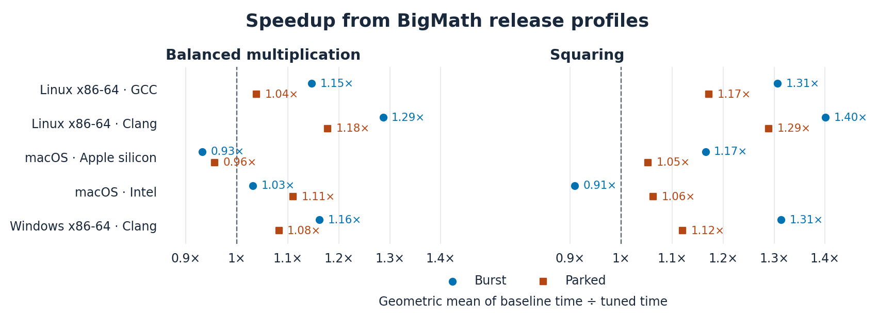
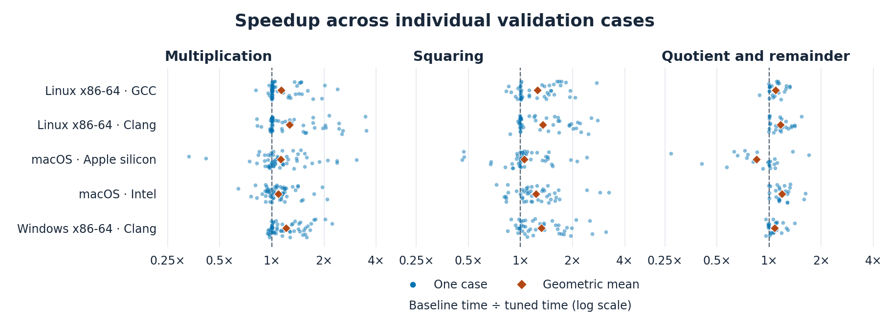
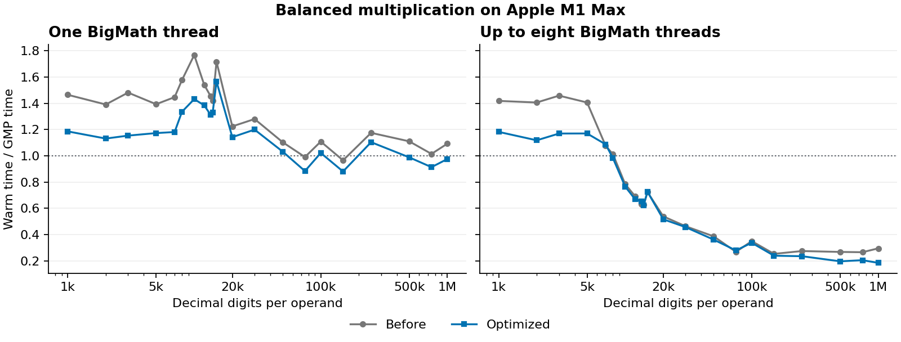
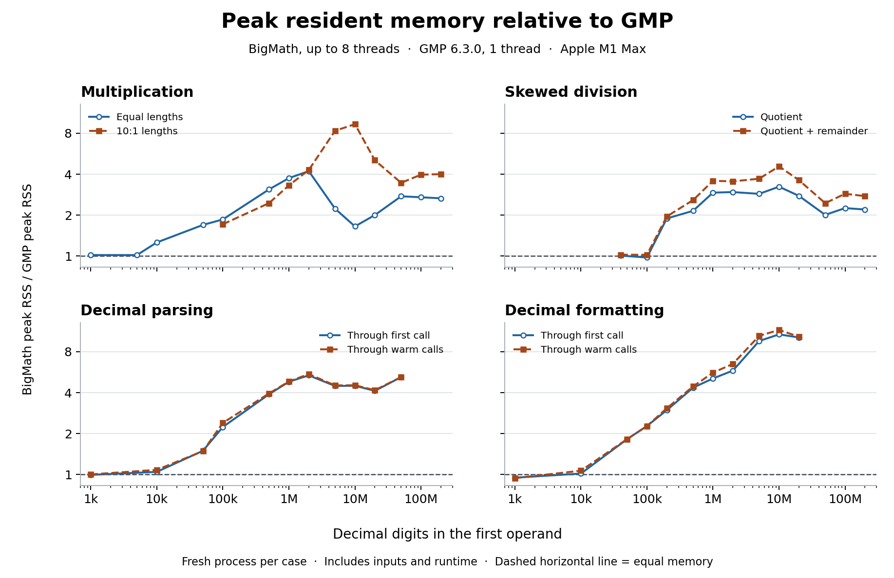
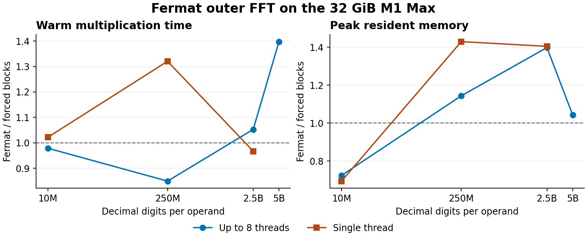

# BigMath benchmark results

## Number theory

These measurements use a native Release build on the Apple M1 Max (Apple Clang 21, 64-bit BigMath limbs, GMP 6.3.0). The harness checks each case against GMP before timing. Each timing is the median of seven batches on the last fixture for that row, with the library order alternating. Input creation, conversion and correctness checks are outside the timed loops. Times are in microseconds per call.

```sh
cmake --build build --target number_theory_vs_gmp
./build/number_theory_vs_gmp
```

### Modular exponentiation

For each size the benchmark checks 24 cases per modulus parity, with positive and negative bases and varying exponent lengths. Timing uses an exponent as wide as the modulus. BigMath uses binary exponentiation with reduction after each multiplication or square. [CSV with all ten timing rows](docs/benchmarks/2026-11-22-powmod-m1-max.csv)

| Modulus and exponent bits | BigMath odd | GMP odd | BigMath even | GMP even |
|---:|---:|---:|---:|---:|
| 256 | 50.82 | 13.21 | 43.77 | 10.49 |
| 512 | 171.80 | 47.60 | 170.01 | 45.62 |
| 1,024 | 815.30 | 268.57 | 797.39 | 271.32 |
| 2,048 | 4,368.24 | 1,760.12 | 4,333.13 | 1,736.95 |
| 4,096 | 27,232.04 | 13,691.51 | 27,686.43 | 14,158.38 |

#### Faster modular exponentiation

The optimized implementation uses native modular products for single-limb moduli and a sliding window for dense exponents. It uses Montgomery reduction for eligible odd moduli and combines the residues modulo the odd part and the power of two for even moduli with a sub-limb power-of-two factor. The existing division dispatcher handles larger moduli and cases outside those paths. Runtime depends on the operands.

Seven paired trials on the Apple M1 Max alternated the existing binary implementation from `be665c1` and the optimized build, using the same Release flags and benchmark source. Each size and modulus parity checks 24 signed-base cases against GMP. The dense rows time a random exponent as wide as the modulus. The sparse rows time exponent 65,537. Times are medians in microseconds, with speedups computed from paired ratios. [All 224 paired observations](docs/benchmarks/2026-11-22-powmod-optimized-m1-max.csv)

| Modulus bits | Modulus | Exponent | Binary (µs) | Optimized (µs) | GMP (µs) | Speedup |
|---:|---|---|---:|---:|---:|---:|
| 32 | Odd | Dense | 1.191 | 0.202 | 0.186 | 5.84× |
| 256 | Odd | Dense | 41.78 | 15.30 | 10.97 | 2.73× |
| 256 | Even | Dense | 40.84 | 13.64 | 11.10 | 2.99× |
| 1,024 | Odd | Dense | 801.57 | 420.59 | 267.57 | 1.91× |
| 1,024 | Even | Dense | 802.36 | 365.43 | 267.09 | 2.19× |
| 4,096 | Odd | Dense | 26,965.81 | 18,586.34 | 12,714.99 | 1.45× |
| 4,096 | Even | Dense | 27,093.14 | 17,054.31 | 13,114.41 | 1.59× |
| 256 | Odd | 65,537 | 1.886 | 1.062 | 0.756 | 1.78× |
| 4,096 | Odd | 65,537 | 73.86 | 72.69 | 56.94 | 1.01× |
| 4,096 | Even | 65,537 | 73.73 | 67.64 | 56.37 | 1.09× |

### Greatest common divisors

Each size checks 24 signed pairs, half with a planted common factor. Both BigMath operations match GMP's nonnegative divisor. Extended GCD also checks `a*x + b*y == gcd` because multiple coefficient pairs can be valid. Timing uses the last random pair, which has no planted factor. [CSV with all ten timing rows](docs/benchmarks/2026-11-22-gcd-m1-max.csv)

| Operand bits | BigMath GCD | GMP GCD | BigMath extended GCD | GMP extended GCD |
|---:|---:|---:|---:|---:|
| 256 | 5.60 | 0.89 | 14.50 | 1.08 |
| 512 | 15.75 | 1.76 | 38.30 | 1.98 |
| 1,024 | 40.27 | 3.51 | 115.03 | 4.15 |
| 2,048 | 115.88 | 7.80 | 296.95 | 9.54 |
| 4,096 | 301.97 | 17.31 | 810.39 | 24.58 |

#### Lehmer GCD

Lehmer's algorithm batches Euclidean steps using the leading bits of both operands. Each batch verifies that the omitted low bits cannot change the predicted quotients. The same batch updates the Bézout coefficients in extended GCD. When a batch cannot verify at least two steps, the implementation uses one exact division step.

On the Apple M1 Max, both variants used the same Release flags and the same GMP harness. The baseline uses the division-based implementation from `d6c2c9f`. Seven paired trials alternated which executable ran first. Each trial checks 24 signed pairs per shape and size, then times the last fixture. Each time below is the median across trials. Speedup is the median of the paired baseline-to-Lehmer ratios. [All 210 paired observations](docs/benchmarks/2026-11-22-lehmer-gcd-m1-max.csv)

| Shape at 4,096 bits | Operation | Euclid (µs) | Lehmer (µs) | GMP (µs) | Speedup |
|---|---|---:|---:|---:|---:|
| Balanced | GCD | 303.08 | 58.14 | 16.97 | 5.22× |
| Balanced | Extended GCD | 793.08 | 159.80 | 22.94 | 4.98× |
| 8:1 bit lengths | GCD | 15.89 | 4.59 | 2.32 | 3.46× |
| 8:1 bit lengths | Extended GCD | 74.76 | 18.56 | 3.15 | 4.02× |
| Shared 3,072-bit factor | GCD | 93.54 | 17.96 | 4.86 | 5.21× |
| Shared 3,072-bit factor | Extended GCD | 145.10 | 29.84 | 5.73 | 4.96× |

Balanced inputs improved at every measured size from 256 to 4,096 bits. On skewed inputs with a one-limb smaller operand, the measured ratios ranged from 0.99× to 1.03×.

### Integer square root and remainder

Each size checks 24 random integers, perfect squares and values one below or above a perfect square. The timing fixture is a random integer with the stated bit length. BigMath uses integer Newton iteration, with a scalar path when the input fits in one limb. [CSV with all eight timing rows](docs/benchmarks/2026-11-22-sqrtrem-m1-max.csv)

| Input bits | BigMath | GMP |
|---:|---:|---:|
| 32 | 0.010437 | 0.008759 |
| 64 | 0.012472 | 0.008667 |
| 65 | 0.312335 | 0.031973 |
| 256 | 0.811279 | 0.041342 |
| 1,024 | 2.800125 | 0.184570 |
| 4,096 | 15.093750 | 0.841156 |
| 16,384 | 140.390625 | 5.822875 |
| 65,536 | 1,283.833250 | 49.875000 |

#### Faster integer square root

Inputs of one or two limbs use native arithmetic. A floating-point estimate is checked with integer arithmetic, and integer Newton iteration corrects it when needed. For larger inputs, the divide-and-conquer algorithm obtains the high part of the root recursively and computes the low part with one division. A limb-aligned split keeps the high root large enough for a single correction. Inputs too small for that split use Newton iteration seeded from their leading bits. [Zimmermann's square root algorithm](https://gmplib.org/manual/Square-Root-Algorithm)

Seven paired trials on the Apple M1 Max alternated the original Newton implementation from `668b5e7` and the optimized build using the same benchmark executable source and Release flags. Each trial checks against GMP on 24 inputs per size through 65,536 bits and eight inputs at each larger size, including squares and their immediate neighbors. The timed input at each size is a random integer. Figures are median times in microseconds per call. Speedup is the median of the paired ratios. [All 119 paired observations](docs/benchmarks/2026-11-22-sqrtrem-optimized-m1-max.csv)

| Input bits | Newton (µs) | Optimized (µs) | GMP (µs) | Speedup |
|---:|---:|---:|---:|---:|
| 32 | 0.00789 | 0.00810 | 0.00664 | 0.97× |
| 64 | 0.00975 | 0.00810 | 0.00657 | 1.20× |
| 65 | 0.23789 | 0.01625 | 0.02424 | 14.65× |
| 128 | 0.27865 | 0.04309 | 0.00973 | 6.47× |
| 129 | 0.51571 | 0.15367 | 0.04532 | 3.40× |
| 256 | 0.56437 | 0.17765 | 0.03459 | 3.17× |
| 1,024 | 2.60970 | 1.12923 | 0.16699 | 2.29× |
| 4,096 | 14.03125 | 2.63281 | 0.69269 | 5.21× |
| 16,384 | 108.21875 | 10.41150 | 5.31775 | 10.39× |
| 65,536 | 1,294.43750 | 64.20850 | 47.83350 | 20.11× |
| 262,144 | 8,253.19800 | 467.75000 | 396.85425 | 16.68× |
| 1,048,576 | 34,299.54175 | 2,247.83350 | 2,602.82300 | 15.17× |

### Primality testing

`IsProbablePrime` screens small factors before running Miller–Rabin. It tests the full unsigned 64-bit range deterministically, using Jaeschke's three bases through 32 bits and Sinclair's seven bases above that. For larger inputs, it first tests base 2, then samples witnesses uniformly from 2 through `n - 2` by rejection sampling using `std::random_device`. With independent uniform witnesses, `rounds` random tests accept any fixed odd composite with probability at most `4^(-rounds)`. The default is 32 rounds. The Montgomery path reuses the modulus and keeps the inner squaring steps in Montgomery form. [Established deterministic bases](https://miller-rabin.appspot.com/) · [GMP reference](https://gmplib.org/gmp-man-6.3.0.pdf)

The benchmark uses BigMath's default 32 rounds and GMP 6.3.0 with `reps=56`, which requests up to 32 Miller–Rabin rounds after GMP's other tests. The libraries use different screening and witness selection. The harness checks GMP-generated primes, odd multiples of three, products of two similarly sized primes, and four known strong pseudoprimes. It times the last seeded fixture for each row, excluding fixture generation. The CSV includes all 28 rows through 4,096 bits. [Raw timings](docs/benchmarks/2026-11-22-primality-m1-max.csv)

| Bits | Input | BigMath (µs) | GMP (µs) |
|---:|---|---:|---:|
| 32 | Prime | 0.584 | 1.941 |
| 64 | Prime | 3.315 | 19.623 |
| 256 | Prime | 592.22 | 403.88 |
| 256 | Semiprime | 15.69 | 10.07 |
| 1,024 | Prime | 12,474.13 | 9,555.92 |
| 1,024 | Semiprime | 421.48 | 225.18 |
| 4,096 | Prime | 616,482.92 | 437,564.96 |
| 4,096 | Semiprime | 19,053.04 | 10,882.77 |
| 4,096 | Small factor | 0.348 | 0.127 |

```sh
cmake --build build --target number_theory_vs_gmp
./build/number_theory_vs_gmp prime
```

#### Parallel Miller–Rabin rounds

When the candidate has at least 1,024 bits, fits the Montgomery path and requests at least eight random witnesses, the default build can test the witnesses in parallel. The small-factor tests and the base-2 screen run before the dispatch. Each worker uses its own scratch space, with batches of up to 32 witnesses. The single-thread build runs the same tests serially.

The Apple M1 Max reran the same fixtures sequentially with the original serial implementation from `13e9706`, the updated default build with up to eight threads, and the updated build with `BIGMATH_USE_THREADS=0`. Each run matched GMP on 286 cases. The table gives medians from seven batches and shows the GMP timing measured alongside the default build. All times are milliseconds. [Raw timings for all three builds](docs/benchmarks/2026-11-22-primality-parallel-m1-max.csv)

| Bits | Input | Original (ms) | Updated single-thread (ms) | Updated default (ms) | GMP (ms) |
|---:|---|---:|---:|---:|---:|
| 1,024 | Prime | 12.64 | 13.19 | 2.43 | 9.60 |
| 2,048 | Prime | 88.18 | 89.71 | 14.31 | 62.07 |
| 4,096 | Prime | 616.65 | 615.67 | 103.03 | 445.02 |
| 4,096 | Semiprime | 19.05 | 19.00 | 19.28 | 11.13 |

### Next probable prime

`NextProbablePrime(n, rounds = 32)` searches strictly above `n` and returns 2 if `n < 2`. Results below `2^64` are exact. Larger results pass the configured Miller–Rabin test. The initial implementation tests sieve survivors in ascending order. For large inputs it screens 1,024 odd candidates per segment and carries the small-prime offsets forward to the next segment. The sieve uses primes below 4,096 through 512 bits and below 32,768 above that size.

The benchmark times one seeded ordinary start and one constructed gap at each size on the Apple M1 Max. The constructed starts follow a multiple of the least common multiple of small integers, which guarantees an initial run of composites. The 4,096-bit searches span more than one sieve segment. All six results matched GMP's `mpz_nextprime`. Times are medians of seven batches. BigMath used 32 randomized rounds and GMP used its own next-prime test settings. [Raw measurements](docs/benchmarks/2026-11-22-next-probable-prime-m1-max.csv)

| Input bits | Start | Distance to result | Odd candidates | Candidates tested by Miller–Rabin | BigMath (ms) | GMP (ms) |
|---:|---|---:|---:|---:|---:|---:|
| 256 | Ordinary | 23 | 12 | 1 | 1.46 | 0.25 |
| 256 | Constructed gap | 652 | 326 | 43 | 2.40 | 0.82 |
| 1,024 | Ordinary | 1,473 | 737 | 84 | 37.85 | 18.64 |
| 1,024 | Constructed gap | 1,486 | 743 | 74 | 33.94 | 15.89 |
| 4,096 | Ordinary | 2,185 | 1,093 | 116 | 2,290.37 | 966.91 |
| 4,096 | Constructed gap | 3,270 | 1,635 | 50 | 1,029.03 | 472.44 |

```sh
cmake --build build --target number_theory_vs_gmp
./build/number_theory_vs_gmp nextprime
```

#### Parallel next-prime screening

The default build tries the first sieve survivor on its own. For Montgomery candidates of at least 1,024 bits, it can then screen up to eight survivors at a time with the base-2 Miller–Rabin test. It checks the passing candidates with the requested randomized rounds in ascending order. Each batch can screen up to seven candidates beyond the result. The one-thread build checks each survivor immediately.

This rerun used the same six fixtures, the serial search from `2146c83`, and matched Release builds with threads enabled and disabled. Each run matched GMP on all six results. Times are median milliseconds over seven batches, with GMP measured alongside the optimized default build. At 4,096 bits the default build screened 121 and 57 candidates, compared with 116 and 50 in the original search. [All 24 timing and candidate-count rows](docs/benchmarks/2026-11-22-next-probable-prime-parallel-m1-max.csv)

| Bits | Start | Default before (ms) | Default after (ms) | Single thread before (ms) | Single thread after (ms) | GMP (ms) | Default speedup |
|---:|---|---:|---:|---:|---:|---:|---:|
| 1,024 | Ordinary | 38.72 | 8.98 | 49.94 | 49.82 | 19.01 | 4.31× |
| 1,024 | Constructed gap | 35.28 | 9.02 | 46.20 | 45.99 | 16.05 | 3.91× |
| 4,096 | Ordinary | 2,344.80 | 447.41 | 2,847.49 | 2,848.28 | 975.17 | 5.24× |
| 4,096 | Constructed gap | 1,054.93 | 261.94 | 1,569.76 | 1,570.05 | 477.57 | 4.03× |

## Platform tuning for release builds

On November 23, 2026 UTC, the full tuning survey ran three sweeps on each of the five release targets at `ed9a01c`. The Apple M1 Max ran the same three-sweep survey locally. The hosted holdout compared the checked-in profiles with generic thresholds. Both variants used the same arithmetic source, CPU flags and runner. [Full survey and raw logs](https://github.com/mmurshed/biginteger/actions/runs/45151334484) · [Survey proposals from all six machines](docs/benchmarks/2026-11-23-platform-survey-45151334484.csv) · [Matched holdout and raw logs](https://github.com/mmurshed/biginteger/actions/runs/45151452463) · [Original profile validation](https://github.com/mmurshed/biginteger/actions/runs/44998103595)

### Measurement method

Each holdout job measured 220 operand-size and worker-state cases with 64-bit limbs. This includes 96 addition and subtraction cases with random inputs or full carry and borrow chains. A burst used consecutive calls, and a parked sample waited for the workers to report a cold state. Each pass used the median of 11 timings for addition and subtraction and nine for the other operations. The workflow alternated build order over three paired passes. Each case's speedup is the median of its generic-to-profile timing ratios. Values above 1× favor the checked-in profile. The workflow labels the generic control as the candidate. The published CSV uses the generic build as the reference to keep the figures' ratio direction consistent. All five CTest suites passed for the control on each runner. The timed harness also checked the arithmetic results. [Per-case timing medians and paired speedups](docs/benchmarks/2026-11-23-platform-tuning-45151452463.csv)

| Release target | Holdout runner CPU | Compiler | CPU flags |
|---|---|---|---|
| Linux x86-64 GCC | AMD EPYC 9V74 80-Core Processor | GCC 11.4.0 | `-march=x86-64` |
| Linux x86-64 Clang | Intel Xeon 6975P-C | Clang 18.1.3 | `-march=x86-64` |
| macOS Apple silicon | Apple M1 (Virtual) | Apple Clang 17.0.0 | `-mcpu=apple-m1` |
| macOS Intel | Intel Core i7-8700B CPU @ 3.20GHz | Apple Clang 17.0.0 | `-march=x86-64` |
| Windows x86-64 Clang | AMD64 Family 25 Model 17 Stepping 1, AuthenticAMD | UCRT64 Clang 23.1.5 | `-march=x86-64` |

### Measured results



| Case | State | Linux GCC | Linux Clang | macOS Apple silicon | macOS Intel | Windows Clang |
|---|---|---:|---:|---:|---:|---:|
| Balanced multiply | burst | 1.146× | 1.287× | 0.932× | 1.031× | 1.162× |
| Balanced multiply | parked | 1.038× | 1.178× | 0.956× | 1.110× | 1.082× |
| Skewed multiply | burst | 1.092× | 1.457× | 0.932× | 1.220× | 1.099× |
| Skewed multiply | parked | 1.009× | 1.051× | 1.024× | 1.037× | 1.070× |
| Square | burst | 1.307× | 1.401× | 1.165× | 0.909× | 1.314× |
| Square | parked | 1.172× | 1.290× | 1.052× | 1.063× | 1.121× |
| Division near the BZ cutoff | burst | 1.008× | 0.984× | 1.028× | 1.004× | 1.004× |
| Balanced division | burst | 1.113× | 1.220× | 1.085× | 1.043× | 1.124× |
| Skewed division | burst | 1.113× | 1.234× | 1.202× | 0.980× | 1.104× |
| Division at about a 7:4 operand ratio | burst | 1.113× | 1.217× | 0.910× | 0.957× | 1.143× |
| Division with a short quotient | burst | 1.026× | 1.096× | 1.040× | 1.109× | 1.068× |
| Addition, random limbs | burst | 0.974× | 1.000× | 0.945× | 1.050× | 1.027× |
| Addition, random limbs | parked | 1.010× | 0.997× | 1.017× | 1.168× | 1.089× |
| Addition, full carry chain | burst | 0.982× | 0.994× | 0.988× | 1.060× | 0.995× |
| Addition, full carry chain | parked | 1.003× | 0.988× | 1.043× | 1.085× | 1.060× |
| Subtraction, random limbs | burst | 0.984× | 0.987× | 0.991× | 1.027× | 1.018× |
| Subtraction, random limbs | parked | 0.998× | 1.001× | 1.024× | 1.046× | 1.043× |
| Subtraction, full borrow chain | burst | 0.976× | 0.993× | 1.064× | 1.020× | 1.006× |
| Subtraction, full borrow chain | parked | 1.004× | 0.978× | 1.031× | 1.099× | 1.030× |



The case plot groups operations by family and shows both worker states wherever measured. Each dot is one case, and each diamond is the geometric mean for that platform and panel. The results describe the listed runners and workloads. [Platform tuning guide](docs/PLATFORM_TUNING.md)

### v13.1.0 tuning verification

The full survey on `d2eec44` ran three sweeps on each of the five release targets. Holdout validation compared the repeatable proposals in `27a2e9d` with the existing profiles, using the same library source and runner for each pair. All five correctness suites and all 124 cases passed their checks per target. The release retained the previously validated profiles. [Full survey](https://github.com/mmurshed/biginteger/actions/runs/45061071413) · [Holdout validation](https://github.com/mmurshed/biginteger/actions/runs/45061473555) · [Per-case comparison CSV](docs/benchmarks/2026-11-22-platform-validation-45061473555.csv)

| Target | Holdout decision |
|---|---|
| Linux GCC | The higher multiplication and square cutoffs yielded 0.68× and 0.74× speedup in the slowest affected cases. The lower BZ cutoff had one affected holdout size. |
| Linux Clang | The higher cutoffs yielded 0.78× in the slowest affected balanced product and 0.80× in the slowest affected square. |
| Apple silicon | The lower BZ cutoff improved the one affected holdout size. This leaves limited coverage of the new cutoff. |
| Intel macOS | Affected balanced products averaged 1.09×, with one burst case at 0.90×. One affected parked square measured 0.74×. |
| Windows Clang | The proposed square cutoffs yielded 0.94× and 0.91× geometric mean speedup on affected burst and parked cases. |

### Cutoffs shipped in the release profiles

| Profile | NTT multiplication floor (total limbs) | NTT square floor (limbs) | Parked NTT square floor (limbs) |
|---|---:|---:|---:|
| Generic baseline | 640 | 352 | 608 |
| Linux x86-64 GCC | 4,096 | 2,048 | 2,560 |
| Linux x86-64 Clang | 5,120 | 2,560 | 2,560 |
| macOS Apple silicon | 640 | 352 | 512 |
| macOS Intel | 2,048 | 768 | 1,280 |
| Windows x86-64 Clang | 4,096 | 2,560 | 2,560 |

The multiplication dispatcher also checks the shorter operand, the product of the operand lengths, and worker-pool state. [Dispatch thresholds](include/biginteger/build/DispatchThresholds.h) · [Profile headers](include/biginteger/build/platform/)

Regenerate both charts with Matplotlib from the checked-in per-case CSV.

```sh
python3 docs/images/make_platform_tuning_plots.py
```

## BigInteger equality

This benchmark compares the previous implementation of `a == b` (`a.CompareTo(b) == 0`) with the specialized equality operator in the same Release binary. The Apple M1 Max ran Apple Clang 21 with the default 64-bit limbs. Each timing is the median of nine warm batches on the same two operands. The harness calibrates repetitions separately for each predicate, alternates their measurement order, and checks the result of every batch. Construction and copying are outside the timer. Nanosecond-scale timings include an indirect function call. [CSV for 1, 4, 1,000 and 1,000,000 limbs](docs/benchmarks/2026-11-21-equality-m1-max.csv)

| Comparison at 1,000,000 limbs | Previous equality | Specialized equality |
|---|---:|---:|
| Same object | 324 µs | 1.58 ns |
| Equal copy | 337 µs | 247 µs |
| Lowest limb differs | 336 µs | 2.19 ns |
| Middle limb differs | 163 µs | 99.8 µs |
| Second-highest limb differs | 3.14 ns | 4.72 ns |
| Highest limb differs | 2.73 ns | 1.96 ns |
| Opposite signs | 1.24 ns | 1.55 ns |

Run the benchmark from a configured Release build.

```sh
cmake --build build --target equality_bench
./build/equality_bench
```

## Ordered comparison

`CompareTo` and the four relational operators share the unsigned limb comparator. It checks the top two limbs first. When a longer prefix matches, it scans 16 limbs at a time and compares whole limb values within the first differing block. The raw `Compare` overloads also use block scans to skip high zero padding. Large comparisons against the same operand can return immediately when both spans refer to the same data.

The Apple M1 Max ran Apple Clang 21 with 64-bit limbs and `-O3 -march=native -DNDEBUG`. The baseline was `a9a2829`. Each value is the median of five process runs per revision, with the revision order alternated per pair. The harness measures seven warm batches per case and checks the result of each batch. Operand construction is outside the timer. Each timing includes an indirect function call. [Full paired CSV](docs/benchmarks/2026-11-22-ordered-comparison-m1-max.csv)

| Operation and case | Limbs | Baseline | Optimized |
|---|---:|---:|---:|
| `<`, equal copy | 8 | 5.73 ns | 8.43 ns |
| `CompareTo`, opposite signs | 4,096 | 0.94 ns | 0.93 ns |
| `CompareTo`, highest limb differs | 4,096 | 2.84 ns | 2.49 ns |
| `CompareTo`, different lengths | 4,096 | 2.39 ns | 3.12 ns |
| `CompareTo`, equal copy | 4,096 | 1.29 µs | 0.446 µs |
| `CompareTo`, lowest limb differs | 4,096 | 1.30 µs | 0.454 µs |
| `>`, lowest limb differs | 4,096 | 1.32 µs | 0.452 µs |
| `>=`, lowest limb differs | 4,096 | 1.30 µs | 0.457 µs |
| `<`, lowest limb differs | 4,096 | 1.30 µs | 0.445 µs |
| `<=`, lowest limb differs | 4,096 | 1.33 µs | 0.445 µs |
| `Compare`, two vectors, lowest limb differs | 4,096 | 1.29 µs | 0.451 µs |
| `Compare`, padded vector equals scalar | 4,096 | 1.33 µs | 0.251 µs |
| `CompareTo`, equal copy | 1,000,000 | 336 µs | 253 µs |
| `CompareTo`, same object | 1,000,000 | 322 µs | 3.12 ns |

Run the benchmark from a configured Release build.

```sh
cmake --build build --target comparison_bench
./build/comparison_bench
```

## Parallel addition and subtraction prototype

The prototype runs each limb block with zero carry or borrow in. Each worker records its outgoing flag and the length of the prefix that would propagate an incoming flag. A serial pass resolves flags across blocks, then patches the affected prefixes. If several prefixes are long, the fixup uses a second dispatch. The `parallel_add_sub_bench` executable forces each kernel. Production dispatch uses separate thresholds for addition and subtraction, only for equal-length 64-bit operands. The timings below are from the prototype sweep, before tuning the production dispatch. [Platform tuning](docs/PLATFORM_TUNING.md)

The benchmark uses native Apple Clang 21 Release builds with 64-bit limbs on a 32 GiB Apple M1 Max. It compares the existing serial operation against two, four, or eight blocks on BigMath's existing pool. Each of five processes measures 31 pairs per case and alternates the order within each pair. The kernel rows reuse preallocated output buffers. The magnitude rows include allocating and trimming the result. The timer includes dispatch, carry or borrow correction, and waking any parked workers. Input construction, verification, and preparing the already-created pool are outside the timer.

For randomly filled, equal-length operands, the allocating operations first won in all five process runs at **4,096 limbs with warm workers** (two blocks) and **32,768 limbs with parked workers** (eight blocks). Both crossover points had a small margin. At **6,144 warm limbs** (about 118,000 decimal digits) and **49,152 parked limbs** (about 947,000 digits), both operations were at least 1.24× as fast in every run with the block counts shown below. The preallocated kernels first won for both operations in all five runs at 6,144 warm limbs and 49,152 parked limbs.

| Pool | Limbs per operand | Blocks | Add serial → parallel | Add speedup | Subtract serial → parallel | Subtract speedup |
|---|---:|---:|---:|---:|---:|---:|
| Warm | 4,096 | 2 | 3.42 → 3.13 µs | 1.08× | 3.42 → 3.25 µs | 1.07× |
| Warm | 6,144 | 4 | 5.13 → 3.75 µs | 1.38× | 5.04 → 3.67 µs | 1.39× |
| Parked | 32,768 | 8 | 27.25 → 26.42 µs | 1.06× | 27.04 → 25.71 µs | 1.07× |
| Parked | 49,152 | 8 | 40.13 → 30.58 µs | 1.32× | 40.00 → 31.63 µs | 1.30× |
| Warm | 524,288 | 8 | 359.63 → 110.50 µs | 3.25× | 365.75 → 85.83 µs | 4.26× |
| Parked | 524,288 | 8 | 405.50 → 129.21 µs | 3.15× | 403.04 → 130.29 µs | 3.14× |

Times are medians across processes. Speedups are medians of the paired ratios. With parked workers and a longer operand of 65,536 limbs, the eight-block 4:1 and full carry or borrow chain fixtures still gave 0.93–1.02×. At 524,288 limbs those fixtures gave 1.82–2.02×. Operand shape and propagation length matter when choosing a cutoff. [All 2,760 measurements](docs/benchmarks/2026-11-22-parallel-add-sub-m1-max.csv)

Run the correctness checks and the sweep from a configured Release build.

```sh
cmake --build build --target parallel_add_sub_bench
./build/parallel_add_sub_bench --check
./build/parallel_add_sub_bench > parallel-add-sub.csv
```

### Production dispatch tuning

The focused [GitHub survey](https://github.com/mmurshed/biginteger/actions/runs/45121607633) completed three sweeps on all five release targets. It selected zero for every add and subtract cutoff. The hosted runners did not show a repeatable 5% lead on both balanced random inputs and full carry or borrow chains at two adjacent sizes and all larger sampled sizes. The checked-in release profiles therefore keep these operations serial.

A separate native M1 Max survey selected 24,576 warm and 98,304 parked limbs for addition, and 16,384 warm and 1,048,576 parked limbs for subtraction. In the local public-operator holdout, geometric mean speedups on balanced inputs were 1.77× and 2.24× for add and subtract bursts, and 1.54× and 1.09× with parked workers. The parked borrow-chain group averaged 0.97×. These are machine-specific results. [Tuning a deployment profile](docs/PLATFORM_TUNING.md)

## Balanced multiplication through one million digits

This sweep compares the public `BigInteger` multiplication operator against GMP 6.3.0 on a 32 GiB Apple M1 Max running macOS 27.2.1. Both revisions used Apple Clang 21, 64-bit limbs and Release builds with `-O3 -march=native`. The baseline was `d733086`. The single-thread build used `-DBIGMATH_USE_THREADS=0`, and the default build could use eight threads. GMP used one thread throughout. [Per-pass first and warm timings, including the 2M and 5M controls](docs/benchmarks/2026-11-22-submillion-products-m1-max.csv)



**Where the crossover matters.** On one thread, forcing the optimized recursive kernel on 520 × 520 limbs took 40.0 µs, versus 46.5 µs for the NTT. At 720 × 720 the NTT won, 65.9 µs versus 69.7 µs. Operand shape also mattered. At 460 × 692 limbs the NTT took 49.0 µs versus 57.0 µs for recursion. The macOS Arm64 Clang profile now enters the NTT at 704 limbs (about 13,600 decimal digits) for distinct, single-thread operands whose lengths differ by at most one limb. Threaded dispatch still accounts for whether the worker pool is awake. [Direct kernel timings for 57 balanced sizes and 44 shape comparisons](docs/benchmarks/2026-11-22-submillion-crossover-m1-max.csv)

**Where the kernels matter.** On Apple silicon with Clang, the schoolbook kernel specializes row widths from 12 through 24 limbs. Knowing the width at compile time lets the compiler schedule the carry chain across a row. This speeds up the base products inside Karatsuba and Toom-3. For larger inputs, the forward and inverse NEON radix-8 NTT now gather each group of roots and modular reduction constants once per stage when the stage length is at most 512 and repeats across at least eight blocks. Each transform uses at most 3.5 KiB of temporary stack space for those groups.

| Digits per operand | One thread before (µs) | One thread after (µs) | After / GMP | Up to eight before (µs) | Up to eight after (µs) | After / GMP |
|---:|---:|---:|---:|---:|---:|---:|
| 1,000 | 1.29 | 1.08 | 1.19× | 1.25 | 1.08 | 1.18× |
| 5,000 | 16.83 | 13.69 | 1.17× | 16.85 | 13.75 | 1.17× |
| 10,000 | 49.77 | 39.83 | 1.43× | 22.17 | 21.56 | 0.77× |
| 13,500 | 68.62 | 61.17 | 1.31× | 30.21 | 30.38 | 0.65× |
| 14,000 | 68.94 | 65.50 | 1.33× | 30.90 | 30.29 | 0.62× |
| 15,000 | 90.29 | 82.35 | 1.57× | 38.81 | 38.62 | 0.73× |
| 20,000 | 100.7 | 92.42 | 1.14× | 44.38 | 42.60 | 0.52× |
| 50,000 | 307.7 | 287.1 | 1.03× | 107.3 | 100.7 | 0.36× |
| 100,000 | 665.9 | 615.5 | 1.02× | 211.2 | 202.6 | 0.34× |
| 500,000 | 4,586.0 | 4,089.0 | 0.99× | 1,112.7 | 818.3 | 0.20× |
| 1,000,000 | 9,614.4 | 8,576.5 | 0.98× | 2,593.4 | 1,626.8 | 0.18× |

Each pass used the same pair of independently seeded operands at each decimal length. A fresh process timed the first multiplication and the fastest of nine subsequent calls. Six paired passes alternated the order of the baseline and optimized builds. The table reports median warm times and the median of the six within-pass BigMath/GMP ratios. A ratio below 1 means BigMath ran faster. The first-call timings in the CSV include any transform-plan and worker-pool initialization. Generating and loading inputs and checking the result hash took place outside the timers.

At 10,000 digits on one thread, delaying the first transform also reduced median first-call time from 186.6 to 54.85 µs. A remaining gap occurs at 15,000 digits, where the single-thread build took 1.57× GMP’s warm time. Here 779 limbs per operand require 3,115 convolution coefficients, just above the 3,072-coefficient cutoff for the shorter transform in this interval.

All 21 measured sizes from 1,000 through one million digits had lower median warm times in the single-thread build. The threaded medians rose by 4.7% at 7,000 digits, 0.6% at 13,500 and 4.5% at 75,000. At 500,000 digits the threaded median fell from 1.11 ms to 0.82 ms. The 552 before-and-after product hashes across all 23 sizes, including the two larger controls, matched GMP.

The default, single-thread, scalar (`BIGMATH_NEON=0`) and legacy-limb builds each passed all four CTest targets. Each build also matched GMP limb-for-limb on 480 additional products covering the cutoff, operand signs, all-ones carries, skewed lengths and self-squaring. These timings and cutoff measurements are local to the M1 Max.

To repeat one pass with the benchmark executables built in separate Release directories, supply the quick dataset and choose the desired digit lengths.

```sh
python3 tests/performance/benchsuite/run_memory.py DATASET DEFAULT_BUILD SINGLE_BUILD products.csv \
  --balanced-digits 1000 5000 10000 12000 13500 14000 15000 20000 50000 100000 500000 1000000 \
  --balanced-warm-reps 9
```

## Higher-degree Toom on 64-bit limbs

**Dispatch decision:** Keep the current automatic paths. The limb Toom-5 replacement is worthwhile for direct calls. Toom-6.5 and Toom-8.5 remain explicitly callable for tuning. The measurements below are from a 32 GiB Apple M1 Max with Apple Clang 21, 64-bit limbs, and Release builds with `-O3 -march=native`. Native x86-64 performance remains unmeasured.

The harness times the existing dispatcher, direct recursive multiplication, direct NTT, and one forced outer level of each higher Toom split. All six results are checked against schoolbook outside the timer. Each build used separate 60-case sweep and holdout processes covering balanced, 7:6, and 9:8 operands. Each shape used seeded random limbs and eleven rounds of shuffled method order. Four untimed calls preceded each batch. A single-thread follow-up used 29 closer-spaced balanced sizes, then 25 different lengths and a fresh seed. Decisions use the fastest measured baseline for each case. [Per-case medians and paired ratios](docs/benchmarks/2026-11-22-toom-higher-m1-max.csv)

| Build and phase | Limbs | Dispatch (µs) | Recursive (µs) | NTT (µs) | Toom-5 (µs) | Toom-6.5 (µs) | Toom-8.5 (µs) |
|---|---:|---:|---:|---:|---:|---:|---:|
| Threaded sweep | 320×320 | 21.64 | 19.20 | 21.55 | 20.50 | 25.90 | 28.79 |
| Single-thread holdout | 559×479 | 45.68 | 42.00 | 45.69 | 45.93 | 44.28 | 51.37 |
| Single-thread balanced band | 735×735 | 83.13 | 83.91 | 83.28 | 69.20 | 79.26 | 83.77 |
| Single-thread holdout | 735×735 | 67.83 | 89.30 | 67.81 | 73.53 | 83.39 | 89.04 |
| Single-thread band holdout | 740×740 | 63.60 | 70.30 | 63.56 | 71.66 | 77.93 | 84.88 |
| Single-thread holdout | 2,092×1,793 | 179.71 | 377.19 | 181.25 | 305.22 | 289.17 | 295.39 |

In the dense sweep the largest Toom-5 wins clustered at 733–735 limbs, peaking at 1.20×. At 735×735 the broad holdout favored the NTT. All 25 offset holdout sizes favored an existing path. At 559×479, Toom-6.5 beat automatic dispatch by about 3%, and ordinary recursive multiplication was faster still. At 2,092×1,793, Toom-6.5 cut recursive time from 377 to 289 µs, and automatic dispatch took 180 µs. These measurements support retaining the existing dispatch on the tested machine.

The CSV’s `vector_comparison` phase adds the retired Toom-5 header from `2bc78bc` as a separately named class in a temporary copy of the same benchmark. Across the 34 shapes that reached the old vector kernel’s 512-limb cutoff, the geometric mean of old/new median times was **1.70×**. For 512×512 limbs, limb Toom-5 took 44.90 µs and vector Toom-5 took 91.58 µs. Both results matched schoolbook.

Build and run the current comparison with:

~~~sh
cmake -S . -B build/toom-threaded -DCMAKE_BUILD_TYPE=Release
cmake -S . -B build/toom-single -DCMAKE_BUILD_TYPE=Release -DCMAKE_CXX_FLAGS=-DBIGMATH_USE_THREADS=0
cmake --build build/toom-threaded --parallel --target toom_higher_bench
cmake --build build/toom-single --parallel --target toom_higher_bench
build/toom-threaded/toom_higher_bench > threaded-sweep.csv
build/toom-threaded/toom_higher_bench --holdout > threaded-holdout.csv
build/toom-single/toom_higher_bench > single-sweep.csv
build/toom-single/toom_higher_bench --holdout > single-holdout.csv
build/toom-single/toom_higher_bench --balanced-band > single-band.csv
build/toom-single/toom_higher_bench --balanced-band --holdout > single-band-holdout.csv
~~~

## Single-thread comparison

The November 23, 2026 full timing run measured revision `ed9a01c` on the Apple M1 Max. At 200M digits per operand the single-thread build took 2.75 s and GMP took 2.90 s. At 50M and 100M digits BigMath used 0.91× and 0.94× GMP’s time. [Measured revision](https://github.com/mmurshed/biginteger/tree/ed9a01c)

The full CSV includes the first call, fastest subsequent call, warm repetition count and arithmetic check status for all 111 rows. Most large sizes have one warm observation per library. All 24 product checks and 40 division checks matched GMP’s reference hashes. Each division mode was checked against the corresponding GMP operation. [README performance table](README.md#performance-numbers) · [Single-thread CSV](docs/benchmarks/2026-11-23-full-ed9a01c-m1-max-single-thread.csv) · [GMP reference for the single-thread build](docs/benchmarks/2026-11-23-full-ed9a01c-m1-max-gmp-single-thread.csv) · [Single-thread figure](docs/images/bigmath_vs_gmp_single_thread.png)

The triangles in the multiplication panels show separate, fresh-process measurements. The 200M point uses the same revision and operands as the timing tables. Points above 200M come from the November 21 seeded sweeps through 5B digits. [Current isolated measurements](docs/benchmarks/2026-11-23-full-ed9a01c-m1-max-memory.csv) · [Earlier seeded measurements](docs/benchmarks/2026-11-21-wide-crt-m1-max-memory.csv)

To repeat the single-thread run, give the driver its own build and results directory. The figure generator uses the checked-in CSVs and requires Matplotlib.

```sh
CXXFLAGS=-DBIGMATH_USE_THREADS=0 BENCH_DIR="$PWD/.benchcache/single-thread" \
  HISTORY_MD="$PWD/.benchcache/single-thread/history.md" \
  bash tests/performance/benchsuite/run_benchmark.sh full --force-gmp
python3 docs/images/make_benchmark_plots.py --ratio-only
```

## Default build with up to eight BigMath threads

With up to eight BigMath threads, equal-length products at 50M, 100M and 200M digits took 162.5, 327.1 and 694.5 ms. The 200M-digit product used 0.24× GMP’s time. [Default-build CSV](docs/benchmarks/2026-11-23-full-ed9a01c-m1-max.csv) · [GMP reference for the default build](docs/benchmarks/2026-11-23-full-ed9a01c-m1-max-gmp.csv) · [Previous full run](docs/benchmarks/2026-11-23-full-24d1a13-m1-max.csv)


The arithmetic panels show warm calls. The division panel covers dividend-to-divisor digit ratios from 4:1 to 10:1. The conversion panels show both the first and warm calls. The dashed horizontal line marks equal time.

### Methodology

- The host had 10 CPU cores and 32 GiB of memory and ran macOS 27.2.1. Apple Clang 21 compiled the C++20 Release build with `-O3 -march=native -DNDEBUG`. BigMath used its default 64-bit limbs, CRT NTT, NEON and up to eight threads. GMP 6.3.0 ran single-threaded.
- This run reused the full profile’s 91 deterministic operand sets. The default pair ran first, followed by the single-thread pair. Each pair ran GMP before BigMath. Each process read the same decimal operands from disk. Each of the 20 division sets was timed in both output modes, giving 111 result rows. Parsing operands, disk I/O and result hashes are outside the arithmetic timers.
- **First** means the first timed call for that operation and input in an already running benchmark process. **Warm** is the minimum of the following repetitions on the same input. Earlier cases can populate caches. Most cases above 100k digits have a single warm observation. The CSV records the actual repetition count and both timings for every row.
- Ratios are BigMath time divided by GMP time. A ratio below 1 means BigMath was faster. A zero-duration observation is shown as “<1 tick”. Its ratio is omitted. Crossovers refer to sampled operand sizes on this host.
- Earlier published division tables used BigMath quotient-only against GMP quotient and remainder. Compare each new division series with its matching output mode. [Earlier tables](https://github.com/mmurshed/biginteger/blob/c9c3e56222a17f520f7725b65c03d33232c71416/BENCHMARK.md) · [PR #129–#150 review](docs/PERFORMANCE_REVIEW_PR129.md)

To repeat the default-build run with fresh GMP timings, run the full profile from the repository root. The driver saves the paired CSV in `$BENCH_DIR/results/`.

```sh
bash tests/performance/benchsuite/run_benchmark.sh full --force-gmp
```

To measure time and peak RSS in fresh processes, use the full profile's memory mode. The extended mode adds larger products, including the 500M, 750M, 1B, 2.5B and 5B cases. The historical 5B comparison peaked at 23.01 GiB per process.

```sh
bash tests/performance/benchsuite/run_benchmark.sh full --memory
bash tests/performance/benchsuite/run_benchmark.sh full --extended
```

To regenerate all figures from their published inputs, run these commands from the repository root. The historical before-and-after figures use the measurements from their respective experiments.

```sh
python3 docs/images/make_benchmark_plots.py
python3 docs/images/make_memory_plots.py
python3 docs/images/make_memory_fix_plot.py
python3 docs/images/make_conversion_workspace_plot.py
python3 docs/images/make_division_balanced_plot.py
python3 docs/images/make_mfa_fusion_plot.py
python3 docs/algorithms-guide/figures/make_figures.py
(cd docs/algorithms-guide && latexmk -pdf algorithms-guide.tex)
```

A separate run of `./build/bench_vs_gmp` on PR #152 measured both libraries in one process on different seeded operands. It completed 151 measurements. Its single 200-million-digit balanced product took 3,721 ms in BigMath and 3,057 ms in GMP (1.22×). [In-process output](docs/benchmarks/2026-11-21-pr152-in-process.txt)

### Multiplication

The equal-length series measures two independently generated operands. The skewed series holds their digit-length ratio at 10:1.

#### Equal lengths

| Operand digits | BigMath first ms | GMP first ms | First ratio | BigMath warm ms | GMP warm ms | Warm ratio | Warm reps |
|---|---:|---:|---:|---:|---:|---:|---:|
| 1,000 × 1,000 | 0.06363 | 0.01092 | 5.83× | 0.001417 | 0.001167 | 1.21× | 7 |
| 5,000 × 5,000 | 0.02992 | 0.02363 | 1.27× | 0.01963 | 0.01542 | 1.27× | 5 |
| 10,000 × 10,000 | 0.5171 | 0.04096 | 12.63× | 0.02867 | 0.03704 | 0.77× | 5 |
| 50,000 × 50,000 | 0.6457 | 0.3625 | 1.78× | 0.2057 | 0.3582 | 0.57× | 3 |
| 100,000 × 100,000 | 1.02 | 0.7739 | 1.32× | 0.254 | 0.709 | 0.36× | 3 |
| 500,000 × 500,000 | 1.911 | 4.672 | 0.41× | 0.9543 | 4.503 | 0.21× | 1 |
| 1,000,000 × 1,000,000 | 3.308 | 8.887 | 0.37× | 1.652 | 8.867 | 0.19× | 1 |
| 2,000,000 × 2,000,000 | 9.873 | 20.43 | 0.48× | 6.361 | 20.63 | 0.31× | 1 |
| 5,000,000 × 5,000,000 | 11.4 | 63.02 | 0.18× | 7.195 | 62.35 | 0.12× | 1 |
| 10,000,000 × 10,000,000 | 22.59 | 205.4 | 0.11× | 17.3 | 203.2 | 0.09× | 1 |
| 20,000,000 × 20,000,000 | 54.99 | 270.4 | 0.20× | 37.41 | 266.4 | 0.14× | 1 |
| 50,000,000 × 50,000,000 | 192.3 | 659.2 | 0.29× | 162.5 | 654.6 | 0.25× | 1 |
| 100,000,000 × 100,000,000 | 398.6 | 1,399 | 0.28× | 327.1 | 1,386 | 0.24× | 1 |
| 200,000,000 × 200,000,000 | 827.5 | 2,873 | 0.29× | 694.5 | 2,907 | 0.24× | 1 |

#### Skewed lengths

| Operand digits | BigMath first ms | GMP first ms | First ratio | BigMath warm ms | GMP warm ms | Warm ratio | Warm reps |
|---|---:|---:|---:|---:|---:|---:|---:|
| 100,000 × 10,000 | 0.1489 | 0.3271 | 0.46× | 0.1038 | 0.3 | 0.35× | 3 |
| 500,000 × 50,000 | 0.4168 | 2.1 | 0.20× | 0.3673 | 2.105 | 0.17× | 1 |
| 1,000,000 × 100,000 | 0.9243 | 4.617 | 0.20× | 0.8555 | 4.622 | 0.19× | 1 |
| 2,000,000 × 200,000 | 1.834 | 9.461 | 0.19× | 1.7 | 9.457 | 0.18× | 1 |
| 5,000,000 × 500,000 | 6.721 | 30.27 | 0.22× | 6.107 | 30.59 | 0.20× | 1 |
| 10,000,000 × 1,000,000 | 20.11 | 70.4 | 0.29× | 14.16 | 70.05 | 0.20× | 1 |
| 20,000,000 × 2,000,000 | 37.89 | 158.8 | 0.24× | 33.28 | 160 | 0.21× | 1 |
| 50,000,000 × 5,000,000 | 84.91 | 669.3 | 0.13× | 72.93 | 672.6 | 0.11× | 1 |
| 100,000,000 × 10,000,000 | 166.3 | 1,003 | 0.17× | 162 | 997.9 | 0.16× | 1 |
| 200,000,000 × 20,000,000 | 346.8 | 1,921 | 0.18× | 344.1 | 1,914 | 0.18× | 1 |

### Division

Quotient-only uses BigMath `/` and GMP `mpz_tdiv_q`. Quotient and remainder uses BigMath `DivideAndRemainder` and GMP `mpz_tdiv_qr`. Both modes use the same dividend and divisor. Equal-digit operands can produce a quotient of zero or one, so those results depend on the sampled values.

#### Skewed dividends

| Dividend ÷ divisor digits | BigMath Q ms | GMP Q ms | Q ratio | BigMath QR ms | GMP QR ms | QR ratio | Warm reps |
|---|---:|---:|---:|---:|---:|---:|---:|
| 40,000 ÷ 10,000 | 0.2423 | 0.2003 | 1.21× | 0.242 | 0.2169 | 1.12× | 3 |
| 100,000 ÷ 10,000 | 0.731 | 0.4281 | 1.71× | 0.723 | 0.4422 | 1.63× | 3 |
| 200,000 ÷ 50,000 | 0.9389 | 1.513 | 0.62× | 0.9487 | 1.65 | 0.58× | 1 |
| 500,000 ÷ 100,000 | 2.555 | 4.249 | 0.60× | 2.469 | 4.553 | 0.54× | 1 |
| 1,000,000 ÷ 200,000 | 3.93 | 9.545 | 0.41× | 5.383 | 10.19 | 0.53× | 1 |
| 2,000,000 ÷ 500,000 | 6.935 | 22.01 | 0.32× | 7.278 | 23.65 | 0.31× | 1 |
| 5,000,000 ÷ 1,000,000 | 17.59 | 61.75 | 0.28× | 20.05 | 65.87 | 0.30× | 1 |
| 10,000,000 ÷ 2,000,000 | 39.58 | 138.8 | 0.29× | 41.53 | 147.4 | 0.28× | 1 |
| 20,000,000 ÷ 4,000,000 | 75.57 | 319.4 | 0.24× | 73.83 | 340.5 | 0.22× | 1 |
| 50,000,000 ÷ 10,000,000 | 144.5 | 1,229 | 0.12× | 146.7 | 1,310 | 0.11× | 1 |
| 100,000,000 ÷ 20,000,000 | 313.2 | 2,316 | 0.14× | 326.6 | 2,508 | 0.13× | 1 |
| 200,000,000 ÷ 40,000,000 | 660 | 4,212 | 0.16× | 645.6 | 4,453 | 0.14× | 1 |

At 200,000 ÷ 50,000 digits the current full run measured 0.62× GMP’s time for the quotient and 0.58× for quotient and remainder. The earlier in-process run on PR #152 measured 0.92× and 1.04× on different operands. Both suites took one warm measurement per library at that size. [In-process output](docs/benchmarks/2026-11-21-pr152-in-process.txt)

#### Equal digit counts

| Dividend ÷ divisor digits | BigMath Q ms | GMP Q ms | Q ratio | BigMath QR ms | GMP QR ms | QR ratio | Warm reps |
|---|---:|---:|---:|---:|---:|---:|---:|
| 1,000 ÷ 1,000 | 0.000083 | <1 tick | — | 0.000166 | 0.000083 | 2.00× | 7 |
| 5,000 ÷ 5,000 | 0.000125 | 0.000041 | 3.05× | 0.000459 | 0.000208 | 2.21× | 5 |
| 10,000 ÷ 10,000 | 0.000042 | <1 tick | — | 0.000125 | 0.000042 | 2.98× | 5 |
| 50,000 ÷ 50,000 | 0.000125 | <1 tick | — | 0.003875 | 0.001708 | 2.27× | 3 |
| 100,000 ÷ 100,000 | 0.000166 | 0.000125 | 1.33× | 0.007916 | 0.003583 | 2.21× | 3 |
| 500,000 ÷ 500,000 | 0.000167 | 0.000167 | 1.00× | 0.004125 | 0.004333 | 0.95× | 1 |
| 1,000,000 ÷ 1,000,000 | 0.000083 | 0.000166 | 0.50× | 0.007459 | 0.008625 | 0.86× | 1 |
| 5,000,000 ÷ 5,000,000 | 0.000084 | 0.000208 | 0.40× | 0.04096 | 0.04312 | 0.95× | 1 |

### Decimal parse (string → BigInteger)

| Digits | BigMath first ms | GMP first ms | First ratio | BigMath warm ms | GMP warm ms | Warm ratio | Warm reps |
|---|---:|---:|---:|---:|---:|---:|---:|
| 1,000 | 0.0135 | 0.00325 | 4.15× | 0.002625 | 0.001542 | 1.70× | 7 |
| 10,000 | 0.07337 | 0.05142 | 1.43× | 0.057 | 0.038 | 1.50× | 5 |
| 50,000 | 0.5215 | 0.4382 | 1.19× | 0.4815 | 0.4027 | 1.20× | 3 |
| 100,000 | 0.578 | 1.073 | 0.54× | 0.5263 | 1.053 | 0.50× | 3 |
| 500,000 | 3.342 | 8.861 | 0.38× | 4.257 | 8.803 | 0.48× | 1 |
| 1,000,000 | 6.276 | 20.34 | 0.31× | 6.363 | 20.45 | 0.31× | 1 |
| 2,000,000 | 13.8 | 48.19 | 0.29× | 15.06 | 48.06 | 0.31× | 1 |
| 5,000,000 | 32.75 | 152.3 | 0.22× | 32.82 | 151.9 | 0.22× | 1 |
| 10,000,000 | 69.77 | 347.7 | 0.20× | 70.97 | 348.7 | 0.20× | 1 |
| 20,000,000 | 153.6 | 791.8 | 0.19× | 157.6 | 791.2 | 0.20× | 1 |
| 50,000,000 | 522.1 | 2,659 | 0.20× | 517.4 | 2,685 | 0.19× | 1 |

### ToString (BigInteger → string)

| Digits | BigMath first ms | GMP first ms | First ratio | BigMath warm ms | GMP warm ms | Warm ratio | Warm reps |
|---|---:|---:|---:|---:|---:|---:|---:|
| 1,000 | 0.02104 | 0.006875 | 3.06× | 0.006416 | 0.003375 | 1.90× | 7 |
| 10,000 | 0.1417 | 0.1009 | 1.41× | 0.107 | 0.07804 | 1.37× | 5 |
| 50,000 | 1.274 | 0.9478 | 1.34× | 0.9295 | 0.8731 | 1.06× | 3 |
| 100,000 | 1.728 | 2.308 | 0.75× | 1.064 | 2.335 | 0.46× | 1 |
| 200,000 | 3.642 | 6.245 | 0.58× | 2.241 | 6.21 | 0.36× | 1 |
| 500,000 | 11.71 | 20.47 | 0.57× | 5.703 | 20.61 | 0.28× | 1 |
| 1,000,000 | 17.74 | 49.7 | 0.36× | 13.04 | 49.64 | 0.26× | 1 |
| 2,000,000 | 38.53 | 119.7 | 0.32× | 27.55 | 119.8 | 0.23× | 1 |
| 5,000,000 | 136.5 | 385.4 | 0.35× | 96.88 | 385.2 | 0.25× | 1 |
| 10,000,000 | 285.8 | 909.8 | 0.31× | 217.4 | 913.9 | 0.24× | 1 |
| 20,000,000 | 594.8 | 2,134 | 0.28× | 481.1 | 2,133 | 0.23× | 1 |

### BigDecimal

BigMath uses decimal fixed-point arithmetic and HALF_EVEN rounding for division. The comparison uses GMP binary floating-point (`mpf_t`), with precision derived from the digit count and requested scale. The split runner times these operations without an equality check. A size of `1,000.100` denotes 1,000 integer digits and 100 fractional digits.

| Operation | Size | BigMath warm ms | GMP warm ms | Ratio | Warm reps |
|---|---:|---:|---:|---:|---:|
| add | 100.10 digits | 0.000083 | <1 tick | — | 7 |
| mul | 100.10 digits | 0.000083 | 0.000041 | 2.02× | 7 |
| add | 1000.100 digits | 0.000166 | <1 tick | — | 7 |
| mul | 1000.100 digits | 0.001166 | 0.001042 | 1.12× | 7 |
| add | 5000.500 digits | 0.000334 | 0.000125 | 2.67× | 5 |
| mul | 5000.500 digits | 0.01571 | 0.01308 | 1.20× | 5 |
| add | 20000.2000 digits | 0.001167 | 0.0005 | 2.33× | 3 |
| mul | 20000.2000 digits | 0.046 | 0.09025 | 0.51× | 3 |
| div | 100.10 / 10 dp | 0.000291 | 0.000125 | 2.33× | 7 |
| div | 1000.100 / 100 dp | 0.001 | 0.001916 | 0.52× | 7 |
| div | 5000.500 / 500 dp | 0.008708 | 0.02533 | 0.34× | 5 |
| div | 20000.2000 / 2000 dp | 0.05983 | 0.1935 | 0.31× | 3 |
| div | 2000.200 / 0 dp | 0.000417 | 0.005208 | 0.08× | 5 |
| div | 2000.200 / 10 dp | 0.000625 | 0.005041 | 0.12× | 5 |
| div | 2000.200 / 100 dp | 0.001292 | 0.005417 | 0.24× | 5 |
| div | 2000.200 / 1000 dp | 0.006834 | 0.009375 | 0.73× | 5 |
| div | 2000.200 / 5000 dp | 0.02658 | 0.03504 | 0.76× | 5 |
| parse | 100 digits | 0.000333 | 0.0005 | 0.67× | 7 |
| parse | 1000 digits | 0.004625 | 0.00475 | 0.97× | 7 |
| parse | 10000 digits | 0.07938 | 0.1081 | 0.73× | 5 |
| parse | 50000 digits | 0.5929 | 1.002 | 0.59× | 3 |
| tostr | 100 digits | 0.000291 | 0.0005 | 0.58× | 7 |
| tostr | 1000 digits | 0.006333 | 0.004833 | 1.31× | 7 |
| tostr | 10000 digits | 0.1073 | 0.1022 | 1.05× | 5 |
| tostr | 50000 digits | 0.9489 | 1.101 | 0.86× | 3 |

## Memory optimization benchmarks

Each comparison uses Release builds on the Apple M1 Max, identical operands and a fresh process for each measurement. Tables give peak RSS through the warm call and warm time. BigMath cells are medians of three processes per build, reversing the run order for the second pair. GMP 6.3.0 ran once per shape. Each process made one first call and one warm call. Products were hashed against GMP.

### Threaded skew dispatch

Compared with `9a3f89a`, skewed products with an available fused matrix transform now bypass truncation at transform lengths of at least 2²¹ and a limb ratio of at least eight. The 5M case exercises the original path. Standard shapes use the full benchmark manifest. Intermediate shapes use the seeded binary generator from `run_memory.py`. [All observations](docs/benchmarks/memory-fix-skew-default.csv)

| Shape | Before | After | GMP |
|---|---:|---:|---:|
| mul 5M × 500k | 87.9 MiB · 8.4 ms | 87.9 MiB · 8.7 ms | 12.2 MiB · 31.8 ms |
| mul 10M × 1.24M | 173.6 MiB · 19.0 ms | 110.8 MiB · 15.8 ms | 23.6 MiB · 69.8 ms |
| mul 10M × 1M | 173.3 MiB · 18.0 ms | 109.9 MiB · 15.8 ms | 18.5 MiB · 69.3 ms |
| mul 10M × 625k | 169.1 MiB · 18.0 ms | 110.5 MiB · 16.7 ms | 17.3 MiB · 78.3 ms |
| mul 12M × 1.2M | 180.4 MiB · 24.9 ms | 112.2 MiB · 17.7 ms | 26.3 MiB · 65.0 ms |

### Compact single-thread weights

The large serial truncated transform now factors each weight into a block and offset. The baseline is the single-thread path from `9a3f89a`, also used by `dbe3b06`. The 10M case exercises the smaller transform. The 162M inputs use the seeded generator. [All observations](docs/benchmarks/memory-fix-weights-single.csv)

| Shape | Before | After | GMP |
|---|---:|---:|---:|
| mul 10M × 10M | 107.4 MiB · 110.9 ms | 107.4 MiB · 111.1 ms | 75.4 MiB · 207.4 ms |
| mul 50M × 50M | 919.9 MiB · 632.7 ms | 345.2 MiB · 640.7 ms | 280.6 MiB · 653.8 ms |
| mul 162M × 162M | 3,410.6 MiB · 2,400.2 ms | 1,112.5 MiB · 2,419.3 ms | 932.3 MiB · 2,369.8 ms |
| mul 200M × 200M | 3,640.6 MiB · 2,860.5 ms | 1,342.5 MiB · 2,917.0 ms | 1,116.8 MiB · 2,872.3 ms |

### Reuse threaded transform buffers

Compared with `4e13510`, fused products of length 2²⁴ and above process each prime in parallel over rows, then reuse both scratch planes for the next prime. This cuts four full-size planes. The 160M and 162M cases straddle a transform doubling. [All observations](docs/benchmarks/memory-fix-planes-default.csv)

| Shape | Before | After | GMP |
|---|---:|---:|---:|
| mul 50M × 50M | 766.4 MiB · 168.4 ms | 533.7 MiB · 175.2 ms | 281.8 MiB · 675.0 ms |
| mul 160M × 160M | 1,658.7 MiB · 365.1 ms | 1,181.5 MiB · 377.7 ms | 895.5 MiB · 2,498.3 ms |
| mul 162M × 162M | 2,878.4 MiB · 693.5 ms | 1,898.3 MiB · 715.8 ms | 932.3 MiB · 2,409.0 ms |
| mul 200M × 200M | 2,966.6 MiB · 713.9 ms | 1,988.5 MiB · 720.4 ms | 1,117.4 MiB · 2,912.1 ms |

### Share conversion transform storage

The baseline is `c49f04c`. A separate instrumented run counted table capacities at construction and writable vector capacities at thread exit. Parsing 50M digits built 648 MiB of leaf plans across workers for 144 MiB of distinct tables. Formatting 10M digits built 198 MiB for 72 MiB of distinct tables and retained 33 MiB of cyclic-product buffers in addition to linear-product buffers. Capacity counts exclude allocator overhead. The timing runs use uninstrumented binaries. [Capacity measurements](docs/benchmarks/memory-conversion-retained-capacity.csv) [All observations](docs/benchmarks/memory-fix-conversion-default.csv)

| Shape | Before | After | GMP |
|---|---:|---:|---:|
| parse 1M | 34.2 MiB · 6.9 ms | 28.5 MiB · 7.9 ms | 8.1 MiB · 21.1 ms |
| parse 50M | 1,588.4 MiB · 566.5 ms | 1,084.4 MiB · 543.6 ms | 307.0 MiB · 2,664.6 ms |
| tostr 10M | 525.5 MiB · 242.0 ms | 372.2 MiB · 236.7 ms | 49.1 MiB · 914.5 ms |
| tostr 20M | 1,052.1 MiB · 525.9 ms | 743.8 MiB · 509.4 ms | 102.3 MiB · 2,142.8 ms |

### Reuse two scratch buffers during decimal conversion

The baseline is `c861c9f` and the conversion change is `7b3cc04`. During parsing and formatting, full fused matrix products use three output planes and two shared scratch planes from 2²⁰ transform coefficients. Each CRT prime uses the scratch planes in turn. Parse joins, formatter divider construction and formatter subtrees on pool workers all use this schedule. Ordinary products retain their 2²⁴ cutoff.

The Apple M1 Max sweep covered all 11 parse sizes, all 11 format sizes and four standalone balanced products. Each build and GMP ran three times per size in separate processes with identical operands and varied build order. Cells give median peak process RSS through the warm calls and median warm time. The CSV also records setup RSS, first-call results and repetition counts. [All 390 observations](docs/benchmarks/2026-11-21-decimal-conversion-scratch.csv) · [Allocation profile and alternative schedules](docs/benchmarks/2026-11-21-conversion-memory.md)

| Conversion | Build | Before | After | GMP |
| --- | --- | ---: | ---: | ---: |
| Parse 20M | Up to 8 threads | 325.9 MiB · 164.3 ms | 288.6 MiB · 167.1 ms | 111.2 MiB · 809.8 ms |
| Parse 20M | 1 thread | 238.8 MiB · 917.0 ms | 192.9 MiB · 910.3 ms | 111.2 MiB · 809.8 ms |
| Parse 50M | Up to 8 threads | 1,082.5 MiB · 552.9 ms | 896.3 MiB · 550.8 ms | 305.2 MiB · 2,666.4 ms |
| Parse 50M | 1 thread | 546.8 MiB · 2,665.9 ms | 549.4 MiB · 2,622.4 ms | 305.2 MiB · 2,666.4 ms |
| Format 10M | Up to 8 threads | 367.3 MiB · 239.1 ms | 331.3 MiB · 249.2 ms | 47.8 MiB · 909.1 ms |
| Format 10M | 1 thread | 289.9 MiB · 1,124.1 ms | 241.8 MiB · 1,191.2 ms | 47.8 MiB · 909.1 ms |
| Format 20M | Up to 8 threads | 755.8 MiB · 507.6 ms | 645.6 MiB · 514.1 ms | 98.5 MiB · 2,117.7 ms |
| Format 20M | 1 thread | 515.7 MiB · 2,530.9 ms | 466.3 MiB · 2,546.4 ms | 98.5 MiB · 2,117.7 ms |

Threaded parsing at 50M digits used 17.2% less peak memory. The same input stayed near 550 MiB on one thread because its largest join already uses a truncated transform with shared scratch. Threaded formatting at 20M used 14.6% less memory and took 1.3% longer. At 10M the formatting time cost was 4.2% with threads and 6.0% on one thread.


The standalone product checks used equal-length operands at the affected transform sizes. Every product hash matched GMP.

| Digits per operand | Threaded before | Threaded after | Single before | Single after |
| ---: | ---: | ---: | ---: | ---: |
| 5M | 7.18 ms | 9.43 ms | 50.09 ms | 49.49 ms |
| 10M | 17.73 ms | 16.10 ms | 110.16 ms | 109.78 ms |
| 20M | 38.11 ms | 37.48 ms | 214.92 ms | 215.15 ms |
| 40M | 81.54 ms | 82.03 ms | 481.95 ms | 479.28 ms |

The 5M threaded result varied most. In 12 additional pairs of fresh processes with alternating build order and one warm call, the median within-pair difference was +0.01 ms. Repeating 12 pairs with 16 warm calls per process gave median best times of 6.65 ms before and 6.75 ms after. A separate mixed-workload check verified that ordinary products used six scratch buffers both before and after a 9M-digit decimal round trip. [Follow-up timings and hashes](docs/benchmarks/2026-11-21-decimal-conversion-mul-control.csv)

## Peak memory and large-product time

The November 23, 2026 run measured revision `ed9a01c` on the 32 GiB Apple M1 Max. Each library ran all 111 full-profile cases in fresh processes with the same operands as the timing tables. All 64 integer arithmetic hashes per BigMath build matched the isolated GMP reference and the long-lived run. The plots also include 23 separately measured seeded sizes from the November 21 sweeps through five billion digits. [Current timings, peak RSS and hashes](docs/benchmarks/2026-11-23-full-ed9a01c-m1-max-memory.csv) · [Previous full sweep](docs/benchmarks/2026-11-23-full-24d1a13-m1-max-memory.csv) · [Seeded products through 5B](docs/benchmarks/2026-11-21-wide-crt-m1-max-memory.csv) · [Benchmark instructions](tests/performance/benchsuite/README.md#isolated-peak-memory-and-time)

**How to read the figures.** RSS is the operating system’s high-water mark for resident process memory. We record it with the inputs ready, after the first operation, and after the last warm call, before hashing. Arithmetic panels show the last high-water mark. The warm BigMath product assigns a new result to the previous output variable. GMP passes the same destination back to `mpz_mul`. The measurements include the storage each public operation uses. Conversion panels show both readings. A ratio of 4 means BigMath reached four times GMP’s peak. Small operands include roughly 2 MiB of process startup memory. A fresh process at every size excludes caches built by preceding cases. The ordinary timing tables use a long-lived benchmark process.




### Memory spikes to investigate

- Multiplication at 5M × 500k digits had the largest threaded peak RSS relative to GMP in the integer sweep, 8.39× (88.3 versus 10.5 MiB). The single-thread maximum was 8.36× for multiplication at 10M × 1M digits (155.2 versus 18.6 MiB).
- Formatting 10M digits on the threaded build used 328.6 MiB versus 48.9 MiB for GMP. The 10M × 1M product used 112.2 versus 18.6 MiB. [Conversion controls](#share-conversion-transform-storage) · [Skewed multiplication controls](#threaded-skew-dispatch)
- At 200M digits per operand the threaded and single-thread builds used 1.94 and 1.31 GiB. GMP used 1.09 GiB.

### Controlled comparisons

These historical controls measured the implementation before the four memory optimizations. Each cell gives the median peak RSS through warm calls and the median warm time across three independent processes, using the same operands and reversing the build order for the second repeat. The transform control sets `BIGMATH_NTT_TRUNC=0`. The conversion control raises the separate parsing and formatting parallel thresholds above the tested sizes. Other build flags match the corresponding stock build. To reproduce, select entries 11, 19, 54 and 64 of the full manifest and run the isolated benchmark on the stock and control builds. [Control measurements](docs/benchmarks/2026-11-21-memory-controls-m1-max.csv) · [CRT plans and workspaces](include/biginteger/algorithms/multiplication/NTTMultiplicationCrt.h) · [Conversion implementation](src/common/Parser.cpp)

| Operation | Build | Stock | Control |
|---|---|---:|---:|
| 10M × 1M multiply | Up to 8 threads | 173 MiB · 20.0 ms | 110 MiB · 15.6 ms |
| 50M × 50M multiply | 1 thread | 920 MiB · 624.4 ms | 735 MiB · 1,055.0 ms |
| Format 10M digits | Up to 8 threads | 527 MiB · 234.6 ms | 324 MiB · 439.0 ms |
| Parse 50M digits | Up to 8 threads | 1,595 MiB · 554.8 ms | 874 MiB · 1,190.0 ms |

The controls motivated the threaded dispatch change, compact serial weights and conversion cache sharing. [Before-and-after measurements](#memory-optimization-benchmarks)

### Balanced products through five billion digits

Each cell reports one warm product time and the process peak RSS through that call. The 23 added sizes use seeded binary operands. Seven sizes from 640M to 5B were rerun with AppleClang Release builds on an Apple M1 Max with 32 GiB of RAM. The baseline is `3a6e250` and the wide build is `6ddd643`. The baseline GMP measurements and hashes serve as the reference for both builds. The other seeded sizes come from revision `99228ed`. The standard sizes (10M, 20M, 50M, 100M and 200M) use full-manifest operands from the `ed9a01c` sweep. All reported BigMath products matched the corresponding GMP hash. [Seeded measurements](docs/benchmarks/2026-11-21-wide-crt-m1-max-memory.csv) · [Matched baseline](docs/benchmarks/2026-11-21-wide-crt-baseline-m1-max-memory.csv) · [Standard sizes](docs/benchmarks/2026-11-23-full-ed9a01c-m1-max-memory.csv)

| Digits per operand | BigMath, up to 8 threads | BigMath, 1 thread | GMP, 1 thread |
|---:|---:|---:|---:|
| 10M | 0.015 s · 0.12 GiB | 0.104 s · 0.11 GiB | 0.206 s · 0.07 GiB |
| 10.2M | 0.032 s · 0.20 GiB | 0.105 s · 0.08 GiB | 0.199 s · 0.07 GiB |
| 20M | 0.034 s · 0.22 GiB | 0.205 s · 0.13 GiB | 0.268 s · 0.11 GiB |
| 20.3M | 0.067 s · 0.38 GiB | 0.233 s · 0.14 GiB | 0.335 s · 0.13 GiB |
| 40M | 0.073 s · 0.43 GiB | 0.467 s · 0.25 GiB | 0.544 s · 0.22 GiB |
| 41M | 0.159 s · 0.50 GiB | 0.521 s · 0.29 GiB | 0.732 s · 0.27 GiB |
| 50M | 0.165 s · 0.52 GiB | 0.605 s · 0.34 GiB | 0.667 s · 0.27 GiB |
| 80M | 0.170 s · 0.59 GiB | 1.029 s · 0.49 GiB | 1.187 s · 0.44 GiB |
| 82M | 0.321 s · 0.97 GiB | 1.137 s · 0.56 GiB | 1.388 s · 0.51 GiB |
| 100M | 0.343 s · 1.01 GiB | 1.316 s · 0.66 GiB | 1.397 s · 0.55 GiB |
| 160M | 0.353 s · 1.15 GiB | 2.250 s · 0.98 GiB | 2.432 s · 0.87 GiB |
| 162M | 0.674 s · 1.85 GiB | 2.357 s · 1.09 GiB | 2.350 s · 0.91 GiB |
| 200M | 0.685 s · 1.94 GiB | 2.809 s · 1.31 GiB | 2.880 s · 1.09 GiB |
| 320M | 0.728 s · 2.22 GiB | 4.688 s · 1.95 GiB | 4.881 s · 1.75 GiB |
| 324M | 0.797 s · 2.24 GiB | 5.320 s · 2.13 GiB | 4.866 s · 1.82 GiB |
| 480M | 1.232 s · 3.03 GiB | 8.161 s · 2.91 GiB | 8.075 s · 2.62 GiB |
| 484M | 1.318 s · 3.05 GiB | 8.159 s · 2.93 GiB | 8.565 s · 2.63 GiB |
| 486M | 1.232 s · 3.06 GiB | 8.002 s · 2.94 GiB | 8.280 s · 2.73 GiB |
| 500M | 1.419 s · 3.14 GiB | 8.552 s · 3.03 GiB | 8.550 s · 2.73 GiB |
| 520M | 1.475 s · 3.25 GiB | 9.260 s · 3.13 GiB | 8.928 s · 2.84 GiB |
| 640M | 1.811 s · 3.70 GiB | 11.300 s · 3.59 GiB | 10.895 s · 3.49 GiB |
| 750M | 2.290 s · 4.28 GiB | 14.49 s · 4.16 GiB | 12.30 s · 4.12 GiB |
| 1B | 3.718 s · 5.40 GiB | 21.038 s · 5.28 GiB | 18.289 s · 5.45 GiB |
| 1.8B | 6.043 s · 9.58 GiB | 37.777 s · 9.47 GiB | 29.946 s · 9.93 GiB |
| 2B | 6.678 s · 10.53 GiB | 41.325 s · 10.43 GiB | 55.129 s · 10.89 GiB |
| 2.5B | 8.582 s · 12.83 GiB | 54.461 s · 12.73 GiB | 44.972 s · 12.59 GiB |
| 3B | 10.635 s · 15.18 GiB | 67.608 s · 15.08 GiB | 56.218 s · 15.31 GiB |
| 5B | 25.757 s · 22.00 GiB | 133.979 s · 22.10 GiB | 101.045 s · 23.01 GiB |

For balanced operands above 1.79B digits, wide CRT replaces standard-prime overlap-add. At 2.5B digits the warm time changed from 16.56 to 8.58 s with up to eight threads and from 94.33 to 54.46 s on one thread. At 5B the times changed from 56.00 to 25.76 s and from 322.19 to 133.98 s. The wide build peaked at 22.00 GiB threaded and 22.10 GiB single-threaded. A separately instrumented threaded 5B all-ones product took 21.54 s on its first call. Folding and weighting took 4.91 s, transforms 11.30 s, reconstruction including unweighting 2.77 s (12.9% of the call), and CRT finalization 1.73 s.

The 640M control differed by 1.1% threaded and 3.6% single-threaded. The 1B control was repeated after timing varied in the first sweep. The repeat measured 3.396 versus 3.418 s threaded and 21.263 versus 21.044 s single-threaded, a difference of at most 1.1%. [1B control repeat](docs/benchmarks/2026-11-21-wide-crt-1b-control-m1-max-memory.csv)

Run the isolated sweep on each revision with its own threaded and single-threaded builds.

```sh
python3 tests/performance/benchsuite/run_memory.py DATASET DEFAULT_BUILD SINGLE_BUILD wide.csv \
  --balanced-digits 640000000 1000000000 1800000000 2000000000 2500000000 3000000000 5000000000
```

The curve crosses the 485M timing boundary smoothly. From 484M to 486M digits, warm time changed from 1.318 to 1.232 s threaded and from 8.159 to 8.002 s single-threaded. From 520M to 750M and 1B it follows the product length with no step at 646M digits.

**Why the curve jumped at revision `c945bdc`.** A single CRT transform holds 2²⁶ coefficients, enough for 323.23M decimal digits per balanced operand. Just above that limit, the old dispatcher split each operand in half and ran four full block products. Around 484.84M, the single-thread build additionally doubled the shorter convolution inside each of those four products. From 484M to 486M the previous single-thread time rose from 14.32 to 18.93 s. The threaded build used a full matrix transform for each block on both sides and took 2.95 and 3.08 s.

**What changed.** In the default configurations, balanced inputs in the next octave use two convolution residues. A short product of the low input coefficients resolves the 485M boundary. At 500M the three lengths are 2²⁶, 2²⁵ and 2²³ per prime. In the earlier three-process comparison, median warm time fell from 3.13 to 1.50 s threaded and from 18.84 to 8.85 s single-threaded. Threaded peak RSS went from 3.03 to 3.14 GiB and single-threaded peak RSS from 2.75 to 3.02 GiB. At that revision the dispatcher returned to blocked multiplication above about 646M digits, with nine block products at 750M and sixteen at 1B. Those are the last two rows of the table. [Paired measurements before and after PR #175](docs/benchmarks/2026-11-21-crt-ceiling-m1-max.csv) · [Convolution and reconstruction](docs/MULTIPLICATION.md#balanced-products-above-the-transform-limit)

**Above 646M digits.** Longer products now stay on convolution residues of one transform length: two weighted residues at 750M digits and three at 1B, with input coefficients shifted to a signed range from about 895M digits. The isolated benchmark measured revision `e1cf7ce` and the change on matching seeded operands. Each cell is one warm product and the peak RSS through that call. All results matched GMP. [Paired measurements, including first calls](docs/benchmarks/2026-11-21-residue-products-m1-max.csv)

| Digits per operand | Up to 8 threads, before | Up to 8 threads, after | 1 thread, before | 1 thread, after | GMP, 1 thread |
|---:|---:|---:|---:|---:|---:|
| 640M | 1.86 s · 3.70 GiB | 1.81 s · 3.70 GiB | 11.81 s · 3.59 GiB | 11.39 s · 3.59 GiB | 10.84 s · 3.49 GiB |
| 650M | 6.59 s · 3.32 GiB | 2.05 s · 3.76 GiB | 31.98 s · 2.83 GiB | 11.98 s · 3.64 GiB | 11.69 s · 3.58 GiB |
| 750M | 6.78 s · 3.61 GiB | 2.37 s · 4.28 GiB | 42.39 s · 3.33 GiB | 14.57 s · 4.16 GiB | 12.39 s · 4.12 GiB |
| 900M | 6.94 s · 4.03 GiB | 3.45 s · 4.90 GiB | 43.06 s · 3.76 GiB | 19.09 s · 4.80 GiB | 14.34 s · 4.97 GiB |
| 1,000M | 12.13 s · 4.19 GiB | 3.42 s · 5.41 GiB | 75.43 s · 3.91 GiB | 21.44 s · 5.28 GiB | 18.31 s · 5.45 GiB |

From 640M to 650M the threaded time now rises by 13% instead of 3.5×, and the single-thread time by 5% instead of 2.7×. Peak RSS is higher than with blocks, by 0.67 GiB at 750M and 1.22 GiB at 1B in the threaded build: one product holds three residue planes for all of its coefficients, where a block pair held them for a third or a quarter of that length. The threaded peak is 4% above GMP's at 750M and below it at 900M and 1B. In the first pass, three warm calls of the previous threaded build were disturbed (11.1 to 11.6 s after first calls of 7.1 to 7.4 s); those sizes were measured again, and the CSV keeps both passes.

Reproduce the focused run with the isolated benchmark. Run each build pair three times at 500M for the median.

```sh
python3 tests/performance/benchsuite/run_memory.py DATASET DEFAULT_BUILD SINGLE_BUILD boundary.csv \
  --balanced-digits 320000000 324000000 480000000 484000000 486000000 500000000 520000000
```


## Large multiplication follow-up

The default threaded build uses a power-of-two NTT in this range. Two equal operands of `m` 64-bit limbs need `4m − 1` coefficients. The transform doubles just above 10.10M, 20.20M and 40.40M decimal digits per operand. The 10M and 20M products fill 99% of their transforms. The 50M, 100M and 200M products fill 62%. A sweep around the first boundary on the M1 Max measured 27.3 ms at 10M and 65.1 ms at 11M on revision `1fa44fa`, while GMP took 200.7 and 200.6 ms on those same inputs (median of three warm products, seeded binary operands).

The matrix Fourier algorithm also paid more per coefficient at larger sizes. It accessed a large root table at a stride that increases with the row index. The revised NEON kernel splits each bit-reversed frequency into a block factor and a lane factor and multiplies four adjacent coefficients at a time. At 200M digits in the threaded build, the top-level forward and inverse tables for the three primes together shrink from 2,304 MiB to 108 MiB, calculated from their table lengths. These figures exclude the transform buffers and leaf plans. Scheduling transpose tiles across the pool lets all eight threads work in stages previously split into six tasks.

On a seeded 200M-digit operand pair, the original code took 1,677 ms. Factoring the cross-twiddles and storing the compact tables brought that to 846 ms with the original six-task schedule. Distributing the tiles across all eight threads brought it to 721 ms. These are warm medians (three, three and five repetitions respectively). Each product matched GMP limb-for-limb.

The split benchmark compared the public multiplication operator before and after the change on the same saved decimal operands. Each entry below is the fastest of three warm products in milliseconds. GMP 6.3.0 used one thread. All four BigMath builds matched the GMP result hashes on all nine operand pairs. [Balanced and 10:1 results](docs/benchmarks/2026-11-21-xl-multiplication-m1-max.csv)

| Digits per operand | 8 threads before | 8 threads after | 1 thread before | 1 thread after | GMP |
|---:|---:|---:|---:|---:|---:|
| 10M | 27.6 | 15.4 | 130.4 | 109.7 | 201.6 |
| 20M | 62.3 | 35.2 | 257.3 | 218.3 | 264.4 |
| 50M | 338.0 | 163.0 | 823.0 | 618.6 | 655.5 |
| 100M | 772.6 | 327.5 | 1,833.9 | 1,341.8 | 1,384.2 |
| 200M | 1,710.4 | 677.5 | 4,366.8 | 2,834.6 | 2,860.4 |

The 10M × 1M skewed case uses the smaller truncated transform. Its threaded time went from 16.1 to 17.6 ms in this sweep. Four isolated reruns per build, alternating their order, gave medians of 18.5 and 19.0 ms. The larger 50M × 5M and 200M × 20M cases used the revised matrix transform and improved by 1.96× and 2.36× respectively.

To repeat the comparison, select multiplication cases 8–13, 19, 21 and 23 from the full split-benchmark manifest, set their warm repetition counts to three, and use the same operand files for each build. Run `bench_run_gmp` once, then `bench_run_bigmath` from each Release build against that reference. The baseline is `1fa44fa`. The one-thread builds use `-DBIGMATH_USE_THREADS=0`.

## Experimental Fermat outer FFT

Phase 2 was built and tested locally on a 32 GiB Apple M1 Max with Apple
Clang 21 and GMP 6.3.0. The Fermat path uses full products for the inner
multiplications and folds the high half. Dispatch remains disabled by
default. [Algorithm and dispatch](docs/MULTIPLICATION.md#experimental-fermat-outer-fft)

The two BigMath variants used identical seeded balanced operands. The
forced-block variant reused the existing overlap-add routine with exactly
three blocks per operand. Each block pair used the wide-prime CRT path
when large enough and a single CRT transform for the small controls.
Three blocks approximate the block count for a balanced 20-billion-digit
product. The local runs exercise that block geometry at smaller transform
sizes. They leave the real large-size crossover and peak memory open.
At 2.5B and 5B digits, the shipped build uses one wide residue product
for these balanced inputs. Each experimental row runs in a fresh
process, measures a first and one warm call, records the RSS high-water
mark before hashing, and checks the warm result against GMP.

### Local results

Warm multiplication time and process peak RSS are paired in each cell.
GMP used one thread. The Fermat rows use the automatic FFT size. The
last column divides Fermat time by forced-block time. Values below 1×
favor Fermat. [Timings, peaks, and verified hashes](docs/benchmarks/2026-11-22-fermat-outer-m1-max.csv)

| Decimal digits per operand | BigMath threads | FFT points | Forced blocks | Fermat | GMP | Fermat / blocks time |
|---:|---:|---:|---:|---:|---:|---:|
| 10M | Up to 8 | 64 | 0.106 s · 0.11 GiB | 0.104 s · 0.08 GiB | 0.206 s · 0.07 GiB | 0.979× |
| 10M | 1 | 64 | 0.371 s · 0.11 GiB | 0.379 s · 0.08 GiB | 0.206 s · 0.07 GiB | 1.022× |
| 250M | Up to 8 | 64 | 3.387 s · 1.49 GiB | 2.877 s · 1.71 GiB | 4.087 s · 1.39 GiB | 0.849× |
| 250M | 1 | 64 | 11.112 s · 1.08 GiB | 14.675 s · 1.55 GiB | 4.087 s · 1.39 GiB | 1.321× |
| 2.5B | Up to 8 | 128 | 27.662 s · 10.26 GiB | 29.119 s · 14.34 GiB | 45.358 s · 13.55 GiB | 1.053× |
| 2.5B | 1 | 128 | 156.538 s · 10.14 GiB | 151.393 s · 14.25 GiB | 45.358 s · 13.55 GiB | 0.967× |
| 5B | Up to 8 | 256 | 55.646 s · 19.30 GiB | 77.790 s · 20.12 GiB | 104.391 s · 17.00 GiB | 1.398× |



At 250M digits the 64-, 128-, and 256-point FFTs took 2.877, 2.766, and
2.630 s with threading, and 14.675, 15.545, and 14.805 s on one thread.
At 2.5B digits Fermat was 5.3% slower with threading and 3.3% faster on
one thread. It used about 4 GiB more peak RSS in both builds. The
threaded 5B result matched GMP. System-wide swap usage reached
about 8.4 GiB during the run. Peak RSS measures resident pages. The extra
512-point trial was stopped and the 5B single-thread trial was deferred.
The 5B timing describes this memory-constrained run.

The default, single-thread, and legacy-limb builds passed all four
CTest targets. Unit tests passed with MFA fusion disabled. The Fermat
tests cover modular arithmetic against an independent divider, FFT
round trips, exact products against Karatsuba, and the opt-in dispatch.
All five also passed with AddressSanitizer and UndefinedBehaviorSanitizer
in the single-thread build.

### Reproduce the local comparison

These commands use the local Xcode SDK and Homebrew GMP. Run them from the repository root.

```sh
export SDKROOT=/Applications/Xcode.app/Contents/Developer/Platforms/MacOSX.platform/Developer/SDKs/MacOSX.sdk
cmake -S . -B build/fermat/default -DCMAKE_BUILD_TYPE=Release -DCMAKE_PREFIX_PATH="$(brew --prefix gmp)"
cmake -S . -B build/fermat/single -DCMAKE_BUILD_TYPE=Release -DCMAKE_CXX_FLAGS=-DBIGMATH_USE_THREADS=0
cmake --build build/fermat/default --parallel 8 --target bench_gen_dataset bench_run_bigmath bench_run_gmp
cmake --build build/fermat/single --parallel 8 --target bench_run_bigmath
mkdir -p build/fermat/dataset
build/fermat/default/bench_gen_dataset build/fermat/dataset quick
python3 tests/performance/benchsuite/run_memory.py \
  build/fermat/dataset build/fermat/default build/fermat/single build/fermat/2p5b.csv \
  --balanced-digits 2500000000 --fermat-blocks 3
```

Add `--fermat-exponents 0 7 8` for an exponent sweep on operand sizes
that fit all selected ring widths. Here 0 means the automatic selector.
Use `--fermat-threads default` or `single` to measure one build. For the
verified threaded 5B run, use `--balanced-digits 5000000000` together
with `--fermat-blocks 3 --fermat-threads default`. Generate the plot with
`python3 docs/images/make_fermat_plot.py`.

Future testing needs a machine with enough physical RAM for both planes,
operands, output, and workspace. The 20B case's two planes and inputs
alone are estimated at about 77 GiB. The current GMP raw fixture format
has a signed four-byte length field. To validate 20B, generate or stream
operands with a format that supports byte lengths above 2 GiB. Measure the
actual Phase 1 and Fermat paths on the same machine against GMP. The
weighted negacyclic inner product and any default activation remain
subject to those results.

### Limb-view point products

The outer FFT now passes the significant limbs of each residue directly to
the inner multiplier and reuses its product buffer for the next point.
The reduction still folds the full product at the ring boundary.

On the 32 GiB Apple M1 Max, matched threaded Release builds compared the
handoff with the copied-input path at `8da6c65`. For each digit length,
`run_memory.py`'s seeded binary fixtures fed the same two operands to each
build. Three pairs alternated which build ran first. Each fresh
`bench_run_bigmath --memory-case <fixtures> 0 --fermat 0` process timed one
first call and two warm calls. The table reports the median of the best
warm time in each process and the median process peak RSS after the warm
calls. Every checked result matched GMP 6.3.0.
[Individual timings, RSS and hashes](docs/benchmarks/2026-11-23-fermat-limb-handoff-m1-max.csv)

| Digits per operand | Before warm ms | After warm ms | Before peak MiB | After peak MiB |
|---:|---:|---:|---:|---:|
| 10M | 76.6 | 77.5 | 84.0 | 82.6 |
| 50M | 621.0 | 617.0 | 393.7 | 391.1 |
| 100M | 1,527.2 | 1,512.5 | 784.5 | 779.4 |

Median peak RSS fell by 1.4–5.1 MiB. Median warm times changed by about
1% in either direction, with larger variation across individual pairs.
These forced-path measurements cover operand sizes below the production
Fermat dispatch range.

## CRT overlap-add block slicing

Overlap-add passes the original operand ranges to the CRT packers. The
block sizes, residue dispatch and carry addition follow the same rules as
the copied-block implementation at `471fd04`.

Matched threaded Release builds on the 32 GiB Apple M1 Max ran three
alternating fresh-process pairs per size on the same seeded binary
operands. Each `bench_run_bigmath --memory-case <fixtures> 0 --wide-blocks 3`
process timed one first call and two warm calls. The table reports the
median of the best warm time per process and the median warm peak RSS.
Every result matched GMP 6.3.0. Forcing three blocks exercises overlap-add
at smaller sizes than the production crossover. The 500M-digit case
uses wide-prime residues for the block pairs.
[Individual timings, RSS and hashes](docs/benchmarks/2026-11-23-ntt-block-views-m1-max.csv)

| Digits per operand | Before warm ms | After warm ms | Before peak MiB | After peak MiB |
|---:|---:|---:|---:|---:|
| 10M | 88.7 | 85.8 | 115.7 | 110.3 |
| 100M | 671.4 | 696.1 | 647.7 | 620.9 |
| 500M | 4,648.4 | 4,760.8 | 2,539.3 | 2,408.2 |

Median peak RSS fell by 5.3–131.1 MiB. The median warm time fell by
3.2% at 10M digits and rose by 3.7% at 100M and 2.4% at 500M.
The 500M paired changes ranged from 7.2% faster to 3.7% slower.

## Small operands

`tests/performance/small_ops_vs_gmp.cpp` times the BigInteger operators against GMP on operands of 1–16 limbs (up to about 300 decimal digits), where per-call overhead and allocation decide the cost. It ran single-threaded on the same machine against two builds: **before** is `main` at 3dafa62, where every value lives in a heap-allocated vector; **after** is the inline-storage revision ([43aa64f](https://github.com/mmurshed/biginteger/tree/43aa64f), #156), which stores values of up to 4 limbs inside the object and computes operands of up to 16 limbs in a stack buffer. Each figure is the fastest of seven rounds of 400,000 calls. BigMath operators return a new value each call; the GMP loop writes into an output it reuses, which is GMP's usual pattern. Division and remainder use a 2n-limb dividend and an n-limb divisor. [CSV](docs/benchmarks/2026-11-21-small-operands.csv)


| Operation | Limbs | Before ns | After ns | GMP ns | Before ratio | After ratio |
|---|---:|---:|---:|---:|---:|---:|
| Multiply | 1 | 21.1 | 8.0 | 3.8 | 5.71× | 2.11× |
| Multiply | 2 | 31.0 | 10.6 | 9.1 | 3.44× | 1.17× |
| Multiply | 4 | 41.1 | 29.4 | 14.7 | 2.82× | 2.00× |
| Multiply | 8 | 73.0 | 60.9 | 39.5 | 1.87× | 1.54× |
| Multiply | 16 | 170.6 | 152.5 | 128.1 | 1.31× | 1.19× |
| Add | 1 | 22.5 | 9.6 | 3.7 | 6.25× | 2.62× |
| Add | 2 | 23.4 | 9.8 | 3.7 | 6.27× | 2.63× |
| Add | 4 | 24.9 | 10.6 | 4.0 | 6.06× | 2.65× |
| Add | 8 | 27.1 | 26.2 | 4.8 | 5.82× | 5.46× |
| Add | 16 | 29.1 | 30.3 | 6.2 | 4.70× | 4.89× |
| Subtract | 1 | 23.6 | 10.9 | 3.7 | 6.12× | 2.92× |
| Subtract | 2 | 25.0 | 11.6 | 3.9 | 6.02× | 2.96× |
| Subtract | 4 | 26.3 | 12.4 | 4.3 | 6.05× | 2.86× |
| Subtract | 8 | 27.1 | 25.9 | 5.2 | 5.36× | 4.95× |
| Subtract | 16 | 31.4 | 30.0 | 6.8 | 4.59× | 4.43× |
| Divide (2n ÷ n) | 1 | 34.6 | 16.3 | 20.1 | 2.90× | 0.81× |
| Divide (2n ÷ n) | 2 | 68.2 | 47.8 | 22.7 | 3.02× | 2.10× |
| Divide (2n ÷ n) | 4 | 94.0 | 89.8 | 63.1 | 1.49× | 1.42× |
| Divide (2n ÷ n) | 8 | 170.7 | 163.9 | 113.5 | 1.50× | 1.44× |
| Divide (2n ÷ n) | 16 | 368.2 | 367.3 | 225.2 | 1.61× | 1.63× |
| Remainder (2n ÷ n) | 1 | 49.0 | 14.1 | 12.5 | 3.94× | 1.13× |
| Remainder (2n ÷ n) | 2 | 88.2 | 48.1 | 24.3 | 3.67× | 1.98× |
| Remainder (2n ÷ n) | 4 | 115.4 | 77.8 | 70.5 | 1.64× | 1.10× |
| Remainder (2n ÷ n) | 8 | 194.3 | 166.8 | 134.9 | 1.44× | 1.24× |
| Remainder (2n ÷ n) | 16 | 397.6 | 398.6 | 300.9 | 1.31× | 1.32× |
| Copy | 1 | 13.2 | 0.3 | 2.5 | 5.32× | 0.12× |
| Copy | 2 | 13.5 | 0.3 | 2.5 | 5.43× | 0.12× |
| Copy | 4 | 15.0 | 0.3 | 2.8 | 5.36× | 0.11× |
| Copy | 8 | 14.5 | 14.3 | 2.8 | 5.19× | 5.13× |
| Copy | 16 | 15.8 | 15.7 | 3.8 | 4.22× | 4.16× |

Values of up to 4 limbs no longer allocate: a copy takes 0.3 ns instead of 13 ns and is faster than GMP's `mpz_set`, and a 1-limb product takes 8 ns instead of 21 ns. Above 4 limbs every result still needs one allocation, so addition stays about 5× behind GMP there; the products and quotients gain only where the stack path replaced the dispatcher's temporary vectors.

To repeat: `cmake --build build --target small_ops_vs_gmp && ./build/small_ops_vs_gmp after`.

### Classic and Karatsuba limb handoffs

The public multiplication operator reads both input limb ranges directly.
Classic uses the raw schoolbook kernel with its longer operand in the
inner loop. Karatsuba uses stack scratch for requests of up to 2,048
limbs, which removes a heap allocation from small recursive products.

Matched 64-bit Release builds on the Apple M1 Max compared the handoff
with `feeac3e`. Seven paired processes alternated which build ran first.
Each checked the full product against GMP 6.3.0, then timed the public
`operator*` on the same seeded operands. Each process reports its fastest
of seven batches. The table reports medians in nanoseconds per call and
the median of the paired speedup ratios.
[All 154 observations](docs/benchmarks/2026-11-23-classic-karatsuba-limb-handoffs-m1-max.csv)

| Limbs | Path | Before ns | After ns | Speedup |
|---:|---|---:|---:|---:|
| 16 × 16 | Small stack control | 120.89 | 122.09 | 0.995× |
| 1 × 17 | Scalar Classic | 44.04 | 32.71 | 1.34× |
| 4 × 18 | Classic | 101.10 | 65.64 | 1.55× |
| 18 × 4 | Classic | 88.84 | 65.85 | 1.35× |
| 24 × 24 | Classic | 336.99 | 253.76 | 1.33× |
| 32 × 32 | Karatsuba | 425.30 | 402.95 | 1.05× |
| 64 × 64 | Karatsuba | 1,336.81 | 1,314.11 | 1.02× |
| 128 × 128 | Karatsuba | 4,156.64 | 4,148.72 | 1.00× |
| 129 × 129 | Karatsuba heap control | 4,233.30 | 4,214.52 | 1.00× |
| 48 × 1,024 | Sliced Karatsuba | 17,819.31 | 17,815.86 | 1.00× |
| 512 × 512 | Threaded NTT control | 21,396.46 | 23,552.08 | 0.95× |

The Classic shapes improved by 1.33–1.55×. Karatsuba picked up 2–5% at
32 and 64 limbs and timed about the same in the other cases. The threaded
512-limb NTT control varied substantially, with paired ratios of
0.75–1.55×. A follow-up ran seven alternating fresh-process pairs with
12 warm calls per process through the normal dispatcher. At 1M digits
per operand, median warm time went from 1.645 to 1.635 ms. At 10M digits,
it went from 14.531 to 14.550 ms. Both cases matched the GMP hashes.
[NTT control observations](docs/benchmarks/2026-11-23-limb-dispatch-ntt-control-m1-max.csv)

```sh
cmake --build build --target small_ops_vs_gmp
./build/small_ops_vs_gmp after --limb-handoff
```

### Addition and subtraction limb handoffs

Serial `BigInteger` addition and subtraction now pass both operand limb
views directly to the magnitude kernels. An allocation probe counted
calls to `operator new` around each operation after constructing its
inputs. Mixed inline and heap cases at 1 × 17, 4 × 64, and 64 × 4 limbs
went from two allocations to one.

Matched 64-bit Release builds on the Apple M1 Max used `0ebde9e` as the
baseline. Seven fresh-process pairs alternated which build ran first.
The harness checked each signed result against GMP 6.3.0, then timed
the public operators on the same seeded operands. Each process reports
its fastest of seven batches. The table gives median nanoseconds per
call and the median of the paired speedup ratios.
[All 280 observations](docs/benchmarks/2026-11-23-add-sub-limb-handoff-m1-max.csv)

| Operand limbs | Add before ns | Add after ns | Add speedup | Subtract before ns | Subtract after ns | Subtract speedup |
|---:|---:|---:|---:|---:|---:|---:|
| 16 × 16 | 29.40 | 29.34 | 1.01× | 29.49 | 29.39 | 1.00× |
| 1 × 17 | 47.53 | 30.15 | 1.57× | 48.79 | 31.34 | 1.56× |
| 4 × 17 | 47.79 | 30.43 | 1.57× | 49.11 | 31.14 | 1.58× |
| 4 × 64 | 71.74 | 51.20 | 1.40× | 73.33 | 52.70 | 1.39× |
| 64 × 4 | 68.49 | 47.76 | 1.43× | 70.20 | 49.12 | 1.43× |
| 4 × 256 | 100.39 | 79.81 | 1.26× | 101.86 | 80.77 | 1.26× |
| 64 × 64 | 65.99 | 65.01 | 1.02× | 66.43 | 65.47 | 1.01× |
| 4,096 × 4,096 | 2,667.30 | 2,652.22 | 0.99× | 2,666.02 | 2,674.76 | 1.01× |

```sh
cmake --build build --target small_ops_vs_gmp
./build/small_ops_vs_gmp after --add-sub-handoff
```

## Division limb handoffs and Newton workspace

Three successive 64-bit Release builds on the 32 GiB Apple M1 Max isolated
the Burnikel–Ziegler correction multiply, short-quotient operand slicing,
and Newton workspace changes. The first baseline was `d1c0ab9`. Each later
comparison used the preceding stage as its baseline. The larger
Burnikel–Ziegler cases called that algorithm directly to exercise its
correction-product handoff. The other cases used the public dispatcher.

Each row in the data represents a fresh process with one first call and
five or nine warm calls. Five before/after pairs alternated which build
ran first. Operands were generated with a fixed seed. The exact fixtures
used `floor(a/b) * b` as the dividend. The benchmark timed quotient-only
and quotient-and-remainder calls separately and checked the last result
of every process against GMP 6.3.0. RSS is the process high-water mark
after the warm calls. The table shows selected cases and medians of
per-process best warm times and peak RSS.
[Burnikel–Ziegler observations](docs/benchmarks/2026-11-23-division-bz-limb-handoff-m1-max.csv) ·
[Short-quotient observations](docs/benchmarks/2026-11-23-division-short-quotient-m1-max.csv) ·
[Newton observations](docs/benchmarks/2026-11-23-division-newton-workspace-m1-max.csv)

| Stage | Operand limbs | Divisor shift | Output | Fixture | Before ms | After ms | Before peak MiB | After peak MiB |
|---|---:|---:|---|---|---:|---:|---:|---:|
| Burnikel–Ziegler | 3,070 ÷ 1,535 | 5 | Quotient and remainder | Random | 0.369 | 0.358 | 3.66 | 3.59 |
| Burnikel–Ziegler, forced | 32,768 ÷ 16,384 | 5 | Quotient | Exact | 6.145 | 5.886 | 9.84 | 9.62 |
| Short quotient | 20,480 ÷ 16,384 | 0 | Quotient | Exact | 1.410 | 1.302 | 12.88 | 12.66 |
| Short quotient | 73,728 ÷ 65,536 | 5 | Quotient | Exact | 3.275 | 3.249 | 34.64 | 34.00 |
| Newton | 524,288 ÷ 131,072 | 0 | Quotient | Exact | 53.635 | 52.439 | 174.95 | 156.89 |
| Newton | 524,288 ÷ 131,072 | 0 | Quotient and remainder | Random | 53.672 | 53.952 | 174.30 | 158.03 |
| Newton | 524,288 ÷ 131,072 | 5 | Quotient and remainder | Random | 55.851 | 53.713 | 172.02 | 166.91 |

Burnikel–Ziegler reduced peak memory by about 0.1–0.2 MiB in the largest
forced case, with mixed timings. The largest short-quotient case used up
to 0.75 MiB less peak RSS. One exact-multiple quotient-only case had a
paired median speedup of 1.08×. Most short-quotient timings changed by
only a few percent. The largest Newton cases cut peak RSS by 16–18 MiB
when the divisor was already normalized and by 4–6 MiB when it needed a
shift. Their paired median warm speedups were 0.99–1.02×.

```sh
cmake --build build --target division_handoff_bench
./build/division_handoff_bench 524288 131072 dispatch q exact 0 5
```

## Internal algorithm crossovers

The November 21 run of `multperf_simple 5` used equal-length random operands. Times are the mean of five calls, and speedups are relative to classical multiplication. All products matched at all four tested sizes.

| digits | Classical ms | Karatsuba ms | Karatsuba× | NTT ms | NTT× |
|---:|---:|---:|---:|---:|---:|
| 10,000 | 0.196 | 0.070 | 2.8× | 0.107 | 1.8× |
| 100,000 | 15.479 | 2.111 | 7.3× | 0.468 | 33.1× |
| 500,000 | 379.127 | 27.560 | 13.8× | 1.608 | 235.7× |

The default 64-bit NTT path requires at least 640 total limbs, 64 limbs in
the shorter operand and an area of at least 96,000 limb pairs. With a parked
pool the area floor is 262,144. Balanced entry is 320 limbs per operand
when warm and 512 when cold.

In `divperf_simple 5`, Burnikel–Ziegler and Knuth division returned matching quotients and remainders at all four tested shapes. At 4,096 ÷ 2,048 limbs they averaged 0.846 ms and 3.028 ms respectively. This harness draws 32 random bits per limb.

---

## Optimization history (condensed)

The margins above are the product of the 2026-05/06 campaign and the two
2026-11 passes. Full analysis,
profiles, and rejection evidence live in the subsystem docs; per-release
summary in [CHANGELOG.md](CHANGELOG.md). The major steps, in order:

| when | change | headline effect |
|---|---|---|
| 2026-05 | 64-bit limbs (`BIGMATH_LIMB_64`), 3-prime CRT NTT, thread pool, M-G reciprocals, radix-4/8 fused butterflies, MFA layout | closed the GMP gap 3–5× across every band up to ~20M digits |
| #82–#95 | division/decimal session: bit-shift normalization, wrap-around Newton family (cyclic remainders, top-limbs quotient estimate, invertappr reciprocal), Newton band frontier, quotient-sized division, decimal D&C retunes | skewed div 5M×1M 2.87× → ~1.0×; killed the BZ non-pow2 5–60× blowups (97.7× at 2^18+1) |
| #96–#99 | **NEON Shoup butterflies** + interleaved twiddle tables + tail layers; dispatch retune they unlocked (NTT entry 5120 → 1280 limbs, Toom-3 window retired, CRT always-on) | butterfly kernel ~4×; mul 100k digits −40% |
| #103 | **fix: MFA inverse cross-twiddle ordering** — every ≥2^24-coefficient product had been silently wrong for 12 days; Newton's fixup fallback masked it as "stuck" runs. `mfa_roundtrip` added to ctest; all earlier 50M+ rows were invalid timings | 200M×40M div: hung → 6.3 s |
| #107–#114 | fused-MFA pass fusion (pointwise rides operand B's last forward stage), row-chunked `ParallelDo(6)` stages, **MFA gate 2^24 → 2^20**, cyclic products on the fused pipeline up to the 2^26 CRT ceiling, F3 on-the-fly packing | mul n=2^22 3×; div 100M÷20M 1.37× → 0.55×; 200M÷40M 6.5 s → 3.1 s |
| #116–#117 | **BZ odd-size bottom-padding fix** (odd divisor limb counts fell back to quadratic Knuth D — 1.3–10× on ~half of real shapes), basecase 512 → 128, full Newton frontier re-sweep | 12289-limb divisor ratio 1.5: 95 → 8.1 ms |
| #118–#119 | parallel D&C subtree fan-out for ToString and parse | both directions flipped to a 1.4–2.6× win ≥500k digits |
| #120–#124 | codebase audit: FastDivision MG top-equal qhat fix (silent wrong quotients on structured operands), remainder-sign fix, CRT-squaring dispatch (2.5–5.8× on Square, parse-cold −14…25%), dedups, header hygiene | correctness + Square/parse-cold wins |
| #129–#139 | **multiplication pass** (2026-11-20): flag-chain limb kernels (`addmul_1` 2.5–3.3 → 1.7 cycles/limb), NEON tail kernels + leaner Shoup butterfly, thread-pool rewrite (claim-based, spin-before-park; also fixes concurrent callers), NEON + parallel Garner finalize, six-unit inverse, truncated `H + L` transform length, area-rule dispatch; **fix: Karatsuba workspace heap overflow on skewed operands** | mul 1.5–4.5× at every size, GMP crossover 500k → 10k digits; div/parse/ToString 1.3–2.8× for free |
| #141–#149 | **division pass** (2026-11-21): raw-buffer Knuth D on a flag-chain `submul_1` (basecase 2.2–3.5× → 1.1–1.6× of GMP), in-place divide-and-conquer Burnikel–Ziegler (1.5–2.4×), Newton reciprocal on a guarded precision schedule with no refinement pass, dispatcher re-swept to one rule per regime, quotient-only division from the operand tops, single-limb kernel, schoolbook leading block in Newton; thread pool: pool-temperature-aware small-NTT entry and lock-free job pickup | division beats GMP from 200k-digit dividends (was 500k) and is 1.14–1.58× faster across the 12 published skewed cases; ToString cold beats GMP from 200k digits (was 1M) |
| #159–#160 | **large-NTT pass** (2026-11-21): padded MFA transpose tiles (the tile rows sat one L1 way apart, 16 KB, and thrashed the 8-way cache), and in single-thread builds the truncated `H + L` transform extended to `H = 2^25` on cache-blocked transforms, one prime at a time | mul 50M–200M digits −19–24% threaded; single-threaded 50M digits 3.31× → 1.24× GMP's time, 200M 3.75× → 1.52× |
| #162 | **ToString small levels** (2026-11-21): the power-of-ten split divides levels below 13,000 digits (6,500 threaded) with the regular division code and builds no reciprocal for them | warm ToString 10k digits 2.23× → 1.42× GMP single-threaded; first call 3.11× → 1.61×; beats GMP at 1M–2M digits single-threaded |
| #165 | Factored NEON cross-twiddles and tile scheduling across the pool | On identical 200M-digit operands, threaded time fell from 1,710.4 to 677.5 ms and single-thread time from 4,366.8 to 2,834.6 ms |

Two history figures are kept with their original data:


*MFA transpose fusion (#78): fusing the transpose into the adjacent row-FFT
cut transform traffic from 8n to 4n bytes — +7–11% across the MFA band,
bit-exact.* [Original measurements for PR #78](https://github.com/mmurshed/biginteger/blob/d6752bc15f68a498eb7c951f3734eeceaf3ba75e/BENCHMARK.md#mfa-transpose-fusion-pr-78-2026-05-31)


*Newton balanced band (#79): BZ's recursive halving lands intermediate NTT
multiplies just over power-of-2 transform boundaries on non-pow2 divisor
sizes (5–60× blowup, 97.7× at 2^18+1); Newton pads once and stays flat. The
band's floor and the residual ratio < 4/3 slice were later rebuilt by #88/#89
(quotient-sized division) and re-swept after #116/#117.*

Process lessons recorded along the way:

- Profile-sample arithmetic overcounts parallel-overlapped work — CPU-time
  savings ≠ wall-clock savings on the threaded stack (#84's rejection).
- The exact Newton tower drifts up to ~B^6 ulps; residue-window sizing needs
  ~B^16 headroom (a B^4 window caused an 8× ToString regression via silent
  FastDivision fallbacks).
- Warm-state-only measurement for chain-/plan-heavy ops; single-iter cold
  rows on those shapes scatter ±20–60% with process state.
- A documented "wall" deserves a kernel-level measurement before it is
  accepted: the sub-NTT gap to GMP was attributed to assembly for months, and
  cycles-per-limb on `addmul_1` showed it was the carry idiom (#136).
- Wall-clock is not CPU time: the finalize pass looked like 3–5% in summed
  profiles and was 17–33% of a threaded multiply's wall-clock (#134).
- There is no sanitizer job in CI. The Karatsuba workspace overflow (#137)
  shipped for months and was only caught when a later change made it crash.
- Random-input cross-checks miss structured-operand bug classes entirely —
  the seeded adversarial-limb fuzz (`test_adversarial_fuzz.cpp`, #125) now
  gates every ctest run.
