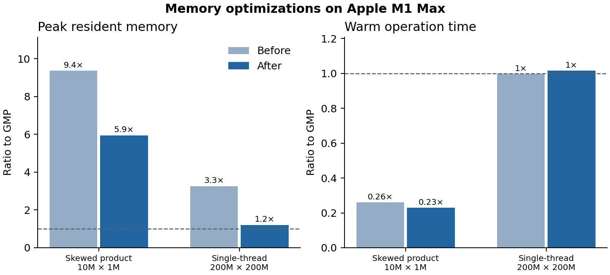
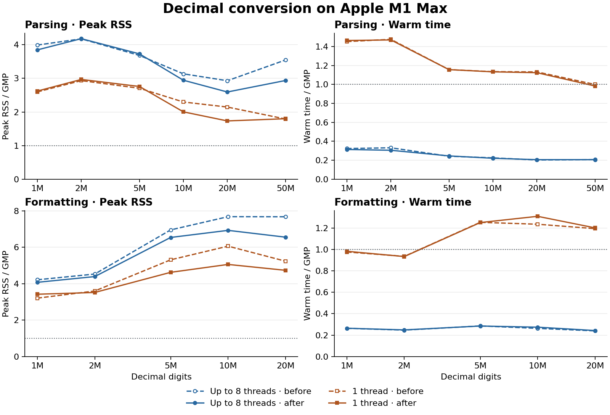
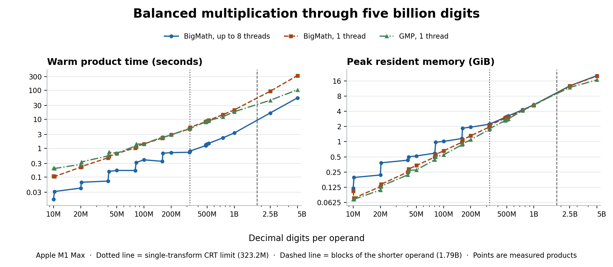
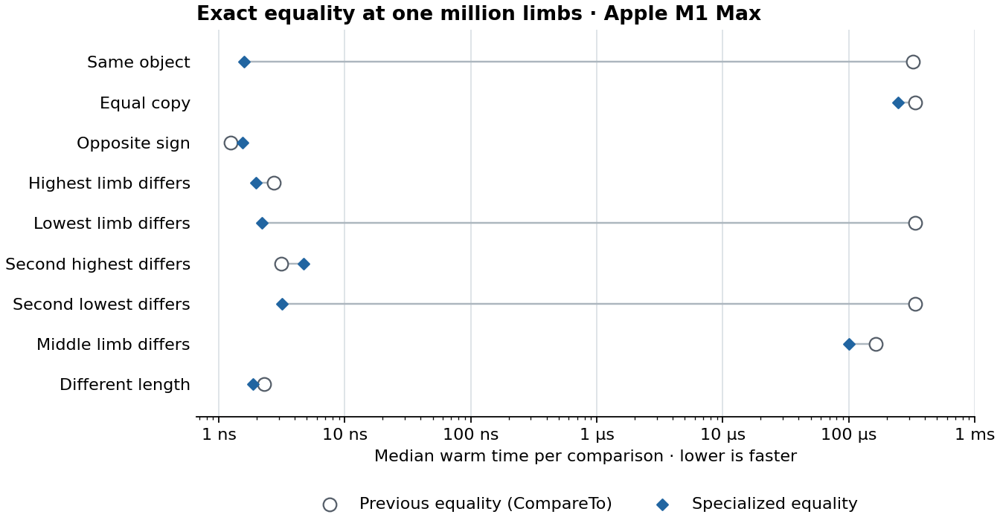

# BigMath

Arbitrary-precision integer library in C++20. Header-light with a thin static-library shell. 64-bit limbs, 3-prime CRT NTT multiplication (multithreaded by default), Newton–Raphson division with cached reciprocals, divide-and-conquer base conversion. Includes a REPL calculator built on top.

Target: portable C++ (with optional NEON intrinsics on aarch64, scalar fallbacks everywhere else) that reaches GMP parity or better across the large-operand bands — no hand-written assembly.

## Performance

The November 23, 2026 full benchmark measured revision `ed9a01c` on an Apple M1 Max. Both BigMath builds used identical operands, with a fresh single-thread GMP 6.3.0 reference for each configuration. Values below 1× mean BigMath was faster. The arithmetic panels show warm calls, and the decimal conversion panels show first and warm calls. Most large cases had one warm measurement per library.

The triangles in the multiplication panels show separate fresh-process measurements. The 200M point is from this run. Larger points through 5B digits come from the November 21 seeded sweeps. [Large-product measurements](BENCHMARK.md#balanced-products-through-five-billion-digits)

### Single-threaded BigMath and GMP

At 50M, 100M and 200M digits per operand, balanced multiplication took 0.91×, 0.94× and 0.95× GMP’s time. The 200M-digit product took 2.75 s in BigMath and 2.90 s in GMP.

At 200M ÷ 40M digits, BigMath used 0.85× GMP’s time for the quotient and 0.79× for quotient and remainder. At 20M digits, parsing took 1.04× GMP’s time and formatting took 1.09×.


### Multithreaded BigMath (up to eight threads) and single-threaded GMP

Balanced products at 10M, 50M, 100M and 200M digits took 17.3, 162.5, 327.1 and 694.5 ms. The first transform doubling above 10M digits occurs near 10.10M digits per operand. [Transform sizes and measured boundaries](BENCHMARK.md#balanced-products-through-five-billion-digits)


### Balanced multiplication through one million digits

On the M1 Max, the optimized single-thread build took 13.69 µs for a 5,000-digit product and 39.83 µs at 10,000 digits, down from 16.83 and 49.77 µs. At 100,000 digits it used 1.02× GMP’s warm time on one thread and 0.34× with up to eight threads. [Paired timings and crossover measurements](BENCHMARK.md#balanced-multiplication-through-one-million-digits)


### Platform tuning for release builds

The November 23 holdout reran the five checked-in release profiles against generic thresholds. On the four x86-64 targets the burst speedup ranged from **1.03× to 1.29×** for balanced multiplication and **0.91× to 1.40×** for squaring. Values above 1× favor the checked-in profile. [Runner details and per-case results](BENCHMARK.md#platform-tuning-for-release-builds)


### Peak memory compared with GMP

Threaded multiplication now uses the fused matrix transform for large operands at ratios of at least 8 to 1. At 10M × 1M digits, peak RSS fell from 173.3 to 109.9 MiB and warm time from 18.0 to 15.8 ms. [Paired measurements](BENCHMARK.md#memory-optimization-benchmarks)

At 200M digits per operand, compact weights cut single-threaded peak RSS from 3.56 to 1.31 GiB. Warm products took 2.86 s before and 2.92 s after. GMP used 1.09 GiB.

Processing the three primes in sequence lets threaded products reuse two scratch buffers. At 200M digits this reduced peak RSS from 2.90 to 1.94 GiB. The jump from 160M to 162M digits now runs from 1.15 to 1.85 GiB.

Sharing immutable transform tables across workers and reusing per-thread buffers cut the 10M-digit formatting peak from 525 to 372 MiB. Parsing 50M digits fell from 1,588 to 1,084 MiB. Warm times for those cases also improved.



Decimal conversion now reuses two scratch buffers for full fused transforms from 2²⁰ coefficients. In a three-run comparison on the M1 Max, threaded 50M-digit parsing went from 1,083 to 896 MiB, and 20M-digit formatting went from 756 to 646 MiB. Their median warm times went from 553 to 551 ms and from 508 to 514 ms, respectively. [Paired results and standalone multiplication controls](BENCHMARK.md#reuse-two-scratch-buffers-during-decimal-conversion)



On revision `ed9a01c`, multiplication at 5M × 500k digits had the largest threaded peak RSS relative to GMP in the integer sweep, 8.39× (88.3 versus 10.5 MiB). The single-thread maximum was 8.36× for multiplication at 10M × 1M digits (155.2 versus 18.6 MiB). [Full memory results](BENCHMARK.md#peak-memory-and-large-product-time)


In the three-process comparison at 500M digits per operand, median warm multiplication fell from **3.13 to 1.50 s** with up to eight threads and from **18.84 to 8.85 s** on one thread. GMP took 8.41 s. Peak RSS rose from 3.03 to 3.14 GiB threaded and from 2.75 to 3.02 GiB single-threaded. The revised path uses additional convolution residues through about 646M digits per operand. [Before-and-after figure](docs/images/bigmath_crt_ceiling.png)

Above about 1.79B digits per balanced operand, a wider prime set handles the product in one set of convolution residues. These measurements report warm multiplication time and process peak resident memory on an Apple M1 Max. [Full table and before-and-after measurements](BENCHMARK.md#balanced-products-through-five-billion-digits)

| Digits per operand | BigMath, up to 8 threads | BigMath, 1 thread | GMP, 1 thread |
|---:|---:|---:|---:|
| 500M | 1.42 s · 3.14 GiB | 8.55 s · 3.03 GiB | 8.55 s · 2.73 GiB |
| 750M | 2.29 s · 4.28 GiB | 14.49 s · 4.16 GiB | 12.30 s · 4.12 GiB |
| 1B | 3.718 s · 5.40 GiB | 21.038 s · 5.28 GiB | 18.289 s · 5.45 GiB |
| 2.5B | 8.582 s · 12.83 GiB | 54.461 s · 12.73 GiB | 44.972 s · 12.59 GiB |
| 5B | 25.757 s · 22.00 GiB | 133.979 s · 22.10 GiB | 101.045 s · 23.01 GiB |



The experimental Fermat outer FFT is disabled by default. Local tests on the 32 GiB M1 Max use smaller products with forced wide-CRT blocking. The actual large-size crossover awaits a larger machine. [Fermat validation and measurements](BENCHMARK.md#experimental-fermat-outer-fft)

### Small operands (1–16 limbs)

Values of up to 4 limbs (256 bits) are stored inside the `BigInteger` object, and operands of up to 16 limbs are combined in a stack buffer. Before and after that change, single-threaded, against GMP writing into a reused output: a 1-limb product went from 5.7× to 2.1× GMP's time, a 1-limb remainder from 3.9× to 1.1×, and copying a small value from 5.3× to 0.12×.


[Single-thread data and methodology](BENCHMARK.md#single-thread-comparison) · [Multithreaded data and methodology](BENCHMARK.md#default-build-with-up-to-eight-bigmath-threads) · [Small-operand data](BENCHMARK.md#small-operands)

### BigInteger equality

On the Apple M1 Max, comparing two one-million-limb integers that differed only in the lowest limb fell from 336 µs to 2.19 ns. Equal copies still require a full scan and fell from 337 to 247 µs. A difference in the second-highest limb took 4.72 ns, up from 3.14 ns. Both `==` and `!=` use the exact comparison with no per-integer hash storage. [Equality benchmark and data](BENCHMARK.md#biginteger-equality)



---

## Features

- **64-bit limb representation** (`BIGMATH_LIMB_64=1`, default). `DataT` stores true 64-bit values; every carry/borrow chain uses `__uint128_t` accumulators. Halves loop iteration counts in scalar paths vs the legacy 32-bit-in-64-bit layout. Opt out via `-DBIGMATH_LIMB_64=0`.
- **Multiplication:** Classic schoolbook → Karatsuba (64-bit-hybrid leaf; levels with ≥ 168-limb operands split three ways, Toom-3) → 3-prime CRT NTT (2013265921 / 469762049 / 1811939329, 32-bit coefficient splitting). With generic thresholds, balanced products switch at 320 limbs per operand with a warm pool or 512 each with a cold pool. Release builds use [per-platform cutoffs](BENCHMARK.md#platform-tuning-for-release-builds). Toom-3 and the single-prime Goldilocks NTT remain as cross-check alternates; the NEON-accelerated CRT path beats both at every measured size.
- **Radix-4 + radix-8 fused NTT butterflies** (PRs #59, #60): 3× fewer memory passes vs radix-2; ~1.6× wall-clock at ≥2M limbs.
- **NEON Shoup butterflies on aarch64** (PRs #96–#99, `BIGMATH_NEON=1` default on Apple Silicon): the radix-8/4/2 layers and 1/n scaling run 4 lanes wide using Shoup's precomputed-reciprocal multiplication — `(w·x) mod P` from one doubling multiply-high (`vqdmulhq_s32`), a multiply-subtract, and one conditional subtract, with interleaved `(twiddle, w′)` tables keeping the strided gathers at one cache line per pair. Bit-exact with the scalar path; ~4× per butterfly pass, −26…40% end-to-end on NTT-bound ops. Scalar fallback everywhere else.
- **Matrix Fourier multiplication.** For large products, the three-prime NTT transforms cache-sized rows. With NEON enabled, rows of at least 256 coefficients use factored cross-twiddles. At 200 million digits per operand the top-level tables for all three primes occupy 108 MiB. Packing, transposition and pointwise multiplication are fused into the transform stages.
- **Internal threading.** Each matrix stage distributes transpose tiles across the pool, so multiple workers can process rows of the same prime. The default pool has up to eight threads including the caller. Build with `-DBIGMATH_USE_THREADS=0` for single-threaded operation.
- **Division:** single-limb kernel with a normalized running remainder → Knuth Algorithm D on raw buffers (`FastDivision`: flag-chain `submul_1`, Möller–Granlund 3/2 quotient digit) below 96-limb divisors → in-place divide-and-conquer Burnikel–Ziegler (GMP `dcpi1` shape, no padding) → Newton–Raphson with a guarded-precision reciprocal and wrap-around cyclic products from 1536-limb divisors (768 at ratio ≥ 3) → quotient-sized division when the quotient is shorter than the divisor but ≥ 3072 limbs. Quotient-only calls (`operator/`) with a quotient shorter than the divisor are computed from the operands' top limbs. One rule per regime, re-swept 2026-11-21 on a divisor × ratio grid (`build/DispatchThresholds.h`). Identity `q·b + r == a` is cross-checked in `tests/div_correctness.cpp`.
- **Squaring:** Specialized Classic / Karatsuba squarers below 352 limbs; above, the CRT NTT handles self-products. The ordinary and truncated CRT paths can reuse the first operand’s spectrum. The fused matrix path uses its paired-row forward stages.
- **String I/O:** Linear chunked parser/formatter for small inputs, divide-and-conquer with cached Newton reciprocals at scale; from 100k digits both directions fan their D&C subtrees out over the thread pool (the subtree outputs are fixed-width fields at precomputable offsets). Asymptotic `O(M(L) · log L)` both directions.
- **Modular exponentiation:** `PowMod(base, exponent, modulus)` returns the least nonnegative residue for arbitrary-size nonnegative exponents and positive moduli. Include `biginteger/ops/NumberTheory.h` or `biginteger/ops/Operations.h`. Runtime depends on the inputs. [Benchmark](BENCHMARK.md#modular-exponentiation)
- **Primality testing:** `IsProbablePrime(n, rounds = 32)` is exact for nonnegative values below `2^64`. Larger inputs use strong Miller–Rabin tests with random witnesses. Inputs below two return false, and a nonpositive round count throws `std::invalid_argument`. [Primality benchmark](BENCHMARK.md#primality-testing)
- **Next prime.** `NextProbablePrime(n, rounds = 32)` finds the first prime or probable prime strictly above `n`. Large searches use a segmented sieve to reject candidates with small factors. [Next-prime benchmark](BENCHMARK.md#next-probable-prime)
- **Greatest common divisor:** `Gcd(a, b)` returns a nonnegative divisor for signed inputs. `ExtendedGcd(a, b)` returns `{gcd, x, y}` with `a*x + b*y == gcd`. Both accept zero, including the pair `(0, 0)`. [Benchmark](BENCHMARK.md#greatest-common-divisors)
- **Integer square root:** `SqrtRem(n)` returns `{root, remainder}` with `root = floor(sqrt(n))` and `remainder = n - root*root`. A zero remainder identifies a perfect square. Negative inputs throw `std::invalid_argument`. [Benchmark](BENCHMARK.md#integer-square-root-and-remainder)
- **BigDecimal:** Java-style fixed-point decimal (unscaled BigInteger + int scale) with exact +, −, \*; rounded division taking 8 rounding modes; parse/format covering plain and scientific notation.
- **Calculator REPL:** Variables, hex/bin/dec output, multi-line continuation, comments, `:help :quit :vars :reset :base :digits :time :load :save` directives. Built as a separate executable.
- **Thread-safe by construction** for concurrent use of distinct objects from distinct threads. See [docs/THREAD_SAFETY.md](docs/THREAD_SAFETY.md).

## Layout

```
include/biginteger/  public BigInteger headers (algorithms, ops, common)
include/bigdecimal/  public BigDecimal headers
src/                 non-inline BigInteger implementations
bigdecimal/          BigDecimal implementation
tests/               correctness, performance, unit tests
calculator/          REPL frontend
docs/                technical references (see below)
```

## Requirements

- CMake ≥ 3.16
- A current C++20 GCC, Clang, or Apple Clang toolchain with `__uint128_t` and `__builtin_*_overflow`. On Windows, use MSYS2 UCRT64 Clang.
- (Optional) `libgmp` for the GMP comparison benchmark.

## Build

```sh
cmake -S . -B build -DCMAKE_BUILD_TYPE=Release
cmake --build build -j
```

Outputs:
- `build/libbigmath.a` — static library
- `build/calculator` — REPL
- `build/{mult_correctness, div_correctness, unit_tests}` — test binaries
- `build/{multperf_simple, divperf_simple, bench_vs_gmp}` — performance harnesses

See [BUILDING.md](BUILDING.md) for shared-library mode, threshold overrides, and installation.
For prebuilt libraries and the GitHub release workflow, see the [release guide](docs/RELEASING.md).

## Test

```sh
cd build && ctest --output-on-failure
```

`mult_correctness` is fast; `div_correctness` runs a broad matrix and takes a few minutes; `unit_tests` is sub-second.

The standalone perf harnesses `multperf_simple` and `divperf_simple` (BigMath-internal, no GMP) take an optional run-count `k` (default 3); each size is timed `k` times and the mean reported:

```sh
./build/multperf_simple 5   # average of 5 runs per size
./build/divperf_simple 5
```

The internal multiplication table reports the mean of five calls per algorithm. [Internal algorithm crossovers](BENCHMARK.md#internal-algorithm-crossovers)

## Use

```cpp
#include "biginteger/BigInteger.h"
#include "biginteger/common/Builder.h"
#include "biginteger/common/Parser.h"
#include "biginteger/ops/Operations.h"

using namespace BigMath;

BigInteger a = BigIntegerBuilder::From("123456789012345678901234567890");
BigInteger b = BigIntegerBuilder::From("987654321098765432109876543210");
BigInteger c = a * b;
std::cout << ToString(c) << '\n';
```

CMake consumers:

```cmake
find_package(bigmath REQUIRED)
target_link_libraries(my_app PRIVATE bigmath::bigmath)
```

## Calculator

```sh
./build/calculator
> x = 2^256 - 1
> x * x
> :base 16
> x
> :quit
```

Operators: `+ - * / % ^` (with `^` right-associative). Literals: decimal, `0x…` hex, `0b…` binary, underscore separators (`1_000_000`). `#` to end of line is a comment. Trailing `\` continues a line.

## Documentation

- [docs/algorithms-guide/algorithms-guide.pdf](docs/algorithms-guide/algorithms-guide.pdf) — practitioner's guide to every algorithm in plain language: worked examples, figures, when each algorithm switches and why (LaTeX source alongside)
- [docs/BASE.md](docs/BASE.md) — number representation, 64-bit limbs, why little-endian
- [docs/MULTIPLICATION.md](docs/MULTIPLICATION.md) — Classic / Karatsuba / Toom-3 / NTT (Goldilocks + multi-prime CRT) and their tradeoffs
- [docs/DIVISION.md](docs/DIVISION.md) — Classic / Fast (Knuth D + Möller-Granlund qhat) / Burnikel–Ziegler / Newton / Reciprocal-cached
- [docs/STRING_CONVERSION.md](docs/STRING_CONVERSION.md) — chunked decimal I/O, D&C parse/format, Newton-divider chain
- [docs/BIGDECIMAL.md](docs/BIGDECIMAL.md) — fixed-point decimal model, rounding modes, performance
- [docs/THREAD_SAFETY.md](docs/THREAD_SAFETY.md) — concurrency model, opt-in internal parallelism
- [BUILDING.md](BUILDING.md) — CMake build, install, build flags, threshold tuning

Each doc covers algorithms, dispatch, benchmark numbers vs GMP, optimizations that landed, and approaches that were tried and rejected with reasons.

## Performance numbers

Warm wall-clock times for `ed9a01c` from the November 23, 2026 Apple M1 Max run. The first ratio compares the two single-thread timings shown. The last column gives the ratio for the default build (up to eight BigMath threads) against its own GMP timing run. Ratios use the unrounded times. [Single-thread CSV](docs/benchmarks/2026-11-23-full-ed9a01c-m1-max-single-thread.csv) · [Default-build CSV](docs/benchmarks/2026-11-23-full-ed9a01c-m1-max.csv)

| Operation | Decimal digits | BigMath 1 thread (ms) | GMP 1 thread (ms) | 1-thread ratio | Default-build ratio |
|---|---:|---:|---:|---:|---:|
| Multiply | 1,000 × 1,000 | 0.0015 | 0.000958 | 1.57× | 1.21× |
| Multiply | 5,000 × 5,000 | 0.01963 | 0.01229 | 1.60× | 1.27× |
| Multiply | 10,000 × 10,000 | 0.05825 | 0.02975 | 1.96× | 0.77× |
| Multiply | 50,000 × 50,000 | 0.4074 | 0.2885 | 1.41× | 0.57× |
| Multiply | 100,000 × 100,000 | 0.8066 | 0.6264 | 1.29× | 0.36× |
| Multiply | 500,000 × 500,000 | 4.12 | 4.378 | 0.94× | 0.21× |
| Multiply | 1,000,000 × 1,000,000 | 8.676 | 8.827 | 0.98× | 0.19× |
| Multiply | 5,000,000 × 5,000,000 | 47.72 | 63.61 | 0.75× | 0.12× |
| Multiply | 10,000,000 × 10,000,000 | 104.3 | 206.3 | 0.51× | 0.09× |
| Multiply | 20,000,000 × 20,000,000 | 210.6 | 274.4 | 0.77× | 0.14× |
| Multiply | 50,000,000 × 50,000,000 | 602.3 | 665.4 | 0.91× | 0.25× |
| Multiply | 100,000,000 × 100,000,000 | 1,319 | 1,409 | 0.94× | 0.24× |
| Multiply | 200,000,000 × 200,000,000 | 2,750 | 2,902 | 0.95× | 0.24× |
| Multiply | 5,000,000 × 500,000 | 22.81 | 30.88 | 0.74× | 0.20× |
| Multiply | 200,000,000 × 20,000,000 | 1,567 | 1,937 | 0.81× | 0.18× |
| Divide, quotient | 200,000 ÷ 50,000 | 2.395 | 1.538 | 1.56× | 0.62× |
| Divide, quotient | 10,000,000 ÷ 2,000,000 | 148.4 | 141.4 | 1.05× | 0.29× |
| Divide, quotient | 50,000,000 ÷ 10,000,000 | 794 | 1,250 | 0.64× | 0.12× |
| Divide, quotient | 200,000,000 ÷ 40,000,000 | 3,638 | 4,266 | 0.85× | 0.16× |
| Divide, quotient and remainder | 200,000 ÷ 50,000 | 2.539 | 1.673 | 1.52× | 0.58× |
| Divide, quotient and remainder | 10,000,000 ÷ 2,000,000 | 156.8 | 150.4 | 1.04× | 0.28× |
| Divide, quotient and remainder | 50,000,000 ÷ 10,000,000 | 879.9 | 1,319 | 0.67× | 0.11× |
| Divide, quotient and remainder | 200,000,000 ÷ 40,000,000 | 3,567 | 4,518 | 0.79× | 0.14× |
| Parse | 100,000 | 1.437 | 1.053 | 1.36× | 0.50× |
| Parse | 20,000,000 | 837.4 | 805.5 | 1.04× | 0.20× |
| ToString | 100,000 | 2.88 | 2.346 | 1.23× | 0.46× |
| ToString | 20,000,000 | 2,352 | 2,151 | 1.09× | 0.23× |

Opt-out flags (`-DBIGMATH_USE_THREADS=0` / `-DBIGMATH_NTT_CRT=0` / `-DBIGMATH_LIMB_64=0`) revert any subset of the defaults — useful for embedded targets, header-only-strict consumers, or A/B comparison.

## License

See [LICENSE](LICENSE).

## Author

S. M. Mahbub Murshed (murshed@gmail.com)
