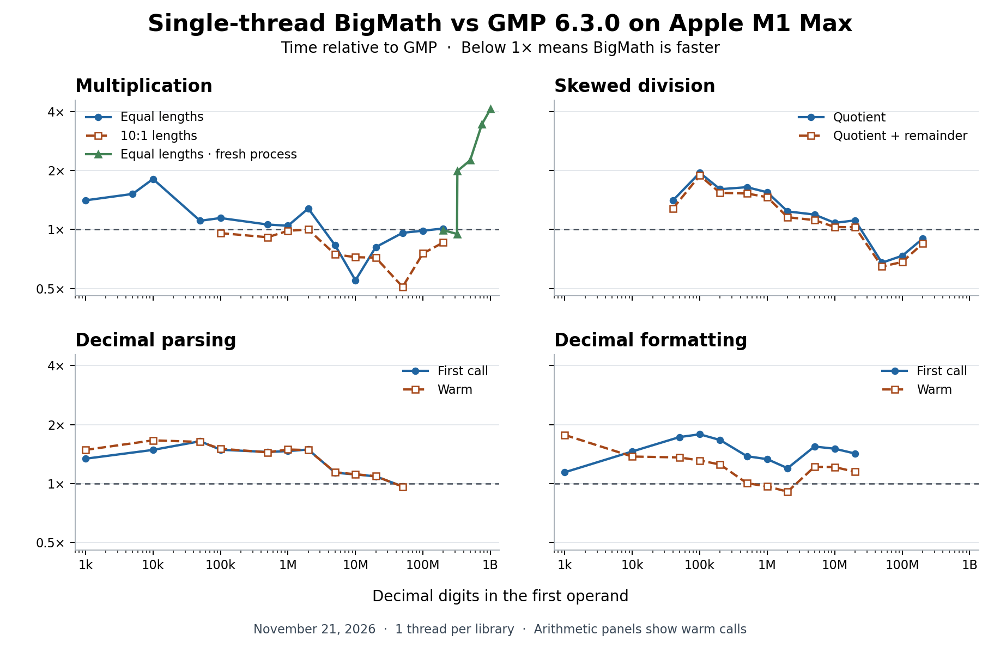
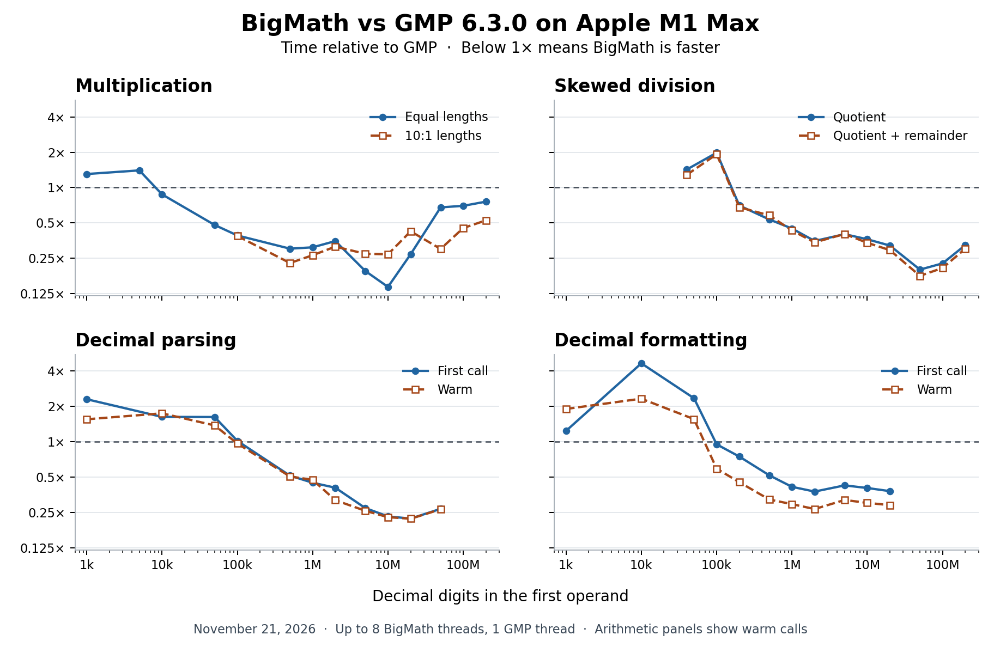
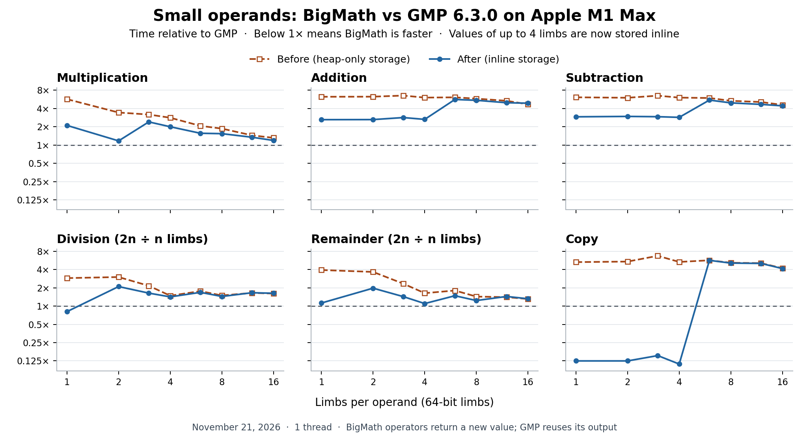

# BigMath

Arbitrary-precision integer library in C++20. Header-light with a thin static-library shell. 64-bit limbs, 3-prime CRT NTT multiplication (multithreaded by default), Newton–Raphson division with cached reciprocals, divide-and-conquer base conversion. Includes a REPL calculator built on top.

Target: portable C++ (with optional NEON intrinsics on aarch64, scalar fallbacks everywhere else) that reaches GMP parity or better across the large-operand bands — no hand-written assembly.

## Performance

The November 21, 2026 full benchmark measured revision `8e19932` on an Apple M1 Max. Both BigMath builds used identical operands and a fresh single-thread GMP 6.3.0 reference. Values below 1× mean BigMath was faster. The arithmetic panels show warm calls, and the decimal conversion panels show first and warm calls. Most large cases had one warm measurement per library.

### Single-threaded BigMath and GMP

At 50, 100 and 200 million digits per operand, balanced multiplication took 0.96×, 0.98× and 1.02× GMP’s time. The 200-million-digit product took 2.91 s in BigMath and 2.87 s in GMP.

At 200 million ÷ 40 million digits BigMath used 0.91× GMP’s time for the quotient and 0.85× for quotient and remainder. At 20 million digits, decimal parsing used 1.13× GMP’s time and formatting used 1.18×.



### Multithreaded BigMath (up to eight threads) and single-threaded GMP

The 10-million-digit balanced product took 17.74 ms. At 50, 100 and 200 million digits it took 164.7, 345.3 and 719.5 ms, about one quarter of GMP’s time at all three sizes. Just above 10.10 million digits per operand, BigMath doubles the transform length. [Transform sizes and before/after measurements](BENCHMARK.md#large-multiplication-follow-up)



### Small operands (1–16 limbs)

Values of up to 4 limbs (256 bits) are stored inside the `BigInteger` object, and operands of up to 16 limbs are combined in a stack buffer. Before and after that change, single-threaded, against GMP writing into a reused output: a 1-limb product went from 5.7× to 2.1× GMP's time, a 1-limb remainder from 3.9× to 1.1×, and copying a small value from 5.3× to 0.12×.



[Single-thread data and methodology](BENCHMARK.md#single-thread-comparison) · [Multithreaded data and methodology](BENCHMARK.md#default-build-with-up-to-eight-bigmath-threads) · [Small-operand data](BENCHMARK.md#small-operands)

---

## Features

- **64-bit limb representation** (`BIGMATH_LIMB_64=1`, default). `DataT` stores true 64-bit values; every carry/borrow chain uses `__uint128_t` accumulators. Halves loop iteration counts in scalar paths vs the legacy 32-bit-in-64-bit layout. Opt out via `-DBIGMATH_LIMB_64=0`.
- **Multiplication:** Classic schoolbook → Karatsuba (64-bit-hybrid leaf; levels with ≥ 168-limb operands split three ways, Toom-3) → 3-prime CRT NTT (2013265921 / 469762049 / 1811939329, 32-bit coefficient splitting) from 320 limbs per operand for balanced products with a warm pool, or 512 each with a cold pool. Toom-3 and the single-prime Goldilocks NTT remain as cross-check alternates; the NEON-accelerated CRT path beats both at every measured size.
- **Radix-4 + radix-8 fused NTT butterflies** (PRs #59, #60): 3× fewer memory passes vs radix-2; ~1.6× wall-clock at ≥2M limbs.
- **NEON Shoup butterflies on aarch64** (PRs #96–#99, `BIGMATH_NEON=1` default on Apple Silicon): the radix-8/4/2 layers and 1/n scaling run 4 lanes wide using Shoup's precomputed-reciprocal multiplication — `(w·x) mod P` from one doubling multiply-high (`vqdmulhq_s32`), a multiply-subtract, and one conditional subtract, with interleaved `(twiddle, w′)` tables keeping the strided gathers at one cache line per pair. Bit-exact with the scalar path; ~4× per butterfly pass, −26…40% end-to-end on NTT-bound ops. Scalar fallback everywhere else.
- **Matrix Fourier multiplication.** For large products, the three-prime NTT transforms cache-sized rows. With NEON enabled, rows of at least 256 coefficients use factored cross-twiddles. At 200 million digits per operand the top-level tables for all three primes occupy 108 MiB. Packing, transposition and pointwise multiplication are fused into the transform stages.
- **Internal threading.** Each matrix stage distributes transpose tiles across the pool, so multiple workers can process rows of the same prime. The default pool has up to eight threads including the caller. Build with `-DBIGMATH_USE_THREADS=0` for single-threaded operation.
- **Division:** single-limb kernel with a normalized running remainder → Knuth Algorithm D on raw buffers (`FastDivision`: flag-chain `submul_1`, Möller–Granlund 3/2 quotient digit) below 96-limb divisors → in-place divide-and-conquer Burnikel–Ziegler (GMP `dcpi1` shape, no padding) → Newton–Raphson with a guarded-precision reciprocal and wrap-around cyclic products from 1536-limb divisors (768 at ratio ≥ 3) → quotient-sized division when the quotient is shorter than the divisor but ≥ 3072 limbs. Quotient-only calls (`operator/`) with a quotient shorter than the divisor are computed from the operands' top limbs. One rule per regime, re-swept 2026-11-21 on a divisor × ratio grid (`build/DispatchThresholds.h`). Identity `q·b + r == a` is cross-checked in `tests/div_correctness.cpp`.
- **Squaring:** Specialized Classic / Karatsuba squarers below 352 limbs; above, the CRT NTT handles self-products. The ordinary and truncated CRT paths can reuse the first operand’s spectrum. The fused matrix path uses its paired-row forward stages.
- **String I/O:** Linear chunked parser/formatter for small inputs, divide-and-conquer with cached Newton reciprocals at scale; from 100k digits both directions fan their D&C subtrees out over the thread pool (the subtree outputs are fixed-width fields at precomputable offsets). Asymptotic `O(M(L) · log L)` both directions.
- **BigDecimal:** Java-style fixed-point decimal (unscaled BigInteger + int scale) with exact +, −, \*; rounded division taking 8 rounding modes; parse/format covering plain and scientific notation.
- **Calculator REPL:** Variables, hex/bin/dec output, multi-line continuation, comments, `:help :quit :vars :reset :base :digits :time :load :save` directives. Built as a separate executable.
- **Thread-safe by construction** for concurrent use of distinct objects from distinct threads. See [docs/THREAD_SAFETY.md](docs/THREAD_SAFETY.md).

## Layout

```
include/biginteger/  public BigInteger headers (algorithms, ops, common)
include/bigdecimal/  public BigDecimal headers
src/                 non-inline BigInteger implementations
bigdecimal/          BigDecimal implementation
tests/               correctness, performance, unit tests
calculator/          REPL frontend
docs/                technical references (see below)
```

## Requirements

- CMake ≥ 3.16
- C++20 compiler with `__uint128_t` + `__builtin_*_overflow` — GCC ≥ 10, Clang ≥ 11, or Apple Clang. MSVC is not supported.
- (Optional) `libgmp` for the GMP comparison benchmark.

## Build

```sh
cmake -S . -B build -DCMAKE_BUILD_TYPE=Release
cmake --build build -j
```

Outputs:
- `build/libbigmath.a` — static library
- `build/calculator` — REPL
- `build/{mult_correctness, div_correctness, unit_tests}` — test binaries
- `build/{multperf_simple, divperf_simple, bench_vs_gmp}` — performance harnesses

See [BUILDING.md](BUILDING.md) for shared-library mode, threshold overrides, and installation.

## Test

```sh
cd build && ctest --output-on-failure
```

`mult_correctness` is fast; `div_correctness` runs a broad matrix and takes a few minutes; `unit_tests` is sub-second.

The standalone perf harnesses `multperf_simple` and `divperf_simple` (BigMath-internal, no GMP) take an optional run-count `k` (default 3); each size is timed `k` times and the mean reported:

```sh
./build/multperf_simple 5   # average of 5 runs per size
./build/divperf_simple 5
```

The internal multiplication table reports the mean of five calls per algorithm. [Internal algorithm crossovers](BENCHMARK.md#internal-algorithm-crossovers)

## Use

```cpp
#include "biginteger/BigInteger.h"
#include "biginteger/common/Builder.h"
#include "biginteger/common/Parser.h"
#include "biginteger/ops/Operations.h"

using namespace BigMath;

BigInteger a = BigIntegerBuilder::From("123456789012345678901234567890");
BigInteger b = BigIntegerBuilder::From("987654321098765432109876543210");
BigInteger c = a * b;
std::cout << ToString(c) << '\n';
```

CMake consumers:

```cmake
find_package(bigmath REQUIRED)
target_link_libraries(my_app PRIVATE bigmath::bigmath)
```

## Calculator

```sh
./build/calculator
> x = 2^256 - 1
> x * x
> :base 16
> x
> :quit
```

Operators: `+ - * / % ^` (with `^` right-associative). Literals: decimal, `0x…` hex, `0b…` binary, underscore separators (`1_000_000`). `#` to end of line is a comment. Trailing `\` continues a line.

## Documentation

- [docs/algorithms-guide/algorithms-guide.pdf](docs/algorithms-guide/algorithms-guide.pdf) — practitioner's guide to every algorithm in plain language: worked examples, figures, when each algorithm switches and why (LaTeX source alongside)
- [docs/BASE.md](docs/BASE.md) — number representation, 64-bit limbs, why little-endian
- [docs/MULTIPLICATION.md](docs/MULTIPLICATION.md) — Classic / Karatsuba / Toom-3 / NTT (Goldilocks + multi-prime CRT) and their tradeoffs
- [docs/DIVISION.md](docs/DIVISION.md) — Classic / Fast (Knuth D + Möller-Granlund qhat) / Burnikel–Ziegler / Newton / Reciprocal-cached
- [docs/STRING_CONVERSION.md](docs/STRING_CONVERSION.md) — chunked decimal I/O, D&C parse/format, Newton-divider chain
- [docs/BIGDECIMAL.md](docs/BIGDECIMAL.md) — fixed-point decimal model, rounding modes, performance
- [docs/THREAD_SAFETY.md](docs/THREAD_SAFETY.md) — concurrency model, opt-in internal parallelism
- [BUILDING.md](BUILDING.md) — CMake build, install, build flags, threshold tuning

Each doc covers algorithms, dispatch, benchmark numbers vs GMP, optimizations that landed, and approaches that were tried and rejected with reasons.

## Performance numbers

Warm wall-clock times from the November 21, 2026 Apple M1 Max run. The first ratio compares the two single-thread timings shown. The last column gives the ratio for the default build (up to eight BigMath threads) against the same GMP timings. Ratios use the unrounded times. [Single-thread CSV](docs/benchmarks/2026-11-21-factored-mfa-m1-max-single-thread.csv) · [Default-build CSV](docs/benchmarks/2026-11-21-factored-mfa-m1-max.csv)

| Operation | Decimal digits | BigMath 1 thread (ms) | GMP 1 thread (ms) | 1-thread ratio | Default-build ratio |
|---|---:|---:|---:|---:|---:|
| Multiply | 10,000 × 10,000 | 0.06425 | 0.03679 | 1.75× | 0.83× |
| Multiply | 1,000,000 × 1,000,000 | 9.587 | 8.997 | 1.07× | 0.34× |
| Multiply | 5,000,000 × 5,000,000 | 50.52 | 62.65 | 0.81× | 0.13× |
| Multiply | 10,000,000 × 10,000,000 | 111.6 | 201.7 | 0.55× | 0.09× |
| Multiply | 20,000,000 × 20,000,000 | 219 | 266 | 0.82× | 0.14× |
| Multiply | 50,000,000 × 50,000,000 | 627.3 | 655 | 0.96× | 0.25× |
| Multiply | 100,000,000 × 100,000,000 | 1,363 | 1,386 | 0.98× | 0.25× |
| Multiply | 200,000,000 × 200,000,000 | 2,913 | 2,869 | 1.02× | 0.25× |
| Multiply | 5,000,000 × 500,000 | 23.64 | 31.16 | 0.76× | 0.27× |
| Multiply | 200,000,000 × 20,000,000 | 1,650 | 1,901 | 0.87× | 0.19× |
| Divide, quotient | 200,000 ÷ 50,000 | 2.579 | 1.508 | 1.71× | 0.66× |
| Divide, quotient | 10,000,000 ÷ 2,000,000 | 159.6 | 142.3 | 1.12× | 0.41× |
| Divide, quotient | 50,000,000 ÷ 10,000,000 | 843 | 1,222 | 0.69× | 0.13× |
| Divide, quotient | 200,000,000 ÷ 40,000,000 | 3,797 | 4,193 | 0.91× | 0.16× |
| Divide, quotient and remainder | 200,000 ÷ 50,000 | 2.578 | 1.639 | 1.57× | 0.82× |
| Divide, quotient and remainder | 10,000,000 ÷ 2,000,000 | 159.3 | 152 | 1.05× | 0.37× |
| Divide, quotient and remainder | 50,000,000 ÷ 10,000,000 | 835.1 | 1,303 | 0.64× | 0.12× |
| Divide, quotient and remainder | 200,000,000 ÷ 40,000,000 | 3,790 | 4,436 | 0.85× | 0.15× |
| Parse | 100,000 | 1.601 | 1.114 | 1.44× | 0.52× |
| Parse | 20,000,000 | 898.5 | 797.3 | 1.13× | 0.20× |
| ToString | 100,000 | 3.048 | 2.295 | 1.33× | 0.50× |
| ToString | 20,000,000 | 2,505 | 2,124 | 1.18× | 0.24× |

Opt-out flags (`-DBIGMATH_USE_THREADS=0` / `-DBIGMATH_NTT_CRT=0` / `-DBIGMATH_LIMB_64=0`) revert any subset of the defaults — useful for embedded targets, header-only-strict consumers, or A/B comparison.

## License

See [LICENSE](LICENSE).

## Author

S. M. Mahbub Murshed (murshed@gmail.com)
