# Division in BigMath

A technical reference for the division subsystem of this BigInteger library: implemented algorithms, dispatch policy, optimization history, benchmark results against GMP, and a catalogue of approaches that were considered and rejected (with their reasons).

---

## Table of contents

1. [Scope and audience](#scope-and-audience)
2. [Number representation](#number-representation)
3. [Top-level dispatch](#top-level-dispatch)
4. [Algorithms](#algorithms)
   - [Classic division](#classic-division)
   - [Fast division (Knuth Algorithm D)](#fast-division-knuth-algorithm-d)
   - [Knuth division (reference implementation)](#knuth-division-reference-implementation)
   - [Burnikel–Ziegler division](#burnikel-ziegler-division)
   - [Newton–Raphson division](#newton-raphson-division)
   - [Reciprocal-cached division](#reciprocal-cached-division)
   - [Exact division](#exact-division)
5. [Benchmark results vs GMP](#benchmark-results-vs-gmp)
6. [Optimizations already implemented](#optimizations-already-implemented)
7. [Future opportunities](#future-opportunities)
8. [Explored but rejected](#explored-but-rejected)
9. [References](#references)

---

## Scope and audience

This document covers `Divide`, `DivideAndRemainder`, and `DivideExact`. Newton iteration and Burnikel–Ziegler recursion use the algorithms in [MULTIPLICATION.md](MULTIPLICATION.md).

Assumed reader: a working C++ engineer with light numerics background. Familiar with the textbook long-division algorithm. Knowledge of [Knuth Vol. 2 §4.3.1 Algorithm D](https://en.wikipedia.org/wiki/Division_algorithm#Integer_division_%28unsigned%29_with_remainder) helps but isn't required.

Code references use `path:line` where applicable.

---

## Number representation

Same as the multiplication subsystem (see [MULTIPLICATION.md §Number representation](MULTIPLICATION.md#number-representation)). Limbs are true 64-bit values stored in `uint64_t` slots, little-endian, in base 2⁶⁴ (`Base() == Base2_64`, the default since the 64-bit limb refactor of 2026-05, PRs #18–#30). The legacy 32-bit mode (`-DBIGMATH_LIMB_64=0`: 32-bit values in `uint64_t` slots, base 2³², upper 32 bits as carry headroom) remains available as an opt-out.

Two type aliases dominate division code:

| symbol | type | role |
|---|---|---|
| `DataT` | `uint64_t` | one limb (full 64-bit value under `Base2_64`) |
| `ULong128` | `__uint128_t` | accumulator for normalize, qhat estimation, and 128/64 divmod |

Limb width matters heavily for division because the inner loop of every divider operates on `(top_two_limbs) / divisor_top_limb`. Under `Base2_64` this is a 128/64 division producing a 64-bit quotient digit per step — the same per-step work as GMP's 64-bit limbs. (Under the legacy 32-bit mode it was a 64/32 division producing a 32-bit quotient digit, doubling the loop iterations relative to GMP — the main motivation for the refactor.)

---

## Top-level dispatch

`include/biginteger/algorithms/Division.h` declares `DivideAndRemainder(a, b, base, computeRemainder)` returning a `{quotient, remainder}` pair; the dispatch logic lives in `src/algorithms/Division.cpp`. The dispatcher considers operand sizes and the dividend/divisor ratio.

### Current rule (64-bit limbs, since 2026-11-21)

With `nb` the divisor length in limbs and `δ = na − nb` (the quotient has
`δ + 1` limbs):

```
single-limb divisor                          → ClassicDivision (DivRem1 kernel)
quotient only and δ + 4 < nb                 → divide the operands' top limbs
                                               ((2δ+4) by (δ+4), through this rule)
nb < 96                                      → FastDivision (schoolbook)
δ ≥ nb  (ratio ≥ 2):
    nb ≥ 1536, or nb ≥ 768 and ratio ≥ 3     → Newton
    otherwise                                → Burnikel–Ziegler
δ < nb  (quotient shorter than the divisor):
    δ ≥ 3072 (and δ + 8 < nb)                → quotient-sized
    nb ≥ 3072 and ratio ≥ 7/4                → Newton
    otherwise                                → Burnikel–Ziegler
```

Thresholds are the `BIGMATH_DIV_*` macros in
`include/biginteger/build/DispatchThresholds.h`; the measurements behind them
are in [the 2026-11-21 division pass](#2026-11-21-division-pass).

### Legacy bands (32-in-64 layout, and 64-bit limbs before 2026-11-21)

The flowchart and band discussion below describe the dispatcher as it was
before the re-sweep. It still applies to `-DBIGMATH_LIMB_64=0` builds.

```mermaid
flowchart TD
    A[DivideAndRemainder&#40;a, b, base&#41;] --> B{IsZero&#40;b&#41;?}
    B -- yes --> Err[throw invalid_argument]
    B -- no --> C{IsZero&#40;a&#41;?}
    C -- yes --> Z[return &#123;0,0&#125;]
    C -- no --> D{Compare&#40;a, b&#41;}
    D -- a == b --> Eq[return &#123;1, 0&#125;]
    D -- a &lt; b --> Less[return &#123;0, a&#125;]
    D -- a &gt; b --> E{Newton band?<br/>b ≥ 896 and a ≥ 8b<br/>OR b ≥ 1280 and 2a ≥ 7b<br/>OR b ≥ 1792 and 5a ≥ 14b<br/>OR b ≥ 2560 and 2a ≥ 5b<br/>OR b ≥ 4096 and a ≥ 2b<br/>OR b ≥ 8192 and 5a ≥ 8b<br/>OR b ≥ 131072 and 3a ≥ 4b}
    E -- yes --> N[NewtonDivision]
    E -- no --> Q{Quotient-sized band?<br/>b ≥ 24576, a ≥ b+64, 3a &lt; 4b<br/>OR thin: b ≥ 8192, 64 ≤ Δ ≤ b/8}
    Q -- yes --> QS[QuotientSizedDivision]
    Q -- no --> F{Power-of-two base<br/>AND b.size &gt; 512<br/>AND BZ shape fits?}
    F -- yes --> BZ[BurnikelZieglerDivision]
    F -- no --> FD[FastDivision]
    FD --> S{b is single limb?}
    S -- yes --> CD[ClassicDivision]
    S -- no --> KD[Knuth-style FastDivision]
```



Single-limb divisor (`b.size() == 1`) is handled inside `FastDivision` itself, which short-circuits to `ClassicDivision::DivModTo`.

Default thresholds (overridable via `-D...`; the canonical defaults live in `include/biginteger/build/DispatchThresholds.h` — its `#define`s win over the `#ifndef` fallbacks in `include/biginteger/algorithms/Division.h`):

| macro | default | unit | meaning |
|---|---|---|---|
| `BIGMATH_NEWTON_HIGH_SKEW_B` | `896` | limbs | Newton floor at ratio ≥ 8/1 |
| `BIGMATH_NEWTON_RATIO35_B` | `1280` | limbs | Newton floor at ratio ≥ 7/2 (keeps the 4.0000 ± 1-limb knife on the Newton side) |
| `BIGMATH_NEWTON_MEDIUM_B` | `1792` | limbs | Newton floor at ratio ≥ 14/5 (`NEWTON_SKEW_*` = 14/5; likewise for 3.0000) |
| `BIGMATH_NEWTON_MID_B` | `2560` | limbs | Newton floor at ratio ≥ 5/2 |
| `BIGMATH_NEWTON_RATIO20_B` | `4096` | limbs | Newton floor at ratio ≥ 2/1 |
| `BIGMATH_NEWTON_RATIO2_B` | `8192` | limbs | Newton floor at ratio ≥ 8/5 |
| `BIGMATH_NEWTON_BALANCED_B` | `131072` | limbs | Newton floor for the near-balanced band, ratio ≥ 4/3 (raised from 24576 on 2026-06-12) |
| `BIGMATH_QSIZED_MAIN_B` | `24576` | limbs | QuotientSizedDivision main-band floor (ratio < 4/3, `a ≥ b + 64`); decoupled from the balanced floor |
| `BIGMATH_QSIZED_MIN_DELTA` | `64` | limbs | minimum quotient size Δ for QuotientSizedDivision |
| `BIGMATH_QSIZED_SMALL_B` | `8192` | limbs | thin-quotient extension floor (`64 ≤ Δ ≤ b/8`) |
| `BIGMATH_BZ_DIVISOR_THRESHOLD` | `512` | limbs | BZ entry guard |
| `BIGMATH_BZ_RECURSION_THRESHOLD` | `128` | limbs | BZ base-case cutoff (retuned 512 → 128 on 2026-06-12) |

The current dispatch logic, paraphrased:

```
1. (b.size ≥ 896    AND a.size ≥ 8·b.size)
   OR (b.size ≥ 1280   AND 2·a.size ≥ 7·b.size)
   OR (b.size ≥ 1792   AND 5·a.size ≥ 14·b.size)
   OR (b.size ≥ 2560   AND 2·a.size ≥ 5·b.size)
   OR (b.size ≥ 4096   AND a.size ≥ 2·b.size)
   OR (b.size ≥ 8192   AND 5·a.size ≥ 8·b.size)
   OR (b.size ≥ 131072 AND 3·a.size ≥ 4·b.size)  ← near-balanced band      → Newton
2. (Base2_32 OR Base2_64)  AND
   ( (b.size ≥ 24576 AND a.size ≥ b.size + 64 AND 3·a.size < 4·b.size)
     OR (b.size ≥ 8192 AND 64 ≤ Δ ≤ b.size/8) )   (Δ = a.size − b.size)    → QuotientSized
3. (Base2_32 OR Base2_64)  AND  b.size > 512  AND
   ( (b.size ≥ 1024 AND a.size ≥ b.size + 32 AND a.size ≤ 3·b.size)
     OR (a.size > 2048 AND a.size > 3·b.size) )                           → Burnikel–Ziegler
4. else                                                                   → FastDivision
5. (b.size == 1 inside FastDivision)                                      → ClassicDivision
```

The ordering matters: Newton wins on **large skewed** problems because the per-divisor reciprocal setup amortizes over multiple chunks. BZ wins on **mid-size near-balanced** problems where its 2n/n recursion structure beats both FastDivision and Newton's setup cost.

**Near-balanced band (PR #79; ratio lowered to 4/3 and floor to 24576 limbs on 2026-06-11; floor raised to 131072 on 2026-06-12).** Above `NEWTON_BALANCED_B` (131072 limbs), ratio-≥-4/3 division goes to Newton instead of BZ. BZ's recursive 2n/n halving lands its intermediate NTT multiplies just over power-of-2 transform-length boundaries for non-power-of-2 divisor sizes — the FFT length doubles and the constant factor compounds across recursion depth into a **5–60× slowdown vs Newton**, worst at `n = 2^k + 1` (measured ~90 s for a 262145-limb divisor vs Newton's ~0.9 s). Newton pads once to the working size and stays flat. Exact-power-of-2 divisor sizes are BZ's best case (it ties Newton); they regress ~4 % under this band but are rare in practice. **Band re-measured 2026-06-11** after the wraparound-Newton PRs (#85–#87) cut Newton's constant: the generic BZ/Newton crossover moved from ratio ~2 down to ~1.3 at large b, and the size floor from ~100k down to ~24k limbs (ratio-1.4 crossover ≈ 24k limbs; ratio-2 crossover ≈ 6k). Band lowered `2/1 → 4/3` and `NEWTON_BALANCED_B` `98304 → 24576`. **Update 2026-06-12:** the BZ odd-size padding fix (PR #116) plus the 128-limb BZ recursion basecase retune made padded BZ win ratio 1.4–1.5 shapes through ~98k limbs, so the floor moved back up: `NEWTON_BALANCED_B` `24576 → 131072` (the old 24576 floor was largely insurance against BZ's odd-size collapse, now fixed). The 24576 value survives as `QSIZED_MAIN_B`, the floor of the **QuotientSizedDivision** main band — a different knob, decoupled from the balanced floor. The ratio ∈ (1, 4/3) residual is closed by QuotientSizedDivision (see below). FastDivision is the default workhorse for everything else.

**Medium/ratio-2 band retune (2026-06-11, follow-up to the 4/3 band).** Post-#85–#87 re-measurement
moved the Newton/BZ crossovers down across the board: `NEWTON_MEDIUM_B` 4096 → 2560 with ratio
3/1 → **5/2**, plus a new `NEWTON_RATIO2` band (`b ≥ 6144`, ratio ≥ **8/5**) — values as of
2026-06-11; the frontier was re-swept twice on 2026-06-12 (after the BZ odd-size padding fix,
then again after the BZ basecase retune 512 → 128) and the canonical bands are now the
seven-row frontier in the table above. The fractional
ratios are deliberate cliff-avoidance: digit-derived operands land at limb ratios like
2.0000 ± 1 limb or 3.0000 ± 1 limb, and the BZ side of a knife-edge `2/1` or `3/1` predicate
blows up 8–12× on non-power-of-2 divisor sizes (measured: 15578×5193 limbs BZ 69 ms vs Newton
9 ms; 20785×10393 BZ 139 ms vs Newton 12 ms — both shapes sat one limb below the old bands).
End-to-end: 200k×50k digits 6.65× → 3.36× vs GMP; 300k×100k 24.6× → 3.07×; 400k×200k
20.7× → 3.57×. Residual narrowed 2026-06-11 (same day): a **thin-quotient extension** of the quotient-sized
band now covers `Δ ≤ b/8` at `b ≥ 8192` (`BIGMATH_QSIZED_SMALL_B`). Sweep data: in that slice
quotient-sized wins generic sizes modestly (8192 limbs ratio 1.1: 3.8 vs BZ 5.5 ms) and kills the
2^k+1 pathology 3–14× (16385 ratio 1.1: 66.4 → 8.3 ms end-to-end). The remaining BZ slice —
`Δ ∈ (b/8, ...)` at `b ∈ (512, 24576)`, plus everything at `b < 8192` below ratio 8/5 — keeps BZ
because it genuinely wins the generic crossovers there (qsized's tops-divide recursion gets
erratic at fat Δ below the Newton floors: measured 48 ms vs BZ 14 at 8192 ratio 1.55); its
non-pow2 pathology stays documented as accepted.

**Short-quotient band (`QuotientSizedDivision`, 2026-06-11).** For `b ≥ QSIZED_MAIN_B` (24576 — decoupled from the balanced floor on 2026-06-12 when `NEWTON_BALANCED_B` moved to 131072), `a ≥ b + 64`, ratio < 4/3: with Δ = a.size − b.size and t = Δ+4, the (Δ+1)-limb quotient is determined to ±a few units by the operand TOPS — `q_est = floor((a >> B^(nb−t)) / (b >> B^(nb−t)))` (truncating b perturbs q by ≤ ~B^(2−GUARD), sub-ulp). The tops divide (ratio ~2, size ~2Δ/Δ) goes to Newton directly at t ≥ 6144 (measured: Newton beats BZ at ratio 2 from ~6k limbs — 13 vs 22 ms at 12k, 40 vs 299 ms at 30k, 0.16 s vs 5.3 s at 65537); the exact remainder then costs one Δ×nb back-multiply plus ±few fixups (cap 8, fallback Newton). Cost scales with the **quotient**, not the divisor. Measured (nb=131073, the 2^k+1 pathology): ratios 1.05/1.10/1.25 went from 1.07 s / 2.16 s / 5.35 s (BZ) to **28 / 43 / 71 ms** (38–75×). Generic nb=120000: 37/56/116 ms → 30/39/66 ms. It also beats BZ at BZ's exact-power-of-2 best case (131072 @1.25: 65 vs 88 ms) — no regression band.

The public `CacheDivision()` API uses `ReciprocalDivision` to reuse Newton's reciprocal across calls. The tests use a separate textbook Algorithm D implementation to cross-check `FastDivision`.

---

## Algorithms

### Classic division

**Location:** `algorithms/division/ClassicDivision.h`.

**Complexity:** O(n) limb operations when the divisor is a single limb. The implementation handles single-limb divisors (a / b where b fits in one limb) and provides primitive helpers used by all other dividers.

**Algorithm (single-limb divisor):** standard short division. Walk dividend limbs from high to low, maintaining a 64-bit accumulator:

```
   acc = 0
   for i = n-1 down to 0:
       acc       = acc · B + a[i]               (B = 2³² for Base2_32)
       q[i]      = acc / divisor
       acc       = acc % divisor
   remainder = acc
```

For `Base2_32`, the inner `(acc << 32 | a[i])` fits in a `ULong128`. As of 2026-05-26 the per-limb divide is a Möller-Granlund "div2by1" reciprocal step (`ClassicDivision::GranlundMollerDivider`, paper Algorithm 4), not a hardware `UDIV`/`DIV` — the reciprocal is precomputed once per call from the invariant divisor, then each limb costs `UMULH` + 128-bit add + 1–2 fixup branches. Base2_64 takes the same path. See [STRING_CONVERSION.md §Granlund–Möller](STRING_CONVERSION.md#granlundmöller-magic-number-divmod-in-classicdivision) for measurement.

The `DivModTo` variant performs the division **in place** on the dividend vector (overwriting it with the quotient) and returns the remainder. This is the hot operation inside `ToStringLinearAppend`, where the dividend is repeatedly divided by `10¹⁸` to peel off 18 decimal digits at a time.

### Fast division (Knuth Algorithm D)

**Location:** `algorithms/division/FastDivision.h`.

**Complexity:** O((m − n + 1) · n) limb multiplies where `m = |a|`, `n = |b|`. This is Knuth's [Algorithm D](https://en.wikipedia.org/wiki/Division_algorithm#Integer_division_%28unsigned%29_with_remainder) as described in *TAOCP Vol. 2 §4.3.1*, tuned for Base2_32.

**Algorithm sketch:**

```
   1. Normalize: shift a and b left by k bits so that b's top limb has its MSB set.
                 The normalized b has a high limb b̂ ≥ 2³¹.
                 a may grow by one limb.

   2. For each output digit position j from high to low:
        a) Estimate qhat from the top two limbs of the current remainder
           divided by b̂. Knuth shows the estimate is at most 2 too high.
        b) Tentative q · b is subtracted from the current remainder window.
        c) If the result went negative, decrement qhat by 1 and add b back
           (this loop runs at most twice; in practice essentially never on
            normalized input).
        d) Record q[j] = qhat.

   3. Denormalize: shift remainder right by k bits to undo step 1.
```

The Base2_32 fast path uses `ULong128` arithmetic for `qhat` estimation (`acc / b̂` is `__uint128_t / uint64_t`, mapping to `DIV`/`UDIV`) and for the in-place subtract-tentative-product step. The non-Base2_32 path falls back to `% base` / `/ base` operations.

**Performance notes.** `FastDivision` is the dispatcher's default. For divisors below the Newton/BZ thresholds (typically `b.size() < 1024`), it is the algorithm that actually runs. The qhat estimation is the inner-loop bottleneck. The implementation also specializes the normalize and unnormalize steps for `Base2_32` with scalar `ClassicMultiplication` calls (rather than going through the generic shift-by-bits path), giving roughly a 1.04–1.3× win on those steps for medium-size inputs.

### Knuth division (reference implementation)

**Location:** `tests/support/DivisionReference.h`.

The FastDivision base-case, adversarial fuzz and regression tests compare
their quotients and remainders against this textbook implementation of
Algorithm D. The standalone division benchmark also uses it.

### Burnikel–Ziegler division

**Location:** `algorithms/division/BurnikelZieglerDivision.h`.

**Complexity:** O(M(n) · log n) where M(n) is the cost of multiplying n-limb numbers. With NTT multiplication this is `O(n · log² n · log log n)` effectively, dominated by the recursive sub-multiplications. The recursion structure is from [Burnikel and Ziegler (1998), "Fast Recursive Division"](https://pure.mpg.de/rest/items/item_1819444_4/component/file_2599480/content).

**The key insight.** Knuth's Algorithm D pays a multi-precision `qhat · b` subtraction at every quotient digit. Burnikel–Ziegler observes that you can group `n` quotient digits at a time, compute that whole block of `q` via a recursive 2n/n division, and pay one multi-precision `q_block · b` subtraction per block — turning the inner cost from quadratic into the cost of the multiplication.

**The recursive structure: 2n/n and 3n/2n.**

The algorithm operates with two recursive primitives:

- **`Div2n1n(a, b)`** — given `a` with 2n limbs and `b` with n limbs (top half), produce a 1-limb-wide quotient block of size n. It does this by calling `Div3n2n` twice in sequence.

- **`Div3n2n(a, b)`** — given `a` with 3n limbs and `b` with 2n limbs, produce an n-limb quotient. Internally calls `Div2n1n` once on the top 2n limbs of `a` against the top n of `b`, then performs the multi-precision subtraction `q · b_low` and a fixup loop.

The mutual recursion bottoms out (at `BIGMATH_BZ_RECURSION_THRESHOLD = 128` limbs; retuned 512 → 128 on 2026-06-12 — Karatsuba-backed multiplies beat 512-limb Knuth-D basecase calls) by calling `FastDivision` on the base case.

```
                                                          
   Div2n1n(a₂ₙ, bₙ)     ←   the public entry for 2n / n  
       │                                                  
       │  splits a into a_high (n limbs) and a_low (n)    
       ▼                                                  
   q_high = Div3n2n(a_high ++ a_low[high half], b)        
       │                                                  
       ▼                                                  
   q_low  = Div3n2n(intermediate_R ++ a_low[low half], b) 
       │                                                  
       ▼                                                  
   quotient = q_high ++ q_low                             
                                                          
                                                          
   Div3n2n(a₃ₙ, b₂ₙ)                                      
       │                                                  
       │  split b into b₁ (high n) and b₀ (low n)         
       │  split a into a top 2n and bottom n              
       ▼                                                  
   q = Div2n1n(top_2n, b₁)            ← recursive 2n/n    
       │                                                  
       ▼                                                  
   r = top_2n − q · b₁                                    
   adjust: r ← (r << n·32) + bottom_n − q · b₀            
       │                                                  
       ▼                                                  
   while r < 0:                                           
       q ← q − 1                                          
       r ← r + b                                          
       (this loop runs at most twice)                     
```

The shape of the recursion makes BZ a near-perfect match for **balanced** division (dividend ≈ 2× divisor). The dispatcher reflects this: BZ runs near-balanced when `b.size() ≥ 1024 AND b.size() + 32 ≤ a.size() ≤ 3·b.size()`, plus a big-and-skewed clause `a.size() > 2048 AND a.size() > 3·b.size()`.

**Handling odd divisor size (fixed 2026-06-12, PR #116).** BZ's recursion halves the divisor size at every level, so the divisor size must stay divisible by 2 all the way down to the basecase. The entry does bit-shift both operands left — but that is **Knuth normalization** (setting the top bit of `b`'s high limb for qhat accuracy), and it never fixed odd sizes below the top level: an odd intermediate size on the way down silently fell back to `FastDivision` at full size. Since ~half of real divisor limb counts hit an odd size at some recursion level, this cost 1.3–10× on those inputs (the root cause of the "2^k+1 family" pathology at ratio < 2.8). The fix pads **both** operands with bottom zero limbs so that the divisor size equals `basecase << levels` — divisible by 2 at every level. The quotient is unchanged by a common bottom-pad, and the remainder's bottom pad limbs come out exactly zero (stripped before return). The pad is at most one basecase-granularity rounding, so the overhead is bounded by ~`1/BZ_THRESHOLD` (≈ 0.8% at the 128-limb basecase).

The `BIGMATH_BZ_DIVISOR_THRESHOLD = 512` guard prevents BZ from being chosen for divisors so small that `FastDivision` would beat it.

### Newton–Raphson division

**Location:** `algorithms/division/NewtonDivision.h`.

**Complexity:** O(M(n)) per divide, where M(n) is multiplication cost. The reciprocal computation is also O(M(n)) but is amortized over multiple divisions when the same divisor is reused (see [`Divider` class](#reciprocal-cached-division)).

**The Newton iteration.** Given a normalized divisor `D` (top bit of `D[n-1]` set), the algorithm computes an approximate reciprocal `R` of `D` to ~2n limbs of precision. The iteration is the classical [Newton's method for 1/D](https://en.wikipedia.org/wiki/Division_algorithm#Newton%E2%80%93Raphson_division):

```
   R_{i+1} = R_i · (2 − D · R_i)        (in fixed-point representation)
```

This **doubles the precision per iteration** quadratic convergence. Starting from a low-precision seed (computed from a 32×32 division on the top limbs of `D`), it reaches n-limb precision in `O(log n)` iterations, each iteration costing M(2^i). The total cost telescopes to `O(M(n))`.

Once `R` is computed, a single division `a / D` becomes:

```
   Q_estimate = (a · R) >> 2n        (high-half multiplication)
   R_final    = a − Q_estimate · D
   fixup:     if R_final ≥ D, increment Q_estimate, subtract D from R_final
              (loop bounded by FIXUP_LIMIT = 8; in practice 0–2 iterations)
```

The implementation calls this `DivideChunk`.

**Blockwise mode for large dividends.** When `na > 2n` (where `n = |b|`), the algorithm processes the dividend in chunks:

```
                                                                 
    a  =  [    top chunk    ][  block₁  ][  block₂  ] ... [ block_k ] 
          ←─── n+1 to 2n ───→←─── n ────→←─── n ────→     ←── n ──→ 
                                                                 
    Step 1: q_top, r = DivideChunk(top_chunk, b, R)               
    Step 2: q_block₁, r = DivideChunk(r ++ block₁, b, R)          ← thread r as high part
    Step 3: q_block₂, r = DivideChunk(r ++ block₂, b, R)          
    ...                                                           
    Final quotient = q_top ++ q_block₁ ++ q_block₂ ++ ... ++ q_block_k 
    Final remainder = r                                           
```

Newton reads already-normalized inputs and the first chunk directly from
their limb ranges. It reuses one buffer to join each later block with the
running remainder and copies each quotient block into its final position.
The reciprocal steps also read their high-limb slices directly.

Each chunk costs O(M(n)) and there are O(na / n) chunks, so total cost is O((na / n) · M(n)). For balanced division this is comparable to BZ; for skewed division where `na ≫ n`, the chunk loop is the bulk of the work and Newton wins decisively because:

1. The reciprocal `R` is computed once and reused across all chunks.
2. Each chunk's `DivideChunk` is O(M(n)) thanks to NTT/Karatsuba in the high-half multiplication, not O(n · chunk_size).

**Single-block boundary (PR #79).** The single-block path handles `na ≤ 2n`; `na > 2n` goes blockwise. The boundary is `2n`, not `2n+1`: with a `2n+1`-limb chunk the truncated `(chunk·R) >> 2n` quotient estimate underestimates `Q` by up to ~`B` steps (the error is `∝ chunk / B^(2n)`, which reaches `B` once the chunk exceeds `2n` limbs), overflowing the fixup cap and falling back to quadratic `FastDivision`. The `+1` limb routinely appears from the Knuth normalize shift on `a ≈ 2n`. Before this fix, `nb = 50000` spiked to ~5200 ms (vs ~360 ms at neighbouring sizes); routing `na > 2n` through the blockwise path keeps every chunk ≤ 2n and the fixup loop at 0–2 iterations.

**High-precision reciprocal flag.** When `na ≥ 2n`, the implementation also runs one **extra Newton iteration at full precision** after the main loop (`EXTRA_REFINE_ITERS = 1`), to drop integer-rounding error in `R` to ≤ 1 quotient digit. Without it the fixup loop diverged at `n = 32768` in early testing, handing off to `FastDivision`.

**Why Newton, why bands.** The structural win of Newton over FastDivision is the O(M(n)) per-chunk cost versus FastDivision's O((m−n+1)·n) quadratic-in-quotient-size cost. The win materializes once the divisor is large enough that NTT/Karatsuba is faster than scalar multi-precision arithmetic, and once the ratio is skewed enough that reciprocal setup amortizes. The 2026-05 tuning lowered the dispatcher band from `b.size ≥ 8192` to `b.size ≥ 1024` with skew threshold `a ≥ 3b`, after a GMP-bench regression at `(a=200k, b=50k digits)` showed Newton was missing the band by 1–3 limbs at boundary cases. (Historical; the current seven-band frontier is in [§Top-level dispatch](#top-level-dispatch).)

### Reciprocal-cached division

**Location:** `algorithms/division/ReciprocalDivision.h` (the wrapper) and `algorithms/division/NewtonDivision.h::Divider` (the implementation).

For repeated division by the same divisor — the canonical use case in `ToStringDivConquer` where every level of the divide-and-conquer formatter divmods by a fixed `10^k` constant — building the reciprocal once and reusing it amortizes the setup cost over every division.

The API:

```cpp
class NewtonDivision::Divider {
public:
    Divider(vector<DataT> const &b, BaseT radix);
    pair<vector<DataT>, vector<DataT>> DivideAndRemainder(
        vector<DataT> const &a, bool computeRemainder = true) const;
};
```

`Divider` stores the normalized `b`, the normalization shift, and the pre-computed reciprocal `R`. Each `DivideAndRemainder` call skips straight to `DivideNormalizedWithReciprocal`.

**Measured win:** for 5 divisions by the same large divisor, the cached form is 27–31× faster than calling `NewtonDivision::DivideAndRemainder` five times. Even including the one-time `Divider` setup cost, it remains 12–25× faster.

This is the foundation of the divide-and-conquer ToString optimization. `Parser.h::BuildDecimalDcChain` constructs a chain of `Divider` instances — one per level of the D&C recursion, each holding `10^(N/2^i)` and its reciprocal — so the recursion's repeated divmods by these constants run at O(M(n)) per divide instead of incurring per-divide reciprocal setup.

---

### Exact division

`DivideExact(a, b)` requires a nonzero divisor and a dividend known to be a
multiple of it. It throws `std::invalid_argument` for a zero divisor.
The result has the usual quotient sign and zero is canonical.

Let `B` be the limb radix. The magnitude kernel takes a bound of
`floor((bit_length(a) - bit_length(b)) / limb_bits) + 1` quotient limbs for
a nonzero dividend. If the quotient fits in `k` limbs, its residue modulo
`B^k` determines it uniquely. The kernel strips the divisor's powers of two
from both operands and reads at most `k` low limbs of the shifted values,
plus the carry-in limb for a partial right shift.

For short quotients, Jebelean's algorithm multiplies the lowest remaining
limb by the inverse of the divisor's low odd limb. It subtracts that quotient
digit times the divisor and stores the digit in the cancelled limb. All
arithmetic stays within the quotient width. A one-limb divisor needs only a
running carry. For longer quotients, Newton–Hensel lifting computes the
odd divisor's inverse modulo `B^k` and a low product recovers the quotient.
The lifting and low-product kernels are shared with FastREDC.
[Brent and Zimmermann, §1.4.5](https://maths-people.anu.edu.au/~brent/pd/mca-0.5.1.pdf)

With 64-bit limbs, lifting starts at a 1,024-limb quotient bound and a
512-limb odd divisor. From a 2,048-limb quotient bound, the divisor
minimum drops to 256 limbs. With 32-bit limbs, the cutoffs are 256 and
128 limbs.

When full-width lifting is outside those cutoffs, blockwise Hensel
division uses one inverse modulo `B^w`, where `w` is the odd divisor's
limb count. Each low product recovers up to `w` quotient limbs. The
correction product has low limbs equal to the ones being cancelled,
so subtracting its high limbs updates the remaining dividend window.
The quotient digits take the cancelled block's place, and borrows
above the quotient bound can be discarded. The last block needs
only the low product.

The block path starts at 128 odd-divisor limbs and an 8:1 quotient
bound to divisor ratio on 64-bit limbs. On 32-bit limbs, these
cutoffs are 64 limbs and 4:1. Set
`BIGMATH_DIVEXACT_BLOCK_MIN_DIVISOR=0` to disable blocks, or
`BIGMATH_DIVEXACT_NEWTON_MIN_QUOTIENT=0` to measure the schoolbook
path at all widths. [Exact division timings](../BENCHMARK.md#exact-division)

## Benchmark results vs GMP

Benchmark harness: `tests/performance/bench_vs_gmp.cpp`. Build:

```
cmake -S . -B build -DCMAKE_BUILD_TYPE=Release
cmake --build build -j8 --target bench_vs_gmp
./build/bench_vs_gmp
```

Hardware: Apple M1 Max. Reference: GMP 6.3.0 (Homebrew).

> The November 21 benchmarks compare quotient-only and quotient-and-remainder division separately. At 200k ÷ 50k digits, warm quotient-and-remainder took 0.60× GMP’s time in the split run and 1.04× in the in-process run. Both runs favored BigMath in both modes at every larger skewed size tested. [Division results](../BENCHMARK.md#division)
>
> **Superseded — see [BENCHMARK.md](../BENCHMARK.md) for the canonical numbers** (2026-06-12 v13.0 run). Summary as of that run: division **beats GMP from 20M-digit dividends (0.45–0.82×)**, reaches parity at 5M digits, and sits at 2.3–3.8× below 200k digits (the basecase wall). The tables below are the **historical 2026-05-27 snapshot**, kept for the optimization narrative; they predate the 2026-06-11/12 division work (wraparound Newton, QuotientSizedDivision, BZ odd-size padding fix, basecase retune, MFA gate retune).

### Balanced division

For `a.size() == b.size()` the quotient is 1–2 limbs and both libraries short-circuit. The benchmark numbers are noise — ratios reflect timer resolution, not algorithmic cost — so they are omitted here. To benchmark balanced division meaningfully, use `(a, b)` where `a.size() ≈ 2·b.size()`, which routes through BZ.

### Skewed division (dispatcher routes to Newton) — historical, 2026-05-27

Numbers below are with the full default stack as of 2026-05-27: `BIGMATH_LIMB_64=1`, `BIGMATH_NTT_CRT=1`, `BIGMATH_USE_THREADS=1` (M1 Max, 8-thread pool, min over 5 runs).

| sizes (digits) | BigMath ms | GMP ms | BM / GMP |
|---|---:|---:|---:|
| `a=40 000, b=10 000` | 0.729 | 0.218 | **3.35 ×** |
| `a=100 000, b=10 000` | 2.188 | 0.455 | **4.81 ×** |
| `a=200 000, b=50 000` | 10.965 | 1.733 | **6.33 ×** |
| `a=500 000, b=100 000` | 17.987 | 4.627 | **3.89 ×** |
| `a=1 000 000, b=200 000` | 33.438 | 10.117 | **3.31 ×** |
| `a=2 000 000, b=500 000` | 81.815 | 23.975 | **3.41 ×** |
| `a=5 000 000, b=1 000 000` | 200.808 | 67.367 | **2.98 ×** |
| `a=10 000 000, b=2 000 000` | 426.945 | 153.584 | **2.78 ×** |
| `a=20 000 000, b=4 000 000` | 963.159 | 347.665 | **2.77 ×** |
| `a=50 000 000, b=10 000 000` | 2 499.998 | 1 298.707 | **1.92 ×** |

All cases route to Newton. The dominant cost is NTT multiplication inside the Newton reciprocal iteration and inside each `DivideChunk`'s high-half mult. The large cases see the biggest wins from the threaded CRT NTT + radix-4+8 fused butterflies.

**Trend at large sizes.** As operands grow into the multi-million-digit range, the ratio to GMP closes — from 4-6× at the 100k-divisor band down to **1.92× at 50M/10M**. This is because BigMath's NTT-based mult beats GMP across the 5M-20M band (see [MULTIPLICATION.md §Benchmark](MULTIPLICATION.md#benchmark-results-vs-gmp)), and Newton's internal mults inherit that win. The residual gap at the largest sizes is the structural overhead of Newton's chunked iteration vs GMP's `mpn_dcpi1_div_q` — a single recursive divide rather than reciprocal-then-chunk.

**Historical view** of the same skewed sizes:

| sizes (digits) | early 2026 | LIMB_64 | + CRT + threads | + radix-4+8 (now) |
|---|---|---|---|---|
| 40 000 / 10 000 | 23 × | 4.8 × | 4.77 × | **3.35 ×** |
| 100 000 / 10 000 | 34 × | 6.9 × | 6.91 × | **4.81 ×** |
| 200 000 / 50 000 | 72 × | 12.4 × | 5.21 × | **6.33 ×** ⁂ |
| 500 000 / 100 000 | 12 × | 11.6 × | 4.09 × | **3.89 ×** |
| 10 000 000 / 2 000 000 | — | — | 3.06 × | **2.78 ×** |
| 50 000 000 / 10 000 000 | — | — | — | **1.79 ×** |

⁂ The 200k/50k case fluctuated with measurement noise: under the dispatch bands in force at the time (2026-05-27), the 2596-limb divisor sat below the Newton floor and routed through BZ. Under the current frontier (`b ≥ 1280` at ratio ≥ 7/2) this shape routes to Newton. The other cases all benefit monotonically from the radix-4+8 NTT speedup flowing through Newton's per-chunk multiplications.

The 40k/10k case sees the smallest improvement because its NTT calls are below the parallelism threshold (Newton's internal mults are too small).

The smaller cases (40k/10k, 100k/10k) saw their improvements from the 64-bit limb refactor halving Newton's outer-loop limb count (PRs #18–#30). They've been at the NTT-bound floor since then; CRT's per-coefficient savings barely move them because at these sizes the NTT is a small fraction of total wall time.

**Where the time actually goes.** Profile of `div 100k/10k` (a = 100 000 decimal digits, b = 10 000):

| function | % of div time |
|---|---:|
| `NewtonDivision::DivideNormalizedWithReciprocal` (chunked Q estimation) | ~72% |
| `NewtonDivision::ApproxReciprocal` (Newton iteration) | ~28% |

Both are essentially **NTT multiplications**: the reciprocal iteration is `R · (2 − D · R)` with two large mults per iter, and `DivideChunk` is one high-half mult `a · R` per chunk. At `b = 10 000 digits` (520 64-bit limbs / 1040 32-bit limbs), every internal multiplication crosses the NTT threshold. Division at this size is effectively "multiplication, repeated several times."

Detailed breakdown at 500k/100k digits (the floor case) sampled with `sample(1)` on macOS:

| function group | % |
|---|---:|
| `NTTCore::Forward` / `NTTCore::Inverse` (DIF + DIT passes) | ~60% |
| `ModularField::Mul` (pointwise multiply inside NTT) | ~12% |
| `NTTMultiplication::FinalizeBase2_64` (coefficient reassembly into 64-bit limbs) | ~8% |
| `NewtonDivision::ApproxReciprocal` overhead (vector allocation, shifts, carry chains) | ~10% |
| `NewtonDivision::DivideNormalizedWithReciprocal` blockwise loop bookkeeping | ~7% |
| Everything else (Compare, Shift, TrimZeros, dispatch) | ~3% |

**Two-thirds of the wall time is inside `NTTCore`.** Any further improvement to skewed division must either (a) reduce the number of NTT calls, (b) reduce the work per NTT call, or (c) parallelize the NTT itself. See [Improving skewed division beyond the current floor](#improving-skewed-division-beyond-the-current-floor).

---

## Optimizations already implemented

A loosely chronological summary of optimizations that landed and stuck.

### Build flags

`-O3 -march=native`. Same impact as for multiplication: NEON autovectorization for helpers, ARM64 instruction scheduling, several percent across the board.

### `FastDivision` Base2_32 specializations

The Knuth Algorithm D implementation has Base2_32 fast paths for:

- **Normalize.** Scalar shift via `ClassicMultiplication` instead of bit-shift loops. ~1.04–1.3× win on the normalize step.
- **Scalar divisor.** When `b.size() == 1`, short-circuit to `ClassicDivision::DivModTo` with a `ULong128 / ULong` inner loop. ~2× win for 1024 / 8192 limb dividends.
- **Remainder unnormalize.** Same scalar specialization.

### `BurnikelZiegler` rewritten as balanced 2n/n with 3n/2n internal steps

The current implementation matches the textbook Burnikel–Ziegler structure rather than the earlier ad-hoc recursion. Block writes are done directly to a preallocated quotient buffer instead of accumulating through `vector<vector<DataT>>`, eliminating per-block heap allocation. Measured: `4096 × 2048` balanced division dropped from 4.19 ms to 2.68 ms.

### `BurnikelZiegler` bottom-zero-limb padding for odd sizes (PR #116, 2026-06-12)

The BZ entry has always bit-shifted both operands left, but that shift is **Knuth normalization** (it sets the top bit of `b`'s high limb so the recursive qhat estimates stay tight) — it does not change limb counts and never fixed odd sizes below the top level. Any odd intermediate divisor size on the way down silently fell back to `FastDivision` at full size, costing 1.3–10× on ~half of real inputs (odd divisor limb counts) and producing the "2^k+1 family" pathology at ratio < 2.8. PR #116 fixed it by padding **both** operands with bottom zero limbs so the divisor size equals `basecase << levels` and halves cleanly at every recursion level: `a·B^k = q·(b·B^k) + r·B^k`, so the quotient is unchanged and the remainder's bottom `k` pad limbs are exactly zero (stripped before return). Padding overhead is bounded by ~`1/BZ_THRESHOLD`. This fix (together with the basecase retune below) is what allowed the Newton balanced floor to move back up to 131072.

### Newton–Raphson with `Divider` cached-reciprocal API

`NewtonDivision::Divider` precomputes the normalized divisor + reciprocal once. For repeated divisions by the same divisor, the per-divide cost drops 27–31× (5 divisions on a large divisor) versus the non-cached form. This API is wired into `ReciprocalDivision::Divider` (public-facing wrapper) and is the foundation of the D&C ToString chain.

### Newton blockwise mode

For `na > 2n + 1`, divides the dividend in chunks of size in `[n+1, 2n]`, threading the remainder as the high part of the next chunk. Each chunk's `DivideChunk` is O(M(n)) thanks to the reciprocal being precomputed. Total cost is `O((na / n) · M(n))`, which is optimal up to constants for arbitrarily skewed division.

### High-precision reciprocal for `na ≥ 2n`

One extra Newton refinement iteration at full precision when the dividend window will pit the reciprocal against a chunk size ≥ 2n. Without it, the fixup loop diverges at `n = 32768`. Bounded by `FIXUP_LIMIT = 8`; falls back to `FastDivision` on the divergence path (in practice never triggered post-flag).

### Dispatcher band tuning (2026-05)

The GMP bench surfaced a 72× regression on `200k / 50k` digits. Tracing showed the dispatcher predicate `a.size() ≥ 4·b.size()` was missing the case by 1–3 limbs at random sizes (`a = 20763, b = 5191` vs `4·5191 = 20764`). Lowering `NEWTON_SKEW_NUMERATOR` from 4 to 3 admitted these boundary cases to Newton. `NEWTON_MEDIUM_B` lowered from 8192 to 1024 after observing Newton beats FastDivision at much smaller divisors than the old guess. Result: that case dropped to 14×, a 5.3× improvement.

### Base2_64 BZ dispatch and shape-focused retune (2026-05-26)

`tests/performance/division_shape_bench.cpp` was added to benchmark meaningful division shapes directly: `2n/n`, `3n/2n`, `3n/n`, `5n/2n`, `5n/n`, and `10n/n`. This exposed a stale dispatcher guard: BZ itself supports Base2_64, but dispatch required `base == Base2_32`, so the default Base2_64 build routed many near-balanced cases to quadratic FastDivision.

The dispatcher now allows BZ for both `Base2_32` and `Base2_64`, raises the medium-skew Newton floor to 4096 limbs, and adds a separate very-high-skew Newton band at 2048 limbs with ratio `a >= 8b`.

Representative Base2_64 timings before the dispatch fix:

| shape | fast ms | BZ ms | Newton ms | old dispatch ms | best |
|---|---:|---:|---:|---:|---|
| `4096/2048` | 5.25 | 3.04 | 7.51 | 5.99 | BZ |
| `6144/4096` | 10.56 | 3.74 | 7.64 | 11.15 | BZ |
| `10240/4096` | 31.61 | 10.37 | 11.94 | 32.73 | BZ |
| `12288/8192` | 43.42 | 8.10 | 13.92 | 44.41 | BZ |

After the retune, dispatch tracks the measured winner or near-winner:

| shape | fast ms | BZ ms | Newton ms | new dispatch ms |
|---|---:|---:|---:|---:|
| `4096/2048` | 5.26 | 3.04 | 7.54 | 3.04 |
| `6144/4096` | 10.51 | 3.69 | 7.61 | 3.61 |
| `10240/4096` | 31.59 | 10.31 | 11.73 | 10.24 |
| `12288/8192` | 43.38 | 8.00 | 13.84 | 7.94 |
| `20480/2048` (`10n/n`) | 47.52 | 22.90 | 19.30 | 19.19 |

The precomputed BZ divisor-tree prototype, a practical version of pre-inverted recursive D&C for this codebase, was also tried. It cached divisor splits and high-half recursive dividers across BZ blocks. It measured mixed/flat, so it was reverted: the current static BZ recursion remains simpler and just as fast.

### Newton reciprocal allocation cleanup

Earlier `ApproxReciprocal` and `DivideChunk` allocated more temporary vectors than necessary in their inner loops, hitting the allocator at every Newton iteration level. Cleanup removed several intermediate copies; the impact is hard to measure in isolation but contributed to overall Newton throughput.

### Möller–Granlund 3/2 reciprocal in `FastDivision` qhat (2026-05, PR #17)

Replaced the per-iteration `__uint128 / uint64` divide in Knuth Algorithm D's qhat estimation with the [Möller–Granlund 3-by-2 preinverted reciprocal](https://gmplib.org/~tege/division-paper.pdf) (Algorithms 2 + 4). One mul-add + ≤ 2 correction branches instead of a hardware DIV. Gated by `BIGMATH_FASTDIV_USE_MG_QHAT` (default on, set to `0` for emergency rollback).

Measured win on `FastDivision` band (Base2_32, M1 Max, `divperf_simple`):

| case | master | M-G | delta |
|---|---:|---:|---:|
| 1024×512 | 0.464 ms | 0.443 ms | −4.5% |
| 4096×2048 | 11.48 ms | 7.44 ms | **−35%** |
| 8192×512 | 9.64 ms | 7.78 ms | −19% |
| 16384×512 | 15.92 ms | 14.15 ms | −11% |

### Möller–Granlund 3/2 reciprocal in `FastDivision` qhat, Base2_64 path (2026-05-26)

Extended M-G to the `Base2_64` path. The 192/128 reciprocal precompute is avoided by using paper Algorithm 6 (`Reciprocal3by2_Base64`): derive the 3-by-2 reciprocal from a 2-by-1 reciprocal of the divisor's top word — only one `ULong128 / ULong` operation, no 192-bit software division. The 3/2 division itself (`MGQhat_Base64`) mirrors `MGQhat_Base32` with `ULong128` intermediates.

Measured win on M1 Max, `Base2_64` default, FastDivision called directly (skewed sizes where qhat dominates):

| m × n (limbs) | Knuth qhat | M-G qhat | speedup |
|---|---:|---:|---:|
| 256 × 16    | 9.41 μs    | 7.42 μs    | **1.27×** |
| 1024 × 32   | 61.3 μs    | 50.2 μs    | **1.22×** |
| 4096 × 64   | 414 μs     | 369 μs     | **1.12×** |
| 16384 × 128 | 3089 μs    | 2860 μs    | 1.08×    |
| 65536 × 256 | 23046 μs   | 22152 μs   | 1.04×    |
| 1024 × 512  | 349 μs     | 345 μs     | flat     |
| 4096 × 2048 | 5464 μs    | 5494 μs    | flat     |

Strong wins are concentrated at high skew with small `n`. As `n` grows the per-iteration `SubtractMul` (n `ULong128` mul-adds) eclipses the qhat cost and the proportional win shrinks. Newton/BZ dispatch bands cover the larger-`n` cases anyway, so the band where M-G actually matters is exactly `b.size() ∈ (1, ~256)` 64-bit limbs.

Gated by the same `BIGMATH_FASTDIV_USE_MG_QHAT` flag (default on); now activates for both `Base2_32` and `Base2_64` when `n >= 2`.

### 64-bit limb refactor (2026-05, PRs #18–#30)

`DataT` now stores true 64-bit values and `Base() == Base2_64` by default. All division paths (Classic, Fast w/ Knuth qhat, BZ, Newton) have native Base2_64 code: `ULong128` carries, shift-by-64 in `ShiftLeftBits`/`ShiftRightBits`, `__builtin_clzll` in BZ's bit-bump-count, two-step unsigned borrow in `SubFromPtr`. Newton's `ApproxReciprocal` seed bootstraps from a single 64-bit top limb (`R_seed = (2^128 - 1) / D[n-1]` at `cur_n = 1`) and lets Newton's quadratic doubling reach full precision — no 256-bit intermediate needed.

Wins on the skewed-div benchmarks:

| case | Base2_32 | Base2_64 | delta |
|---|---:|---:|---:|
| 40 000 / 10 000 | 2.51 ms | 1.04 ms | **−59%** |
| 100 000 / 10 000 | 4.90 ms | 3.12 ms | **−36%** |
| 200 000 / 50 000 | 21.4 ms | 20.9 ms | −2% (NTT-bound) |
| 500 000 / 100 000 | 54.3 ms | 53.7 ms | ≈ 0 (NTT-bound) |

The smaller cases benefit most: Newton's outer loop (scalar carry chains, FastDivision base case, BZ helpers) halves its limb count. The largest cases are NTT-bound and gain little from wider limbs (Goldilocks coefficient capacity is fixed at 16 bits, so the same problem produces the same coefficient count regardless of limb width).

Opt-out: `-DBIGMATH_LIMB_64=0` reverts to 32-bit limbs.

### Multi-prime CRT NTT (2026-05, PRs #34–#37, default since #37)

Three NTT-friendly primes with 32-bit coefficient splitting (2 per 64-bit limb vs Goldilocks' 4 × 16-bit). Halves the NTT length at the cost of 3 parallel transforms + Garner CRT reconstruction. Size-gated via `BIGMATH_NTT_CRT_THRESHOLD`; below the gate, Goldilocks runs unchanged. The current prime triple is {2013265921, 469762049, 1811939329} and the gate default is 256 limbs sum (CRT is effectively always on) — see [MULTIPLICATION.md](MULTIPLICATION.md) for the canonical CRT configuration; the original 2026-05 triple and the 5000-limb gate it shipped with are superseded.

Per-prime modular arithmetic is 32-bit (single `MUL` + simple reduce), much cheaper than Goldilocks' ULong128 reduce. Net win on Newton-internal mults: 10-12% on the floor div cases.

Opt-out: `-DBIGMATH_NTT_CRT=0`. Threshold tuneable via `-DBIGMATH_NTT_CRT_THRESHOLD=N`.

### Multithreaded NTT (2026-05, PRs #32, #38, default since #39)

`BIGMATH_USE_THREADS=1` default activates a small thread pool (size `min(hw_concurrency, BIGMATH_MAX_THREADS=8)`). The CRT NTT's 6 forwards + 3 inverses dispatch as batched `ParallelDo` work units — one dispatch per phase, **2 dispatches per Multiply** total (down from the 100+ in an earlier per-layer attempt that regressed; see PR #38 for the profile-driven fix).

Each NTT runs serially inside its worker. Pointwise multiply chunks across the pool too. Speedup vs serial:

| case | serial | threads | speedup |
|---|---:|---:|---:|
| 200 000 / 50 000 | 20.9 ms | 9.21 ms | 2.3× |
| 500 000 / 100 000 | 53.7 ms | 18.9 ms | 2.8× |

Combined with the CRT NTT default, the cumulative win on the original floor cases is ~2.5-3× vs the pre-CRT-pre-threading baseline.

Opt-out: `-DBIGMATH_USE_THREADS=0`. Pool size override: `-DBIGMATH_MAX_THREADS=N`. See [`THREAD_SAFETY.md`](THREAD_SAFETY.md) for the thread-safety model.

---

## Improving skewed division beyond the current floor

Once dominant: `200k/50k` at 12.4× GMP and `500k/100k` at 11.6×. **Status as of 2026-05: both cases now at 5.21× and 4.09× GMP respectively** via two follow-up PRs (multi-prime CRT NTT in PR #34/#35/#36/#37, cross-prime threading in PR #38/#39, both default-on). Cumulative wins via the threading/CRT default stack: **2.3-2.8× on the floor cases.**

Remaining angles, ranked:

### Reduce NTT calls — Mulders' short multiplication (IMPLEMENTED, REJECTED 2026-05-26)

Newton's `R_new = R · (2 − D · R) / B^k` only needs the high half of `D · R`. [Mulders (2000), "On Short Multiplications and Divisions"](https://citeseerx.ist.psu.edu/document?repid=rep1&type=pdf&doi=10.1.1.20.1948) gives ~60–75% of full-mult cost for Karatsuba via recursive split. Same opportunity in `DivideChunk`'s `Q ≈ (chunk · R) >> 2n`.

Built on branch `feat/mulders-short-mul` (not merged): bit-exact `MulHigh(a, b, want)` via two-step decomposition — full `a_h · b` + recursive top-B of `a_l · b` + carry-tracking add. Wired into both `ApproxReciprocal` (RD = R_pad · diff) and `DivideChunk` (CR = chunk · R). Cross-checked vs full `Multiply` and truncate across 13 shapes (3 to 5200 limbs); all bit-exact.

**Measured: flat across every skewed-div size** (bench_vs_gmp, min of 3 runs):

| case | baseline | with exact MulHigh | delta |
|---|---:|---:|---:|
| 40 000 / 10 000 | 1.07 ms | 1.08 ms | flat |
| 100 000 / 10 000 | 3.12 ms | 3.19 ms | +2% (noise) |
| 200 000 / 50 000 | 9.25 ms | 9.21 ms | flat |
| 500 000 / 100 000 | 18.92 ms | 19.01 ms | flat |

Root cause: at the bench operand sizes (n = 2600–5200 limbs in CRT-NTT range), exact MulHigh decomposes one full `Multiply(chunk, R)` (NTT on ~3n+1 limbs) into `Multiply(a_h, b) + Multiply(a_l, b)` (two NTTs on ~2n+1 limbs each). NTT cost scales near-linearly in operand size, so the two-NTT sum totals ≈ 1.0–1.27× the original — Mulders' Karatsuba edge does not translate to NTT.

Bonus pitfall surfaced during development: `Multiply()` trims trailing zeros, so indexing the top window via `p.size() - want` instead of `(A + B) - want` returns the wrong slice when the top product limb is 0. The initial naive impl regressed +700% on `500 000 / 100 000` (cascading Newton fixup → FastDivision fallback) before this was found.

Reverted in full. Don't re-attempt unless a non-NTT multiplication path becomes dominant, or there's a Karatsuba-only Newton band big enough to matter.

### Reduce NTT length — wrap-around cyclic remainder (LANDED 2026-06-11)

The follow-up to the Mulders rejection above, attacking the same `DivideChunk` cost from the
angle that *does* translate to NTT: cut the **transform length**, not the multiply count.
Transform length is the serial critical path of a CRT-NTT multiply (the three primes already run
in parallel; see the prepared-transform rejection in *Explored but rejected* for the measurement
proving count-cuts don't move wall-clock).

`DivideChunk` needed the full `QB = Q · b_norm` (transform length `bit_ceil(2·(2n+1))` coeffs)
only to compute `rem = chunk − QB` and detect quotient-estimate error. But `|chunk − Q·b_norm| <
9·b_norm < B^(n+1)`, so the *residue* `(Q·b_norm) mod (B^L − 1)` with `L ≈ n+2` determines `rem`
exactly — and a length-`N` NTT computes products mod `(x^N − 1)` natively, so the residue costs a
cyclic transform of `bit_ceil((n+2)·c)` coeffs — **half the full product's length**
(GMP's `mpn_mu_div_qr` uses the same wraparound idea via `mulmod_bnm1`).

Implementation: `NttCrt::MultiplyMod2km1(a, b, L, base)` (cyclic convolution at `N = L·c`,
wrap-folding Garner finalize, canonical residue), used by `NewtonDivision::WrappedRemainder`
which reconstructs `rem = (chunk − W) mod (B^L − 1)` and reads the sign of the true
`t = chunk − Q·b_norm` from the residue's magnitude (`t ≥ 0` ⇒ ≤ n+1 limbs; `t < 0` ⇒ ≥ n+2
limbs; disjoint because `L ≥ n+2` and quotient-estimate error is O(n) ≪ B). Fixup loops and the
`FIXUP_LIMIT` bail-to-FastDivision semantics are unchanged. Gated on: power-of-two base,
`BIGMATH_NTT_CRT`, `Q+n ≥ BIGMATH_CYCLIC_NTT_THRESHOLD` (its own macro, default 1280 — not
the NTT multiplication threshold), cyclic length strictly below the linear
length, and `N ≤ 2^26` (the CRT ceiling — raised from 2^22 in PR #110, which also routed the
cyclic transforms through the fused MFA pipeline; the MFA permutation cancels in the
pointwise product, so the old below-MFA restriction was unnecessary).

Measured (M1 Max, paired back-to-back runs):

| case | base | cyclic | delta |
|---|---:|---:|---:|
| div 1M / 200k digits | 34.9 ms | 31.1 ms | **−11%** |
| div 5M / 1M digits | 206.1 ms | 184.9 ms | **−10%** |
| tostr 1M digits | 147.1 ms | 136.7 ms | **−7%** |
| tostr 200k digits | 21.3 ms | 20.4 ms | −4% |
| div 1M/1M digits (FastDivision path) | 0.226 ms | 0.223 ms | flat (not routed) |

Verified: 246 unit tests, `div_correctness`, ToString round-trips at 100k/1M/5M digits, and a
focused stress harness at gate-active sizes (nb 2 600–16 000 limbs, ratios 1.5–15, all-max /
sparse / zero-half adversarial patterns, `na = 2n`/`2n±1` boundaries, power-of-two cliffs) —
cross-checked limb-for-limb against FastDivision plus the `q·b + r == a`, `r < b` identity.

### Truncate the quotient-estimate product — top-limbs CR (LANDED 2026-06-11)

The CR-side follow-up (GMP `mu_divappr` style): `CR = chunk · R` only feeds
`Q = CR >> 2n`, and because `b_norm` is normalized (top bit set, `b ≥ B^n/2`) the bottom
`chunk.size() − (n+1)` limbs of the chunk contribute under 1 ulp to Q
(`c_lo / b < 2·B^(sh−n) ≤ 2/B`). `DivideChunk` therefore multiplies only the **top n+1 limbs**
of the chunk against R — the product shrinks from `(chunk + R)` to `(n+1 + R)` limbs, halving
the transform whenever the two sizes straddle a power-of-two boundary (`bit_ceil` gate; at
sizes where both round to the same transform length the approximation is skipped entirely).

The estimate underestimates Q by ≤ ~3 extra steps (floor truncations; same direction as the
existing reciprocal error), absorbed by a relaxed fixup budget (12 on the approx attempt vs 8
exact). Safety net: if the approx attempt ever blows its budget, `DivideChunk` retries once
with the exact full product before falling back to FastDivision — the worst case is bounded at
~1.4× a normal chunk, never quadratic.

Measured (M1 Max, paired runs, on top of the cyclic-QB win above):

| case | cyclic QB only | + top-limbs CR | delta |
|---|---:|---:|---:|
| div 3M / 600k digits | 90.2 ms | 72.3 ms | **−20%** |
| div 5M / 1M digits | 187.6 ms | 149.7 ms | **−20%** |
| tostr 1M digits | 138.5 ms | 122.7 ms | **−11%** |
| div 1M / 200k digits | 30.9 ms | 30.8 ms | flat (gate off: equal `bit_ceil`) |

The win lands on the ~1/3 of sizes (log-uniform) where `(3n+1)·c` and `(2n+2)·c` straddle a
transform-length boundary; elsewhere the gate keeps the exact product and cost is unchanged.
Verified with the same stress harness as the cyclic-QB change (gate-active divisor sizes,
adversarial patterns, blockwise/single-block boundaries) plus `div_correctness`, 246 unit
tests, and ToString round-trips at 100k/1M/5M digits.

### Wrapped Newton iteration in `ApproxReciprocal` — invertappr style (LANDED 2026-06-11)

The third wraparound lever, closing the family: the reciprocal's own doubling iterations.
Algebra: with `E = B^(2m) − D_new·R_pad`, the exact step
`R_new = (R_pad·(2B^(2m) − D_new·R_pad)) >> 2m` decomposes exactly into
`R_new = R_pad + floor(R_pad·E / B^(2m))`. The seed is accurate to ~`cur` limbs, so `|E|` is
known-small — which buys two structural cuts per iteration:

1. **E recovered exactly from a cyclic residue.** `(D_new·R_pad) mod (B^L − 1)` at
   `L ≈ 2m − cur` instead of the full `2m+1`-limb product (`T`). At the high-precision
   extra-refine iteration (`cur = m`) the cyclic transform is **half** the linear length.
   Sign read from residue magnitude, same window argument as `WrappedRemainder`.
2. **Correction from top slices only.** `floor(R_pad·E / B^(2m))` has only `m − cur`
   significant limbs; top slices of `R_pad` and `E` (20-limb guards) replace the full
   `(m+1)×(2m+1)` `RD` product with a `(m−cur)`-sized one. Dropped tails stay sub-ulp.

**The bug that cost a debugging round:** the sign/validity window was first sized at
`B^4` headroom over the theoretical `|E| < ε·B^(2m−cur)` bound, assuming `ε` (the seed's
ulp error) stays at a few units. It does not — **the exact-path tower itself leaves R off
by up to ~`B^6` ulps** (integer-rounding drift accumulating through the doublings; the same
slack the `high_precision` extra iteration exists to heal). The too-tight window
misclassified E's sign at the second wrapped step, the then-clamp froze R at stale
precision, and every downstream `DivideChunk` blew its fixup budget → FastDivision fallback
on every ToString chain divide (8× regression, reproduced with a `10^500000` divisor).
Fixes: window headroom `B^16`, slice guards widened to match (20 limbs), and out-of-window
now falls back to the exact iteration for that step instead of clamping.

Measured (M1 Max, paired runs, on top of the two levers above; one-shot divides are where
the reciprocal isn't amortized):

| case | before | after | delta |
|---|---:|---:|---:|
| div 1M / 200k digits | 30.7 ms | 23.4 ms | **−24%** |
| div 3M / 600k digits | 71.7 ms | 54.6 ms | **−24%** |
| div 5M / 1M digits | 148.2 ms | 110.7 ms | **−25%** |
| tostr 1M digits | 122.0 ms | 117.3 ms | −4% (Divider reciprocal mostly amortized) |
| `Divider` ctor, 10^500000 divisor | 38.9 ms | 27.8 ms | −29% |

Session cumulative on div 5M/1M: 206 → 111 ms (**−46%**). Verified: 246 unit tests,
`div_correctness`, ToString round-trips (100k/1M/5M digits), the gate-active stress harness,
plus a dedicated Pow10-divisor suite (10^60k…10^800k at ratios 1.7/2.0/3.1 — the shape that
exposed the window bug) cross-checked against FastDivision.

### Parallelize NTT — multithreading (LANDED, PR #32/#38/#39)

`BIGMATH_USE_THREADS=1` (default since PR #39) wires a small thread pool (size `min(hw_concurrency, BIGMATH_MAX_THREADS=8)`) into the CRT NTT path. The 6 forwards (3 of `fa`, 3 of `fb`) dispatch as one `ParallelDo` batch of 6 work units; 3 inverses dispatch as a 3-unit batch. Each NTT runs serially within its worker — **2 dispatches per Multiply**, not 100+.

Earlier attempts at per-NTT-layer parallelism regressed (`__psynch_cvwait` dominated profile at 42K samples). Profile-driven fix in PR #38 moved to coarse-grained cross-prime parallelism.

Measured speedup vs serial baseline (M1 Max, 8 threads):

| case | serial | threaded | speedup |
|---|---:|---:|---:|
| 200 000 / 50 000 | 20.9 ms | 9.21 ms | 2.3× |
| 500 000 / 100 000 | 53.7 ms | 18.93 ms | 2.8× |
| 1M / 1M (mul, for ref) | 36.5 ms | 12.85 ms | 2.8× |

Architectural notes:
- Public headers stay free of `<thread>` — pthread linkage only when `BIGMATH_USE_THREADS=1` and consumer links the lib.
- Pool created lazily on first `ParallelDo` call. Workers spin on a condition variable; dispatch latency ~5µs.
- `static thread_local` NTT plan + Pow10 caches mean each worker fills its own on first touch — warm pool with one large mult per thread for latency-critical workloads.
- See [`THREAD_SAFETY.md`](THREAD_SAFETY.md) for the full thread-safety model.

### Faster NTT kernel — multi-prime CRT with 32-bit coefficients (LANDED, PR #34/#35/#36/#37)

`BIGMATH_NTT_CRT=1` (default since PR #37) uses 3-prime CRT with 32-bit coefficient splitting (2 per 64-bit limb vs Goldilocks' 4). Halves coefficient count at the cost of 3 parallel transforms + Garner CRT reconstruction.

Size-gated via `BIGMATH_NTT_CRT_THRESHOLD`. Below the gate, single-prime Goldilocks NTT runs unchanged. The prime triple and gate have both changed since the 2026-05 landing (currently {2013265921, 469762049, 1811939329}, gate 256 limbs sum — CRT effectively always on); [MULTIPLICATION.md](MULTIPLICATION.md) is the canonical reference for the CRT configuration.

Measured speedup vs Goldilocks-only on the skewed-div cases:

| case | Goldilocks | CRT | delta |
|---|---:|---:|---:|
| 200 000 / 50 000 | 20.93 ms | 18.78 ms | −10% |
| 500 000 / 100 000 | 53.69 ms | 47.83 ms | −11% |

The CRT + threading combination compounds: 4-5× cumulative win on the floor cases. See the "Measured speedup" table in the multithreading section above for the combined numbers.

### Algorithmic alternatives (out of scope without a concrete trigger)

- **Schönhage–Strassen** for the division-internal mults: same rejection as for multiplication (`MULTIPLICATION.md`). NTT covers our range.
- **Block-recursive Mulders division**: redundant with Newton blockwise per the prior rejection.
- **GPU-offload NTT**: hardware-specific, transport overhead dominates at our sizes.

---

## Future opportunities

Ranked by expected ROI per unit of effort.

_(M-G 3/2 for Base2_64 FastDivision was landed 2026-05-26 — see [Optimizations already implemented §Möller–Granlund 3/2 reciprocal in `FastDivision` qhat, Base2_64 path](#möllergranlund-32-reciprocal-in-fastdivision-qhat-base2_64-path-2026-05-26).)_

---

## 2026-11-21 division pass

Measured the whole (divisor size, ratio) grid against GMP `mpn_tdiv_qr`
before touching anything. Divisors of 2–1000 limbs were 2–6× behind — the
band below every NTT-era algorithm — and the dispatch frontier had gone
stale after the multiplication pass. The entries below are that pass.

### Basecase on raw buffers with a flag-chain `submul_1` (PR #142)

`FastDivision`'s inner loop was

```cpp
ULong128 product = (ULong128)v[i] * qhat + borrow;
DataT low = lo(product);  borrow = hi(product);
if (u[j + i] < low) { u[j + i] -= low; ++borrow; } else u[j + i] -= low;
```

— a limb-valued carry through the multiplier *and* a data-dependent branch
per limb. Measured 2.9–4.0 cycles/limb against 1.3–1.8 for GMP's assembly.
`LimbKernel::SubMul1` (same two-chain shape as `AddMul1`: products along an
add chain, then subtracted along a borrow chain) runs at 1.6–1.8, at parity
with GMP from 128 limbs.

Around the kernel, the 64-bit-limb path now works on raw buffers:
`FastDivision::DivideNormalized64(q, u, nu, v, n, vinv)` does Knuth D in
place with the Möller–Granlund 3/2 quotient digit, and the wrapper shifts
both operands into one workspace (on the stack up to 192 limbs) with
`LimbKernel::Lshift`, so a division allocates only its two results. The
single-limb-divisor case inside `FastDivision` uses the invariant-divisor
reciprocal instead of a 128/64 library division per limb. `BigInteger`
`DivideAndRemainder`/`Divide` move the limb vectors into their results.

Dispatcher vs GMP, quotient + remainder (M1 Max):

| divisor × dividend limbs | before µs | after µs | GMP µs | before/GMP | after/GMP |
|---|---:|---:|---:|---:|---:|
| 2 × 3 | 0.160 | 0.063 | 0.022 | 7.3× | 2.9× |
| 8 × 16 | 0.314 | 0.181 | 0.110 | 2.8× | 1.6× |
| 16 × 32 | 0.638 | 0.377 | 0.284 | 2.3× | 1.3× |
| 32 × 64 | 1.95 | 1.01 | 0.870 | 2.2× | 1.2× |
| 64 × 128 | 6.05 | 3.11 | 2.54 | 2.4× | 1.2× |
| 64 × 640 | 52.6 | 26.5 | 24.8 | 2.1× | 1.07× |
| 128 × 256 | 23.1 | 10.7 | 7.83 | 2.9× | 1.4× |
| 256 × 512 | 85.2 | 39.2 | 24.5 | 3.5× | 1.6× |

Below ~8 limbs the two result allocations dominate; from 128 limbs GMP is on
its divide-and-conquer code, which is the next entry's subject.

### Burnikel–Ziegler in place (PR #143)

The BZ implementation sliced operands into fresh vectors at every level
(`Slice`, `CombineShifted`, `Add`/`Subtract` temporaries), compared whole
operands twice per call, and padded both operands with zero limbs so the
divisor length halved cleanly. On 64-bit limbs it is replaced by an in-place
divide-and-conquer in the shape of GMP's `mpn_dcpi1_div_qr`:

- everything happens inside the shifted dividend buffer; the divisor's low
  and high parts are pointer offsets;
- an odd length splits into floor/ceil halves, so no padding;
- to divide 2n limbs by n: divide the top `2·hi` limbs by the divisor's top
  `hi` limbs, subtract `q_hi · d_low`, add the divisor back while the result
  is negative (bounded, since the divisor is normalized); then the same for
  the next `2·lo` limbs;
- a dividend longer than 2n is peeled in blocks from the top — a first block
  of `qn mod dn` limbs, then full `dn`-limb blocks — and a block shorter than
  the divisor uses only the divisor's top limbs for the recursive part
  (`DivBlock`);
- the basecase is `FastDivision::DivideNormalized64`, from
  `BIGMATH_DC_DIV_THRESHOLD = 64` limbs down (swept 24–96: flat within 1–3%).

Sub-products go through the multiplication dispatcher. The legacy vector
implementation is kept for the 32-in-64 layout.

`BurnikelZieglerDivision` direct, quotient + remainder (M1 Max):

| divisor × dividend limbs | before µs | after µs | GMP µs | after/GMP |
|---|---:|---:|---:|---:|
| 256 × 512 | 59.2 | 30.0 | 24.4 | 1.23× |
| 512 × 1024 | 166 | 96.6 | 72.3 | 1.34× |
| 1024 × 1126 | 75.4 | 44.3 | 29.3 | 1.51× |
| 1024 × 2048 | 463 | 254 | 191 | 1.33× |
| 2048 × 2253 | 185 | 77.4 | 79.6 | 0.97× |
| 2048 × 4096 | 1060 | 679 | 504 | 1.35× |
| 4096 × 8192 | 2302 | 1492 | 1189 | 1.25× |

### Newton reciprocal: guarded schedule, unpadded step (PR #144)

Profiling Newton division in units of `M(n)` (one balanced n×n multiply)
showed the reciprocal at 4–7 `M(n)`, plus roughly one more for the "high
precision" refinement that every division with `na ≥ 2n` requested.

**Why the refinement existed.** A Newton step squares the relative error: a
seed good to `p` limbs gives `2p` limbs minus a few bits. The schedule asked
for exactly `2p` each time, starting from a one-limb estimate, so the
shortfall doubled at every step. Measured against `floor(B^(2n)/D)` from GMP,
the result was off by ~`B^5.5` at `n = 1024` and 930 ulps at `n = 2048`
(usually 0–2 ulps — the later wrapped iterations happened to repair most of
it). The extra full-size iteration was the patch.

**Schedule.** Precisions are now derived backwards from `n`, each earlier one
being `ceil((p + 2) / 2)`, so every step's doubled accuracy covers its target
with guard limbs to spare; the tower starts from an *exact* reciprocal of the
top ≤ 32 limbs (schoolbook division). Result: `0 ≤ floor(B^(2n)/D) − R ≤ 2`
at every size and pattern tested, never an overestimate, no refinement.

**Step.** With `e = m − cur` and `R_pad = R·B^e`, the exact step
`R_new = R_pad + floor(R_pad·(B^(2m) − D_m·R_pad) / B^(2m))` equals

```
E'    = B^(m+cur) − D_m · R            (|E'| < 4·B^m)
R_new = R·B^e + floor(R · E' / B^(2cur))
```

so it needs the `m × (cur+1)` product `D_m·R` — half the padded `m × (m+1)`
one — and the top `e+2` limbs of `R·E'`, which only the top `e+4` limbs of
each factor can reach. The old exact path multiplied `(m+1) × (2m+1)` for the
second part. `E'` comes from the plain product, or from its residue modulo
`B^L − 1` when a cyclic transform of `L ≥ m + 6` limbs is strictly shorter
(the old window needed `L ≈ 1.5·m`).

`NewtonDivision::FallbackCount()` now counts every time a division abandons
the reciprocal path for schoolbook. The result is still correct when that
happens, only quadratic — a silent fallback once cost an 8× ToString
regression — so `tests/unit/test_newton_division.cpp` asserts it stays zero,
alongside the reciprocal's accuracy contract. A sweep of 5 380 shapes against
GMP (divisors to 262 144 limbs, five operand patterns) found no mismatch and
no fallback.

µs, M1 Max (`recip` = `ApproxReciprocal`; `newton` = `DivideAndRemainder` at
ratio 2):

| divisor limbs | recip before | recip after | newton before | newton after | GMP |
|---:|---:|---:|---:|---:|---:|
| 256 | 68.8 (+41 refine) | 28.6 | 154 | 73.1 | 24.5 |
| 512 | 141 (+73) | 74.3 | 287 | 159 | 70.1 |
| 1024 | 219 (+57) | 154 | 405 | 302 | 197 |
| 2048 | 428 (+152) | 308 | 720 | 536 | 489 |
| 4096 | 673 (+180) | 581 | 1300 | 1048 | 1182 |
| 8192 | 1178 (+398) | 1032 | 2426 | 1895 | 2542 |
| 65536 | 9755 (+3554) | 9091 | 23633 | 19277 | 30950 |

The reciprocal is still ~3.5–4 `M(n)` at large power-of-two sizes: the top
step's `D_m·R` product lands one limb over a truncated-transform boundary
there. A half-size reciprocal with two quotient blocks (GMP's `mu_div`
shape) would be the next step for ratio ≈ 2; not done.

### Dispatch re-sweep (PR #145)

Every crossover had moved, so the frontier was re-measured on a grid of
divisor lengths 32…262 144 limbs × ratios 1.02…10, each algorithm timed
directly. Against the old bands the dispatcher was more than 10% off the best
algorithm on 69 of 232 cells (up to 2.8×: e.g. 98 304 limbs at ratio 1.6 went
to Newton where quotient-sized is 2.8× faster; 512-limb divisors still went to
schoolbook where BZ is 1.6× faster).

The 64-bit rule is now, with `nb` the divisor length and `δ = na − nb` (the
quotient has `δ + 1` limbs):

```
nb < 96                                      → FastDivision (schoolbook)
δ ≥ nb  (ratio ≥ 2):
    nb ≥ 1536, or nb ≥ 768 and ratio ≥ 3     → Newton
    otherwise                                → Burnikel–Ziegler
δ < nb  (quotient shorter than the divisor):
    δ ≥ 3072 (and δ + 8 < nb)                → quotient-sized
    nb ≥ 3072 and ratio ≥ 7/4                → Newton
    otherwise                                → Burnikel–Ziegler
```

What changed in substance:

- **BZ replaces schoolbook from 96-limb divisors** at every ratio (it bottoms
  out in the same kernel, so there is no small-quotient penalty any more); the
  old entry was 512 with shape conditions.
- **One Newton floor per regime** instead of seven ratio bands: the bands had
  been hand-fitted around BZ's old odd-size and power-of-two pathologies.
- **Short quotients belong to BZ, long ones to quotient-sized.** In-place BZ
  on a quotient shorter than the divisor is already "divide the tops, one
  δ × nb back-multiply" — the quotient-sized cost shape — so the thin-quotient
  band is gone. `QuotientSizedDivision` proper (Newton on the tops) wins from
  a quotient of ~3 072 limbs: at δ = 3 072 it runs at 0.78–0.87× of the better
  of BZ and Newton, at δ = 2 703 at 1.11×.
- Newton is no longer used for ratio < 7/4: it computes a reciprocal of the
  whole divisor to produce a quotient that only the divisor's top limbs
  determine.

After the re-sweep 3 of 232 cells are more than 10% off (all under 16%).
Dispatcher time relative to GMP, geometric mean over the 11 ratios:

| divisor limbs | before this PR | after |
|---:|---:|---:|
| 32–96 | 1.24–1.27× | 1.24–1.26× |
| 192 | 1.48× | 1.33× |
| 384 | 1.83× | 1.35× |
| 512 | 2.12× | 1.44× |
| 768 | 2.19× | 1.37× |
| 1024 | 1.43× | 1.34× |
| 2048 | 1.11× | 1.08× |
| 4096 | 0.90× | 0.85× |
| 12288 | 0.61× | 0.55× |
| 32768 | 0.69× | 0.61× |

The legacy 32-in-64 layout keeps its previous bands (its BZ and Newton
implementations are unchanged).

### Single-limb divisor kernel (PR #146)

`ClassicDivision::DivRem1` does one Möller–Granlund 2/1 step per limb against
the normalized divisor, normalizing the dividend limbs on the fly so the
running remainder — the loop-carried value — never leaves normalized form.
The previous loop called `GranlundMollerDivider::DivMod`, which re-shifts a
128-bit (remainder : limb) pair and un-shifts the remainder on every call,
all of it on the dependency chain. 6.4 → 4.9 ns per dividend limb (GMP's
assembly `mpn_divrem_1`: 3.1). Used by every 64-bit single-limb path:
`ClassicDivision::Divide` / `DivideAndRemainder` / `DivModTo` and the
one-limb case inside `FastDivision`.

### Quotient-only division from the operand tops (PR #147)

`Divide(a, b)` — and `BigInteger::operator/` on top of it — used to run the
full division and drop the remainder. When the quotient is shorter than the
divisor that wastes almost all of the work: the quotient is determined by
the operands' top limbs.

With `δ = na − nb`, `t = δ + 4` and `s = nb − t`, let `a' = ⌊a / B^s⌋`,
`b' = ⌊b / B^s⌋` and `(q', r')` their quotient and remainder. Then

```
a/b < (a' + 1) / b'  = q' + (r' + 1)/b' ≤ q' + 1
a/b > a' / (b' + 1)  > q' + r'/b' − B^-2
```

so `q` is `q'` or `q' − 1`, and it is `q'` whenever `r' ≥ B^(δ+2)` — for
random operands all but ~2^-128 of the time. The dispatcher therefore does a
`(2δ+4)`-by-`(δ+4)` division (through itself, so it picks schoolbook / BZ /
Newton by size) instead of work proportional to `δ · nb`. Only when `r'` is
too small to decide — exact multiples of `b` always land there — does it pay
one `δ × nb` product to settle the last unit, which is what the full division
would have cost anyway.

Quotient-only time, µs (M1 Max):

| divisor limbs | quotient limbs | before | after | GMP `mpz_tdiv_q` |
|---:|---:|---:|---:|---:|
| 512 | 11 | 3.56 | 0.29 | 0.17 |
| 512 | 52 | 15.6 | 2.26 | 1.28 |
| 512 | 257 | 47.8 | 31.5 | 17.9 |
| 1024 | 21 | 12.4 | 0.58 | 0.32 |
| 1024 | 103 | 44.0 | 7.27 | 3.97 |
| 4096 | 83 | 89.7 | 4.94 | 2.74 |
| 4096 | 411 | 156 | 70.3 | 36.9 |
| 16384 | 329 | 332 | 47.3 | 25.7 |
| 16384 | 1639 | 784 | 539 | 274 |
| 16384 | 8193 | 2471 | 2194 | 2075 |

Quotients at least as long as the divisor (ratio ≥ 2) are unchanged: there
the remainder falls out of the division anyway.

### Newton: schoolbook for a short leading block (PR #149)

Blockwise Newton division cuts the normalized dividend into a leading chunk
of `n+1 … 2n` limbs and then `n`-limb blocks. Every chunk costs a reciprocal
multiply and a back-multiply at the divisor's size, whatever the chunk's
quotient length. A dividend of exactly `k·n` limbs gains a limb from the
normalization shift whenever the divisor's top limb has leading zeros and the
dividend's top limb is large enough — one random input in three — and that
single quotient limb was paying for a whole chunk. Leading blocks of up to
`BIGMATH_NEWTON_SCHOOLBOOK_HEAD = 32` quotient limbs now go to
`FastDivision` (the divisor is already normalized): ~1.3 ns per divisor limb
per quotient limb, against 60–75 ns per divisor limb for a chunk.

Six random 8192 ÷ 4096-limb divisions, single-threaded, µs: before 3106,
2636, 2614, 3099, 2595, 3116 — after 2624, 2645, 2591, 2615, 2620, 2630. The
slow third is gone (−16%); the rest is unchanged.

## Explored but rejected

Each rejection has a concrete reason. Don't re-propose without new evidence overturning the reason.

### Prepared-transform reuse in `NewtonDivision::DivideChunk` (2026-06-11)

Implemented and rejected on branch `perf/newton-prepared-transforms`. The idea: `DivideChunk`'s
two products (`CR = chunk·R`, `QB = Q·b_norm`) recompute the forward CRT-NTT spectra of `R` and
`b_norm` on every chunk and every `Divider` reuse, even though both operands are constant. The
existing `NttCrt::PreparedOperand` API was wired into `DivideChunk` (size-gated per product on
`NTT_MULTIPLICATION_THRESHOLD`), prepared eagerly in `Divider`'s constructor and in the blockwise
one-shot path. Profiling had suggested ~15–18%: forward:inverse top-of-stack samples sit at 3:2,
and one of the two forwards per product becomes cacheable.

**Measured: flat to slightly negative.** Paired runs, M1 Max, default threaded stack:

| case | base | prepared |
|------|-----:|---------:|
| div 1M×200k digits | 34.4 ms | 35.7 ms |
| div 5M×1M digits | 205.7 ms | 209.7 ms |
| tostr 1M digits | 151.0 ms | 149.6 ms |
| tostr 100k digits | 9.63 ms | 9.45 ms |

Root cause: **the saved work was never on the critical path.** With `BIGMATH_USE_THREADS=1`
(default), `NttCrt::Multiply` dispatches all 6 forward transforms (2 operands × 3 primes) as one
batched `ParallelDo` across the 8-thread pool — they run concurrently, so the forward phase's
wall-clock is one transform regardless of whether 3 or 6 are queued. Removing one operand's
forwards cut **CPU** time 11% (`/usr/bin/time`: user 2.30 s → 2.05 s on the 1M×200k loop) but
wall-clock was flat, and the prepared path's separate `ParallelDo(3)` dispatches scheduled
slightly worse than the batched 6.

The profile-derived 15–18% estimate was CPU-time arithmetic; it ignored that sample counts
across pool threads overlap in wall-clock. **Lesson: on the threaded default, an optimization
must shorten the serial chain (transform length, transform count *per dependency step*, memory
passes), not just total transform count.**

Re-attempt only if: (a) a single-threaded build matters as a first-class target (the CPU saving
is real there), or (b) the pool gains intra-transform parallelism making per-transform latency
the unit of progress, or (c) energy/throughput-under-contention becomes a goal rather than
single-call latency.

### Earlier deferral of subquadratic GCD

The library initially deferred half-GCD because only single-limb GCD was
available. The public `Gcd` and `ExtendedGcd` now use Möller's difference-based
half-GCD for sufficiently large, similarly sized remainders. The implementation
uses the existing multiplication dispatcher to apply and combine the reduction
matrices. Lehmer batches and exact division handle the remaining cases.
[Number-theory benchmarks](../BENCHMARK.md#recursive-half-gcd)

### Möller–Granlund 3/2 reciprocal for qhat (round 1)

Initially considered, then pivoted to full Newton-Raphson reciprocal division — a bigger structural win at the sizes that actually hurt (skewed division with large divisors). Möller–Granlund remains worth doing for the FastDivision fallback path (see [Future opportunities](#future-opportunities)) but is no longer the primary attack vector.

### Block-recursive Mulders division

Pivoted to blockwise Newton, which captures the same recurrence behavior at the operand sizes this library actually hits, with simpler implementation. Mulders' multi-quotient-block recursive division is theoretically nicer but in practice Newton's blockwise mode plus reciprocal caching delivers the same asymptotic win with less code.

### Mulders' short multiplication

Implemented exactly (carry-tracking two-step decomposition) on branch `feat/mulders-short-mul` 2026-05-26, measured flat across every skewed-div bench size, reverted. The two sub-mults of the decomposition sum to ≈ 1.0–1.27× the single mult they replace under CRT-NTT (which routes every bench-relevant operand), and Mulders' Karatsuba edge does not translate. Detail and measurement table in [Improving skewed division beyond the current floor](#improving-skewed-division-beyond-the-current-floor) above.

### Lowering `BIGMATH_BZ_RECURSION_THRESHOLD` below 512 — **OVERTURNED 2026-06-12**

Original rejection: below 512 limbs the BZ recursion overhead (multiple `Div3n2n` / `Div2n1n` levels, internal mult dispatching) exceeds the work of just calling `FastDivision` on the base case; 512 also matched `BZ_DIVISOR_THRESHOLD` at the dispatcher level.

**Overturned on 2026-06-12:** after the odd-size padding fix (PR #116) made recursion depth size-independent, re-measurement showed Karatsuba-backed multiplies beat 512-limb Knuth-D basecase calls, and the threshold was retuned 512 → **128** — worth another 1.2–1.5× across the BZ band. (`BZ_DIVISOR_THRESHOLD` stays at 512 as the dispatcher entry guard; the two knobs are now independent.)

### Removing the `high_precision` reciprocal refinement

Tested early; without the extra iteration the fixup loop diverges at `n = 32768`. The cost of the extra iteration is one full-precision `D · R` multiplication per `ApproxReciprocal` call (small compared to the rest of the iteration chain). The protection is worth the cost.

### Dispatcher: tighter Newton skew threshold (`a ≥ 4·b`)

Initially the Newton skew predicate was `a.size() ≥ 4 · b.size()`. GMP bench surfaced random-size cases failing the predicate by 1–3 limbs, causing them to fall through to FastDivision (quadratic) and producing 70+× regressions vs GMP. Lowered to `3·b`; predicate matches Newton's actual win band better. Don't tighten back without re-running the GMP bench across boundary sizes.

### Removing the cached reciprocal `Divider` class

Without `Divider`, the D&C `ToString` chain rebuilds the reciprocal at every divmod level, restoring O(n²) behavior for the chain. The 8.4× ToString win at 100k digits hinges on the cache. The class stays.

### Schönhage-Strassen / multi-prime NTT for division-internal mults

Same reasons as for multiplication ([MULTIPLICATION.md §Explored but rejected](MULTIPLICATION.md#explored-but-rejected)). Division's NTT mults are the same NTT used by `Multiply`; division benefits or suffers in lockstep.

---

## References

### Algorithms

- Knuth, D. E. *The Art of Computer Programming, Vol. 2: Seminumerical Algorithms*, §4.3.1 — the canonical treatment of Algorithm D (long division).
- [Division algorithm — Wikipedia](https://en.wikipedia.org/wiki/Division_algorithm) — overview including Algorithm D, Newton–Raphson, and related schemes.
- [Burnikel, C. and Ziegler, J. — "Fast Recursive Division" (MPI-I-98-1-022, 1998)](https://pure.mpg.de/rest/items/item_1819444_4/component/file_2599480/content) — the original 2n/n and 3n/2n recursion paper.
- [Newton's method for division — Wikipedia](https://en.wikipedia.org/wiki/Division_algorithm#Newton%E2%80%93Raphson_division) — the iteration `R · (2 − D · R)`.
- [Möller, N. and Granlund, T. — "Improved Division by Invariant Integers" (IEEE Trans. Comput., 2010)](https://gmplib.org/~tege/division-paper.pdf) — 2/1 and 3/2 single-limb reciprocal schemes used in qhat estimation.
- [Mulders, T. — "On Short Multiplications and Divisions" (AAECC 11, 2000)](https://citeseerx.ist.psu.edu/document?repid=rep1&type=pdf&doi=10.1.1.20.1948) — high-half multiplication and its use in Newton iteration.
- [Brent, R. P. and Zimmermann, P. — *Modern Computer Arithmetic* (Cambridge, 2010)](https://members.loria.fr/PZimmermann/mca/pub226.html) — Chapter 1 covers integer division and the relationship between Newton, BZ, and short multiplication. The canonical modern textbook on big-number algorithms.

### Subquadratic GCD

- [Möller, N. *On Schönhage's algorithm and subquadratic integer GCD computation* (Math. Comp., 2008), section 6](https://www.lysator.liu.se/~nisse/archive/S0025-5718-07-02017-0.pdf)

### Reference implementations

- [GMP — The GNU Multiple Precision Arithmetic Library](https://gmplib.org/) — canonical reference for high-performance big-number arithmetic.
- [GMP manual: "Division Algorithms"](https://gmplib.org/manual/Division-Algorithms) — overview of `mpn_divrem`, `mpn_dc_divappr`, `mpn_dcpi1_div_q`, and the Mulders-style high-half routines GMP uses internally.
- [MPIR (Multiple Precision Integers and Rationals)](http://mpir.org/) — GMP fork with alternative algorithms.

### This codebase

- `include/biginteger/algorithms/Division.h` — top-level dispatcher declarations; dispatch logic in `src/algorithms/Division.cpp`.
- `include/biginteger/build/DispatchThresholds.h` — canonical dispatch threshold defaults (its `#define`s win over the `#ifndef` fallbacks in the algorithm headers).
- `include/biginteger/algorithms/division/ClassicDivision.h` — single-limb division and `DivModTo` helper.
- `include/biginteger/algorithms/division/FastDivision.h` — Knuth Algorithm D with Base2_32/Base2_64 fast paths.
- `tests/support/DivisionReference.h` — textbook Algorithm D reference for tests and benchmarks.
- `include/biginteger/algorithms/division/BurnikelZieglerDivision.h` — balanced 2n/n recursive, with bottom-zero-limb padding so the divisor size halves cleanly at every level (PR #116).
- `include/biginteger/algorithms/division/NewtonDivision.h` — Newton–Raphson reciprocal, blockwise mode, `Divider` cached-reciprocal class.
- `include/biginteger/algorithms/division/QuotientSizedDivision.h` — short-quotient tops-divide algorithm (ratio < 4/3 band).
- `include/biginteger/algorithms/division/ReciprocalDivision.h` — public-facing wrapper around `NewtonDivision::Divider`.
- `tests/div_correctness.cpp` — cross-algorithm correctness harness; verifies `q · b + r == a` and `r < b` for every algorithm.
- `tests/performance/bench_vs_gmp.cpp` — GMP comparison.
- `tests/performance/dispatch_tuner.cpp` — reports recommended dispatch constants for the current machine.

### Companion document

- [MULTIPLICATION.md](MULTIPLICATION.md) — multiplication subsystem reference. Division calls into multiplication heavily through Newton and BZ recursion; understanding the multiplication dispatch and NTT internals is helpful for reasoning about division performance.
