# Multiplication in BigMath

A technical reference for the multiplication subsystem of this BigInteger library: implemented algorithms, dispatch policy, optimization history, benchmark results against GMP, and a catalogue of approaches that were considered and rejected (with their reasons).

---

## Table of contents

1. [Scope and audience](#scope-and-audience)
2. [Number representation](#number-representation)
3. [Top-level dispatch](#top-level-dispatch)
4. [Algorithms](#algorithms)
   - [Classic schoolbook](#classic-schoolbook)
   - [Karatsuba](#karatsuba)
   - [Toom-Cook 3](#toom-cook-3)
   - [Toom-3 and Toom-4 inside the Karatsuba recursion](#toom-3-and-toom-4-inside-the-karatsuba-recursion-2026-11-21)
   - [Toom-5](#toom-5)
   - [Toom-6.5 and Toom-8.5](#toom-65-and-toom-85)
   - [NTT (Goldilocks prime)](#ntt-goldilocks-prime)
   - [Squaring](#squaring)
5. [Benchmark results vs GMP](#benchmark-results-vs-gmp)
6. [Optimizations already implemented](#optimizations-already-implemented)
7. [Future opportunities](#future-opportunities)
8. [Explored but rejected](#explored-but-rejected)
9. [References](#references)

---

## Scope and audience

This document covers `Multiply` and `Square` only. Division, addition, subtraction, parsing, and formatting are out of scope, except where they appear as callers in the benchmarks.

Assumed reader: a working C++ engineer with light numerics background. Familiar with big-integer arithmetic at the level of [Knuth Vol. 2 §4.3](https://en.wikipedia.org/wiki/The_Art_of_Computer_Programming) but not necessarily with FFT-based multiplication internals.

Code references use `path:line` where applicable.

---

## Number representation

The library uses **base 2⁶⁴ limbs** by default (`BIGMATH_LIMB_64=1`), stored little-endian:

```
                    most significant ──→
        ┌────────┬────────┬────────┬────────┐
   a =  │  a[3]  │  a[2]  │  a[1]  │  a[0]  │
        └────────┴────────┴────────┴────────┘
            ↑                         ↑
         high                       low
```

A `BigInteger` (`include/biginteger/BigInteger.h`) wraps a `std::vector<DataT>` where `DataT = uint64_t` holds a true 64-bit value (`Base() == Base2_64`). Partial products accumulate in `__uint128_t`.

| symbol | type | width | role |
|---|---|---|---|
| `DataT` | `uint64_t` | 64-bit value | one limb |
| `BaseT` | `uint64_t` | `Base2_64` (2⁶⁴; stored as the sentinel value `0` since 2⁶⁴ doesn't fit in 64 bits) | the base |
| `ULong` | `uint64_t` | 64-bit | accumulator for 32-bit limb paths |
| `ULong128` | `__uint128_t` | 128-bit | accumulator (one 64×64 product fits) |

The historical **32-in-64 layout** — `DataT = uint64_t` holding only a 32-bit value (`Base2_32`), with the upper 32 bits kept as carry headroom — remains available as the `-DBIGMATH_LIMB_64=0` fallback for A/B testing. It costs roughly a 2× factor in scalar arithmetic; the [64-bit limb refactor](#optimizations-already-implemented) made `Base2_64` the default in 2026-05 (PRs #18–#30).

Number-theoretic transform (NTT) input packing depends on the path: the default 3-prime CRT path splits each 64-bit limb into two 32-bit coefficients, while the single-prime Goldilocks fallback always splits to 16-bit chunks regardless of limb size — fixed by the Goldilocks prime's coefficient capacity (see [NTT section](#ntt-goldilocks-prime)).

---

## Top-level dispatch

`include/biginteger/algorithms/Multiplication.h` declares `Multiply(a, b, base)`, which returns a fresh limb vector. The implementation in `src/algorithms/Multiplication.cpp` picks schoolbook, Karatsuba, or the NTT based on operand size and shape. The limb-based Toom-3 split runs inside Karatsuba. The NTT wrapper chooses between Goldilocks and CRT/MFA.

```mermaid
flowchart TD
    A[Multiply&#40;a, b, base&#41;] --> B{IsZero?}
    B -- yes --> Z[return &#123;0&#125;]
    B -- no --> C{a or b<br/>single limb?}
    C -- yes --> Sc[ClassicMultiplication::Multiply&#40;scalar&#41;]
    C -- no --> S{Same operand, 64-bit base<br/>and at most 319 limbs?}
    S -- yes --> SQ[Square]
    S -- no --> D{size ≤ CLASSIC_THRESHOLD &#40;56&#41;<br/>OR minSize ≤ CLASSIC_MIN_LIMB &#40;24&#41;?}
    D -- yes --> Cl[ClassicMultiplication::Multiply]
    D -- no --> E{size ≥ 640 AND minSize ≥ 64<br/>AND la·lb ≥ 96000?}
    E -- no --> K[KaratsubaMultiplication::Multiply<br/>&#40;slices operands ≥ 2:1 apart&#41;]
    E -- yes --> P{Pool warm or area ≥ 262144?}
    P -- no --> KS{Same 64-bit operand?}
    KS -- yes --> KQ[KaratsubaSquare]
    KS -- no --> K
    P -- yes --> N[NTTMultiplication::Multiply]

    N --> C1{CRT enabled<br/>AND size ≥ CRT_THRESHOLD &#40;256 — effectively always&#41;?}
    C1 -- no --> G[Goldilocks NTT]
    C1 -- yes --> C2[3-prime CRT NTT]
    C2 --> C3{coeffs ≤ 1.5·H,<br/>2048 ≤ H ≤ 2^20?}
    C3 -- yes --> TR[truncated H + L transform]
    C3 -- no --> C4{transform n ≥ 2^20?}
    C4 -- yes --> MFA[MFA / Bailey 6-step]
    C4 -- no --> R8[radix-8 CRT NTT]
```



`size = a.size() + b.size()`, `minSize = min(a.size(), b.size())`, `la·lb` is the schoolbook area, `H = bit_ceil(coeffs) / 2`. The rule was re-swept on 2026-11-20 over a `(min, max)` shape grid — see [Dispatch re-sweep](#dispatch-re-sweep-area-rule-for-the-ntt-entry-2026-11-20).

Default thresholds (overridable via `-D...`):

| macro | default | unit | meaning |
|---|---|---|---|
| `BIGMATH_SMALL_SELF_SQUARE_MAX` | `319` | limbs | Largest identical 64-bit operand routed to the square dispatcher |
| `BIGMATH_NTT_COLD_AREA_THRESHOLD` | `262144` under LIMB_64 | limbs² | Unconditional NTT entry once the other size gates hold |
| `BIGMATH_NTT_SERIAL_BALANCED_MIN_LIMBS` | `0` generic, `704` on macOS Arm64 Clang | longer operand in limbs | NTT floor in a single-thread build for distinct 64-bit operands whose lengths differ by at most one limb |
| `BIGMATH_CLASSIC_MULTIPLICATION_THRESHOLD` | `56` under LIMB_64 | sum of limbs | Classic small-product cutoff (96 → 64 → 56 on 2026-11-20) |
| `BIGMATH_CLASSIC_MIN_LIMB_THRESHOLD` | `24` under LIMB_64 | min of limbs | Classic whenever the shorter operand is at or below the Karatsuba leaf cutoff |
| `BIGMATH_CLASSIC_SKEW_MIN_LIMB_THRESHOLD` | `0` under LIMB_64 | min of limbs | Legacy high-skew Classic guard — retired 2026-11-20 (sliced Karatsuba wins) |
| `BIGMATH_CLASSIC_SKEW_RATIO` | `10` | ratio | Legacy high-skew Classic guard |
| `BIGMATH_NTT_MULTIPLICATION_THRESHOLD` | `640` under LIMB_64 | sum of limbs | Floor on the total for NTT (5120 → 1280 on 2026-06-12, → 640 on 2026-11-20) |
| `BIGMATH_NTT_MIN_LIMB_THRESHOLD` | `64` under LIMB_64 | min of limbs | NTT needs the shorter operand at least this long |
| `BIGMATH_NTT_AREA_THRESHOLD` | `96000` under LIMB_64 | limbs² | NTT needs `la·lb` at least this large |
| `BIGMATH_NTT_CRT_THRESHOLD` | `256` | sum of limbs | CRT NTT vs Goldilocks NTT (CRT effectively always) |
| `BIGMATH_NTT_MFA_THRESHOLD` | `2^20` | transform coefficients | MFA vs radix-8 CRT NTT (2^24 → 2^20 in PR #109) |
| `BIGMATH_KARATSUBA_THRESHOLD` | `24` under LIMB_64 | per-operand limbs | Inside Karatsuba: base-case cutoff (48 → 32 on 2026-06-12, → 24 on 2026-11-20 with the limb kernels) |

Tests and benchmarks can force [the higher Toom splits](#toom-5). The dispatcher takes its thresholds from `include/biginteger/build/DispatchThresholds.h`, where the definitions take precedence over the fallbacks in the algorithm headers.

`Square(a, base)` lives in `algorithms/Squaring.h` and has its own parallel dispatcher:

```mermaid
flowchart TD
    A[Square&#40;a, base&#41;] --> B{IsZero?}
    B -- yes --> Z[return &#123;0&#125;]
    B -- no --> C{a.size&#40;&#41; == 1?}
    C -- yes --> Sc[ClassicSquare]
    C -- no --> D{a.size&#40;&#41; &lt; NTT_SQUARE_THRESHOLD &#40;352&#41;?}
    D -- yes --> K[KaratsubaSquare]
    D -- no --> N[NttCrt::Multiply&#40;a, a&#41; — CRT self-multiply]
```



`NTT_SQUARE_THRESHOLD` defaults to `352` limbs under LIMB_64 (`2048` → `640` on 2026-06-12 when the square dispatch moved to the CRT+NEON self-multiply; → `352` on 2026-11-20: KaratsubaSquare ties the CRT self-multiply at 352 limbs and loses 1.2× at 384, 1.8× at 512). The threshold uses operand size directly, not the sum. Legacy LIMB_32 builds keep the older `512`-limb default. Above the threshold the dispatcher calls `NttCrt::Multiply(a, a)`: the CRT path detects `&a == &b` and skips the duplicate forward transforms (3 forwards instead of 6; NEON Shoup butterflies and MFA apply). The single-prime Goldilocks `NTTSquare` remains the `-DBIGMATH_NTT_CRT=0` fallback.

---

## Algorithms

### Classic schoolbook

**Location:** `algorithms/multiplication/ClassicMultiplication.h`, plus an inlined hybrid leaf in `algorithms/multiplication/KaratsubaMultiplication.h::MultiplyClassicPtr`.

**Complexity:** O(n²) limb multiplies, O(n + m) space.

**Algorithm:** for each `b[i]`, compute `b[i] · a` and add at offset `i` of the result. The standard form is:

```
for i in 0..nb-1:
    carry = 0
    for j in 0..na-1:
        prod = a[j] * b[i] + r[i+j] + carry
        r[i+j] = prod mod 2³²
        carry  = prod div 2³²
    r[i+na] = carry
```

The Karatsuba leaf implementation (`KaratsubaMultiplication.h::MultiplyClassicPtr`) uses a **64-bit hybrid** Base2_32 path landed during the 2026-05 optimization pass (this packing applies in the `-DBIGMATH_LIMB_64=0` fallback build; under the default 64-bit limbs the leaf is already plain 64-bit schoolbook). Conceptually:

```
┌────────────────────────────────────────────────────────────────┐
│ Pack adjacent 32-bit limbs into 64-bit values:                 │
│                                                                │
│     a[2k+1] : a[2k]    →    a64[k] = a[2k] | (a[2k+1] << 32)   │
│                                                                │
│ Run schoolbook in 64-bit limb space:                           │
│                                                                │
│     prod = (__uint128_t)a64[j] * b64[i] + r64[i+j] + carry     │
│     r64[i+j] = (uint64_t)prod                                  │
│     carry    = (uint64_t)(prod >> 64)                          │
│                                                                │
│ Unpack r64 back to 32-bit limbs at the end.                    │
└────────────────────────────────────────────────────────────────┘
```

On ARM64 each 64×64→128 multiply is `MUL` + `UMULH` (≈ 2 cycles), versus one 32×32→64 `UMULL` (1 cycle). With ¼ as many multiplies the net is ~2× over the scalar 32-bit form.

Stack buffers cover up to 64 packed limbs (i.e. 128 32-bit limbs of input) without heap allocation, which is comfortably above the Karatsuba leaf threshold of 32.

### Karatsuba

**Location:** `algorithms/multiplication/KaratsubaMultiplication.h`.

**Complexity:** O(n^{log₂3}) ≈ O(n^1.585) multiplies, O(n) extra space.

**Algorithm:** split each operand into low/high halves at limb position m:

```
   a = a_lo + a_hi · B^m
   b = b_lo + b_hi · B^m

   a · b = a_lo · b_lo                                   ← T1
         + ((a_lo + a_hi)(b_lo + b_hi) − T1 − T2) · B^m  ← T3 trick
         + a_hi · b_hi · B^(2m)                          ← T2
```

The "T3 trick" replaces the four multiplications of the naive split with **three** sub-multiplications. Recursively applied, the multiplication count drops from n² to n^{log₂3}.

The implementation uses pointer-based recursion with a shared workspace (`unique_ptr<DataT[]>` of size ~8n) to avoid per-recursion `vector` allocations. Output `c` and workspace region `t3` are NOT pre-zeroed — recursive sub-calls (which eventually leaf to `MultiplyClassicPtr`, which does zero its own output region) cover every position written.

**Diagram of one recursion level:**

```
         a = [ a_lo | a_hi ]            b = [ b_lo | b_hi ]
                                                                 
   step 1:  c[0..2m-1]      = MulRec(a_lo,  b_lo)     ← T1
   step 2:  c[2m..2n-1]     = MulRec(a_hi,  b_hi)     ← T2
   step 3:  sum_a = a_lo + a_hi
            sum_b = b_lo + b_hi
            t3 = MulRec(sum_a, sum_b)                  ← (a_lo+a_hi)(b_lo+b_hi)
   step 4:  t3 -= T1
            t3 -= T2                                   ← middle term = 2·a_lo·a_hi
   step 5:  c[m..] += t3
```

Base case (`min(la, lb) ≤ KARATSUBA_THRESHOLD = 24`; 48 → 32 on 2026-06-12, → 24 on 2026-11-20) hands off to `MultiplyClassicPtr`, which under 64-bit limbs is `LimbKernel::MulBasecase` — see [Flag-chain limb kernels](#flag-chain-limb-kernels-the-portable-c-wall-was-the-idiom-2026-11-20).

Helpers `AddPtr`, `AddToPtr`, `SubtractFromPtr` were rewritten in the same optimization pass with:

- the `Base2_32` branch hoisted out of the inner loop
- three loop phases: both-contribute, longer-only, carry-propagate

These eliminate per-iteration branches that the compiler was not consistently hoisting on its own.

### Toom-Cook 3

**Location:** `algorithms/multiplication/ToomKernels.h`, called by `KaratsubaMultiplication.h` and `KaratsubaSquare.h` for 64-bit limbs.

**Complexity:** O(n^{log₃5}) ≈ O(n^1.465) multiplies. Faster asymptotic exponent than Karatsuba, but larger constant factor due to evaluation/interpolation overhead.

**Entry points:** Use `operator*` for `BigInteger` values or `BigMath::Multiply` for limb vectors. These replace direct calls to the removed `ToomCookMultiplication` class. Use `BIGMATH_MUL_TOOM33_THRESHOLD` to tune three-way splits inside the Karatsuba recursion.

**Algorithm:** split each operand into three parts, evaluate the resulting polynomials at five points {0, 1, −1, 2, ∞}, perform five sub-multiplications, and interpolate. Concretely:

```
   a = a₀ + a₁·B^k + a₂·B^(2k)  (k = ⌈n/3⌉)
   b = b₀ + b₁·B^k + b₂·B^(2k)

   Evaluations:
       p(0)  = a₀                    q(0)  = b₀
       p(1)  = a₀ + a₁ + a₂          q(1)  = b₀ + b₁ + b₂
       p(−1) = a₀ − a₁ + a₂          q(−1) = b₀ − b₁ + b₂
       p(2)  = a₀ + 2a₁ + 4a₂        q(2)  = b₀ + 2b₁ + 4b₂
       p(∞)  = a₂                    q(∞)  = b₂

   Five pointwise products:  rᵢ = p(xᵢ) · q(xᵢ)

   Interpolate c₀..c₄ from r values, then assemble:
       a·b = c₀ + c₁·B^k + c₂·B^(2k) + c₃·B^(3k) + c₄·B^(4k)
```

**Why the dispatch band was narrow (historical — window retired 2026-06-12).** Toom-3's useful window was the gap between Karatsuba's recursion overhead and NTT's next-power-of-two setup cost. The 2026-05 dispatcher sweeps kept Karatsuba below total size 2560, used Toom-3 for `[2560, 5120)`, and switched to NTT at 5120+; the main production win was avoiding an NTT length-boundary regression near total size 4608. The NEON Shoup butterflies (2026-06-11) made CRT NTT ~2.5× faster in that band, so the window closed and the NTT entry dropped to 1280.

`tests/unit/test_toom.cpp` forces the limb-based Toom-3 split and compares the product with schoolbook. It also covers recursive products and squares around the tuned cutoffs.

### Toom-3 and Toom-4 inside the Karatsuba recursion (2026-11-21)

**Location:** `algorithms/multiplication/KaratsubaMultiplication.h` (`Toom3`, `Toom4`), `KaratsubaSquare.h` (squares), shared kernels in `algorithms/multiplication/ToomKernels.h`.

Each recursive call chooses its split from the lengths it receives. This includes pieces of sliced unbalanced products and products inside Burnikel–Ziegler division. With 64-bit limbs, a level whose shorter operand has at least `BIGMATH_MUL_TOOM33_THRESHOLD = 168` limbs can split three ways when both operands have a nonempty top third. The three-way square cutoff is `BIGMATH_SQR_TOOM3_THRESHOLD = 160` limbs.

- **Toom-3:** points 0, 1, −1, 2, ∞; five products of about n/3 limbs. Bodrato's interpolation sequence turns out to keep every intermediate a non-negative combination of the product's coefficients (e.g. `(v2 − v−1)/3 = r1 + r2 + 3r3 + 5r4`), so it runs entirely on unsigned limbs with the flag-chain kernels; only `v(−1)` carries a sign, folded into the first two steps.
- **Toom-4:** points 0, ±1, ±2, ½, ∞; seven products of about n/4. Solved through even/odd splits (`E = (P(x) + P(−x))/2`, `O = (P(x) − P(−x))/2`) plus the ½ point, again with every value after the first sums non-negative; divisions by 3 and 5 are exact multiplications by the inverse mod 2^64. **Off by default** (`BIGMATH_MUL_TOOM44_THRESHOLD = 1000000`): against Toom-3 it was −2.5% at 320 limbs, +5% at 384, flat at 448–512, and balanced products past 512 limbs go to the NTT on this machine. Kept for platforms whose NTT starts later.

Sweep (Apple M1 Max, header-only `tests/performance/toom_threshold_sweep.cpp`, µs per balanced product, Karatsuba only → with Toom-3 at 168):

| limbs | 160 | 168 | 176 | 192 | 224 | 256 | 384 | 448 | 512 | 768 |
|---|---:|---:|---:|---:|---:|---:|---:|---:|---:|---:|
| Karatsuba | 7.38 | 8.36 | 9.20 | 10.21 | 13.40 | 15.84 | 31.60 | 41.09 | 48.76 | 96.44 |
| + Toom-3 | 7.37 | 8.07 | 8.60 | 9.55 | 12.64 | 15.97 | 28.76 | 38.02 | 45.73 | 86.53 |

Squares (µs, Karatsuba square → Toom-3 from 160): 192 limbs 7.32 → 6.98, 320 16.72 → 15.70, 384 22.66 → 20.90, 512 35.55 → 32.49, 608 46.85 → 42.44.

Through the public API (best of 4 × 9 rounds, `main` → this tier): products 192×192 −5.9%, 288×288 −5.6%, 168×168 −2.4%; squares 192 −4.0%, 256 −2.9%, 288 −2.3%; 2000 ÷ 1000-limb division −1.4%, 800 ÷ 400 −2.6%, 1600 ÷ 400 −2.5%; decimal parse/format at 10k–50k digits within ±1.6%. 256×256 products are 1–2.5% slower (86-limb pieces against Karatsuba's clean halving at a power of two). Sizes from ~310 limbs per operand go to the NTT when the pool is warm, so the tier matters there only for cold calls (up to 512 limbs) and unbalanced pieces. The NTT entry points were rechecked and left unchanged: the warm crossover is still ~300 limbs (Karatsuba + Toom-3 18.8 µs vs NTT 19.2 µs at 288; 22.8 vs 19.5 at 320).

### Toom-5

**Location:** `algorithms/multiplication/ToomHigherMultiplication.h`. The existing `Toom5Multiplication::Multiply` entry calls the limb kernel for 64-bit operands when the longer input reaches 512 limbs. Smaller products and the legacy radix use Karatsuba.

Toom-5 splits both operands into five chunks and evaluates at 0, ±½, ±1, ±2, 4 and ∞. The products at 0 and ∞ give the two end coefficients. Pairing the readings at +x and −x isolates the even and odd powers. There are three even and four odd unknown coefficients. The reading at 4 supplies the last odd sample after subtracting the recovered even contribution.

### Toom-6.5 and Toom-8.5

The 7×6 and 9×8 splits use 12 and 16 products. For each split, the longer operand gets the extra high slot. A missing slot represents zero. Toom-6.5 uses the two endpoints and pairs at magnitudes ¼, ½, 1, 2 and 4. Toom-8.5 adds ⅛ and 8. The paired powers-of-two design follows the approach described in the [GNU MP manual](https://gmplib.org/manual/Higher-degree-Toom_0027n_0027half).

All three kernels scale fractional readings to an integer grid and recover the coefficients with exact divided differences. Coefficients, point evaluations, and multiplication scratch share one packed limb allocation. The forced entry point, `ToomHigherMultiplication::Multiply`, applies one outer split and delegates the point products to the existing Karatsuba recursion. The [higher Toom benchmark](../BENCHMARK.md#higher-degree-toom-on-64-bit-limbs) compares these direct calls with the production dispatcher.

### NTT (Goldilocks prime)

**Location:** `algorithms/multiplication/NTTMultiplication.h`.

**Complexity:** O(n log n) limb multiplies. Constant factor is large (transform setup, coefficient packing, transforms, pointwise multiply, and final carry propagation), so the dispatcher keeps Karatsuba until both the size and area gates are met (balanced 64-bit products enter at 320 limbs per operand when warm and 512 when cold).

**Setup.** Multiplication via NTT computes a cyclic convolution of the digit sequences in a finite field, then propagates carries. The choice of field is critical: it must support a root of unity of sufficient order, fast reduction, and a coefficient capacity large enough that the unreduced convolution sum cannot overflow the field.

**Goldilocks prime: `P = 2⁶⁴ − 2³² + 1`.**

This prime has three properties that make it ideal for NTT on 64-bit hardware:

1. It fits in a 64-bit machine word, so all field elements are `uint64_t`.
2. It supports a `2³²`-th root of unity, which covers any practical transform size.
3. It admits a closed-form fast reduction exploiting the identities

   ```
   2⁶⁴ ≡ 2³² − 1   (mod P)
   2⁹⁶ ≡ −1        (mod P)
   ```

   so a 128-bit value `x = x_lo + 2⁶⁴·x_hi_lo + 2⁹⁶·x_hi_hi` reduces to `x_lo + (2³²−1)·x_hi_lo − x_hi_hi` modulo P, computable with a few add/sub instructions and no division.

The `ModularField::Reduce` implementation uses branchless overflow detection via `__builtin_sub_overflow` / `__builtin_add_overflow`, where the overflow flag becomes a mask (`-overflow`) used to conditionally adjust the result. On ARM64 this compiles to `CSEL`; on x86 to `CMOV`. Avoiding mispredicted branches in the inner butterfly hot loop matters because the NTT pass touches O(n log n) coefficients with no spatial locality.

**Input split.** Each 32-bit limb is split into two 16-bit chunks before transform. Coefficients are then 16-bit values, so a convolution sum of `m` products of such coefficients has magnitude at most `m · 2³²`. For the Goldilocks field `P ≈ 2⁶⁴` to safely contain this sum, `m ≤ 2³²`. That bounds the transform length at `2³²` coefficients ≈ 2³¹ source limbs ≈ 8 GB operands — well beyond any practical input.

**Transform pair.** The library uses a **forward DIF + inverse DIT** pair:

```
     forward DIF (decimation-in-frequency):
         input:  natural-order coefficients
         output: bit-reversed-order spectrum
                                                  
     inverse DIT (decimation-in-time):
         input:  bit-reversed-order spectrum
         output: natural-order coefficients
```

The two orderings cancel: both transformed operands land in bit-reversed order, so pointwise multiplication is index-aligned regardless. The explicit bit-reversal permutation pass that ordinary Cooley-Tukey requires is eliminated. Measured: ~14% win at 100k digits, ~15% at 500k vs the explicit-permutation form.

**Butterfly inner loop (forward DIF):**

```
for len in (n, n/2, n/4, ..., 2):
    halflen = len / 2
    stride  = n / len
    for each block of `len` starting at i:
        for j in 0..halflen-1:
            u = a[i + j]
            v = a[i + j + halflen]
            a[i + j]           = (u + v) mod P                   ← branchless Add
            a[i + j + halflen] = ((u − v) mod P) · roots[j·stride]   ← branchless Sub, then Mul
```

`ModularField::Mul` is `Reduce((ULong128)a * b)`. On ARM64 that's one `MUL` + one `UMULH` for the 64×64→128 product, then the closed-form reduce. On x86, `MULX` plus reduce. This is the single most heavily executed instruction sequence in the library and dominates the cost of any operation routed to NTT.

**Twiddle factor cache.** Roots are precomputed once per transform size and cached in a `thread_local unordered_map<Int, vector<ULong>>` keyed by `n`. Subsequent transforms at the same size pay only a hash lookup. Newton iterations and Karatsuba-leaf NTT calls (when they occur) thus amortize root construction.

**End-to-end flow:**

```
                                         
    A (32-bit limbs)           B (32-bit limbs)              
         │                          │                       
         ▼                          ▼                       
    [split → 16-bit              [split → 16-bit         ← input packing
     coefficients]                coefficients]             
         │                          │                       
         ▼                          ▼                       
    [forward DIF                  [forward DIF           ← FFT 1, FFT 2
     transform]                    transform]              
         │                          │                       
         └──────────┬───────────────┘                       
                    ▼                                       
              [pointwise                                 ← O(n) mod-Mul
               multiply mod P]                              
                    │                                       
                    ▼                                       
              [inverse DIT                               ← FFT 3
               transform]                                   
                    │                                       
                    ▼                                       
              [carry propagation                         ← serial fixup
               in base 2¹⁶]                                 
                    │                                       
                    ▼                                       
              [reassemble pairs                          ← output unpacking
               into 32-bit limbs]                          
                    │                                       
                    ▼                                       
                  A · B                                     
```

References for further reading: [Cooley-Tukey FFT algorithm (Wikipedia)](https://en.wikipedia.org/wiki/Cooley%E2%80%93Tukey_FFT_algorithm), [Discrete Fourier transform over a ring (Wikipedia)](https://en.wikipedia.org/wiki/Discrete_Fourier_transform_over_a_ring), and [Plonky2's Goldilocks documentation](https://github.com/0xPolygonZero/plonky2) for an introduction to the prime in the SNARK context.

### Squaring

**Locations:** `algorithms/multiplication/ClassicSquare.h`, `KaratsubaSquare.h`, `NTTSquare.h`; dispatcher in `algorithms/Squaring.h` (out-of-line body in `src/algorithms/Squaring.cpp`).

`Square(a, base)` computes `a²` faster than the equivalent `Multiply(a, a, base)`:

| size | algorithm | speedup |
|---|---|---|
| ≤ 48 limbs (`KARATSUBA_SQUARE_THRESHOLD`) | `ClassicSquare` | ~1.5× vs `Multiply(a, a)` |
| 48 – 640 limbs under LIMB_64 | `KaratsubaSquare` (pointer-based) | 1.38–1.59× vs `Multiply(a, a)` |
| ≥ 640 limbs under LIMB_64 (`NTT_SQUARE_THRESHOLD`, retuned from 2048 on 2026-06-12) | `NttCrt::Multiply(a, a)` (CRT self-multiply) | 2.5–5.8× vs the former Goldilocks `NTTSquare` |

**Classic schoolbook square.** Half the partial products of full multiplication:

```
   ┌─────────────────┐
   │                 │
   │   a[i] · a[j]   │  ← for j > i, this product appears TWICE in a²
   │                 │
   └─────────────────┘
   
   Step 1: compute Σ_{i<j} a[i]·a[j]  (upper triangle, once)
   Step 2: multiply that sum by 2     (left-shift by 1 bit)
   Step 3: add the diagonal Σ a[i]²
```

Performs about n²/2 partial products versus n² for full multiplication.

**Karatsuba square.** Same recursion structure as Karatsuba multiplication, but uses three *squarings* instead of three multiplications:

```
   a² = a_lo² + ((a_lo + a_hi)² − a_lo² − a_hi²) · B^m + a_hi² · B^(2m)
```

Pointer-based recursion with shared workspace (≈ 8n limbs) mirrors `KaratsubaMultiplication`. An earlier vector-based version regressed at 128 limbs (0.55× — slower than `Multiply(a,a)`) due to per-recursion `vector` allocations. The pointer rewrite fixed it and gives uniform ≥1.38× across all Karatsuba-band sizes.

**CRT NTT square (since 2026-06-12).** Above `NTT_SQUARE_THRESHOLD = 640` limbs the dispatcher calls `NttCrt::Multiply(a, a)`. The CRT path detects the self-operand (`&a == &b`) and skips the duplicate forward transforms — 3 forwards instead of 6 — with the NEON Shoup butterflies and MFA applying exactly as in full multiplication. Measured 2.5–5.8× over the former single-prime Goldilocks `NTTSquare`, which used the 16-bit split at twice the transform length with no NEON and no MFA. `NTTSquare` (single forward transform on `a`, pointwise self-multiply, single inverse — one forward FFT instead of two) remains the `-DBIGMATH_NTT_CRT=0` fallback and a test-exercised alternate.

**Why this exists.** `Pow10(d)` in `common/Parser.h` recursively constructs powers of 10 used by `ToString`'s divide-and-conquer formatter. For even `d`, `Pow10(d) = Pow10(d/2)²` — a genuine squaring call. The chain build during a cold `ToString` invocation benefits proportionally to the fraction of total time spent in `Pow10` construction. In warm-cache benchmarks the `Pow10` cache is hit on the second iteration and beyond, so the steady-state benefit is small (~2–3% as predicted). The infrastructure also exists for a future `BigInteger::Pow` operator (modular exponentiation, RSA-style use cases), where squaring becomes the hot path.

---

## Benchmark results vs GMP

**Current canonical numbers live in [BENCHMARK.md](../BENCHMARK.md) (2026-06-12 v13.0 run):** balanced mul beats GMP from 500k digits (0.31–0.89×), and all skewed shapes from 500k×50k (0.40–0.73×). The tables below are the **2026-05-27 historical snapshot** — several optimization generations stale (pre-NEON Shoup butterflies, pre-MFA 2^20 gate, pre-2026-06 dispatch retunes) — kept only as the record of the 2026-05 stack. Additionally, the 50M+-digit rows predate the PR #103 MFA inverse-twiddle fix and were timed on incorrect MFA output, so they are invalid as measurements.

Benchmark harness: `tests/performance/bench_vs_gmp.cpp`. Build:

```
cmake -S . -B build -DCMAKE_BUILD_TYPE=Release
cmake --build build -j8 --target bench_vs_gmp
./build/bench_vs_gmp
```

Hardware: Apple M1 Max. Reference library: GMP 6.3.0 (Homebrew). Refreshed 2026-05-27. Build config: full defaults (`BIGMATH_LIMB_64=1` + `BIGMATH_NTT_CRT=1` + `BIGMATH_USE_THREADS=1`, 8-thread pool).

| operation | size | BigMath ms | GMP ms | BM / GMP |
|---|---|---:|---:|---:|
| `mul` | 1 000 × 1 000 digits | 0.002 | 0.001 | 1.92 × |
| `mul` | 5 000 × 5 000 | 0.030 | 0.011 | 2.66 × |
| `mul` | 10 000 × 10 000 | 0.283 | 0.086 | 3.31 × |
| `mul` | 50 000 × 50 000 | 1.022 | 0.578 | 1.77 × |
| `mul` | 100 000 × 100 000 | 1.352 | 0.784 | **1.72 ×** |
| `mul` | 500 000 × 500 000 | 5.218 | 4.217 | **1.24 ×** |
| `mul` | 1 000 000 × 1 000 000 | 10.499 | 9.061 | **1.16 ×** |
| `mul` | **2 000 000 × 2 000 000** | **21.893** | **20.555** | **1.07 ×** ← near parity |
| `mul` | **5 000 000 × 5 000 000** | **46.470** | **63.450** | **0.73 ×** ← BigMath faster |
| `mul` | **10 000 000 × 10 000 000** | **105.381** | **211.825** | **0.50 ×** ← BigMath 2.01× faster |
| `mul` | **20 000 000 × 20 000 000** | **278.550** | **277.598** | **1.00 ×** ← parity |
| `mul` | 50 000 000 × 50 000 000 | 1 231.5 | 660.4 | 1.86 × ← GMP SSA still ahead |
| `mul` | 100 000 000 × 100 000 000 | 2 831.5 | 1 391.0 | 2.04 × |
| `mul` (skewed) | 100 000 × 10 000 | 0.540 | 0.306 | 1.77 × |
| `mul` (skewed) | **500 000 × 50 000** | **2.133** | **2.132** | **1.00 ×** ← parity |
| `mul` (skewed) | **1 000 000 × 100 000** | **4.470** | **4.786** | **0.93 ×** ← BigMath faster |
| `mul` (skewed) | **2 000 000 × 200 000** | **9.432** | **9.454** | **1.00 ×** ← parity |
| `mul` (skewed) | 5 000 000 × 500 000 | 38.982 | 30.610 | 1.27 × |
| `mul` (skewed) | 10 000 000 × 1 000 000 | 88.435 | 70.513 | 1.25 × |
| `mul` (skewed) | 20 000 000 × 2 000 000 | 259.758 | 161.113 | 1.61 × |
| `mul` (skewed) | **50 000 000 × 5 000 000** | **666.753** | **666.405** | **1.00 ×** ← parity |
| `mul` (skewed) | 100 000 000 × 10 000 000 | 1 154.909 | 1 003.655 | 1.15 × |

(Division, parse, and ToString benchmarks are in the same harness but covered in other documents.)

**Reading these numbers (as of the 2026-05-27 snapshot).**

- **Balanced multiplication wins from 5M through 10M digits and is near parity at 20M.** Radix-4 + radix-8 fused butterflies (PRs #59, #60) widened the prior sweet spot. Raising the MFA gate to `2^24` improved the 10M balanced row by about 8% (114 ms → 105 ms) by avoiding early MFA. (Historical: the gate later returned to `2^20` in PR #109 once the row-chunked fused stages flipped the break-even.)
- **GMP recovers at ≥50M via Schönhage-Strassen.** The 2026-05-27 retuned run measured 1.86× at 50M and 2.04× at 100M — but both rows were timed on incorrect MFA output (pre-#103) and are invalid. (The "CRT butterfly SIMD/assembly" lever this bullet originally flagged landed on 2026-06-11 as the [NEON Shoup butterflies](#neon-radix-8-butterflies-via-shoup-multiplication-2026-06-11).)
- **Skewed mults:** 500k×50k, 2M×200k, and 50M×5M are parity; 1M×100k is a BigMath win. Raising the MFA gate gives up the earlier 50M×5M early-MFA win but improves the balanced sweet spot.

A historical view of the same benchmark (early 2026 vs the 2026-05-27 default stack):

| op | early 2026 | CRT + threads | + radix-4+8 (now) | total improvement |
|---|---|---|---|---|
| mul 100 000 × 100 000 | 6.2 × | 1.74 × | **1.72 ×** | **3.6 ×** |
| mul 1 000 000 × 1 000 000 | 4.2 × | 1.41 × | **1.16 ×** | **3.6 ×** |
| mul 5 000 000 × 5 000 000 | ~3 × | 0.92 × | **0.73 ×** | **4.1 ×** |
| mul 10 000 000 × 10 000 000 | ~3 × | 0.73 × | **0.50 ×** | **6.0 ×** |
| mul 20 000 000 × 20 000 000 | — | 1.61 × | **1.00 ×** | **1.6 ×** (vs CRT) |
| mul 50 000 000 × 50 000 000 | — | 3.58 × | **1.86 ×** | **1.9 ×** (vs CRT) |
| mul (skewed) 1M / 100k | 3.5 × | 1.02 × | **0.95 ×** | **3.7 ×** |

The 2026-05 optimization stack — 64-bit limb refactor (PRs #18-#30), multi-prime CRT NTT (PRs #34-#37), cross-prime threading (PR #38-#39), **radix-4 + radix-8 fused NTT butterflies (PRs #59, #60)** — closed the GMP gap by **3-6× across every band**: at the snapshot, balanced multiplication beat GMP across 2M-20M and skewed mults across 500k×50k–50M×5M. The 2026-06 stack (NEON Shoup, MFA 2^20 gate, dispatch retunes) moved the win onset down to 500k digits — see [BENCHMARK.md](../BENCHMARK.md).

---

## Optimizations already implemented

A loosely chronological summary of optimizations that landed and stuck.

### Build flags

`-O3 -march=native` is the canonical build flag. On Apple Silicon this enables NEON autovectorization for the helpers and unlocks ARM64-specific instruction scheduling for the schoolbook leaf. The `mul 5 000 × 5 000` case improved from ~9× to ~3.5× when switching from `-O2` to `-O3 -march=native`.

### NTT branchless reduction

`ModularField::Add`, `Sub`, and `Reduce` use `__builtin_*_overflow` returning a flag, then `mask = -flag` for conditional subtraction. The compiler turns this into `CSEL` on ARM64 / `CMOV` on x86. Earlier versions used `if (sum >= P) sum -= P;` which mispredicted ~50% of the time in the butterfly hot loop.

### Multi-prime CRT NTT with 32-bit coefficients (2026-05, PRs #34-#37; prime ceiling lift 2026-05-27)

`NTTMultiplication` dispatches large products to `NttCrt::Multiply` when `BIGMATH_NTT_CRT=1` and `a.size() + b.size() >= BIGMATH_NTT_CRT_THRESHOLD` (default threshold: 256 total limbs — below the default 640-total-limb NTT entry floor, so CRT runs effectively always; Goldilocks is now only the `-DBIGMATH_NTT_CRT=0` fallback. The gate was 5000 when this landed and dropped on 2026-06-12 after the NEON retune). The CRT path uses three NTT-friendly primes with 2-adic order ≥ 2^26:

| prime | primitive root | factorization | max power-of-two length |
|---:|---:|---:|---:|
| 2 013 265 921 | 31 | 15·2^27 + 1 | 2^27 |
| 469 762 049 | 3 | 7·2^26 + 1 | 2^26 |
| 1 811 939 329 | 13 | 27·2^26 + 1 | 2^26 |

#### Balanced products above the transform limit

A single transform accepts **2²⁶ coefficients**, about 323.23M decimal digits per operand in a balanced product. Above that, while the shorter operand has more than `H/2` coefficients, the default build recombines the product from several residues computed with transforms of length `H = 2²⁶`.

Write the product in blocks of H coefficients, `C = C_0 + x^H·C_1 + … + x^(kH)·C_k`, where the top block holds the remaining `tail ≤ H` coefficients. Weighting both inputs by `w^i` turns a cyclic convolution of length H into a product modulo `x^H − s` with `s = w^H`. After unweighting, index `i` of that residue holds `Σ_m s^m · C_m[i]`. Each prime field has an element of odd order 15, 7 or 9, and k of its powers give k weighted residues with distinct `s_j ≠ 1`. A cyclic convolution of length `L ≥ tail` adds the same sum at `s = 1` for the blocks folded to length L. Those k + 1 values determine the top block, which fits L, as the leading coefficient of the interpolating polynomial. The k weighted residues then give the other blocks through the inverse Vandermonde matrix of the `s_j`. An operand longer than H wraps while it is packed, and the weights supply the factor `s` for each turn.

Transform work is `k·H + L` coefficients per prime, so it follows the length of the product. One weighted residue covers balanced products through about 646.46M digits: `A = low + s·high` and `B − fold(A) = (1 − s)·fold(high)`. At 750M digits the product uses two residues and `L = 2²⁵`, and at one billion three residues and `L = 2²³`.

Just above a power-of-two tail length, the implementation can keep the shorter cyclic transform. If the top block exceeds L by at most L/4, it computes the same number of low product coefficients from the operand prefixes. Those known low coefficients separate the two top coefficients that wrap to the same cyclic index. At 500M digits this uses convolution lengths 2²⁶, 2²⁵ and 2²³ per prime. The final carry pass uses the exact reconstructed coefficients. [Measurements around the boundary](../BENCHMARK.md#balanced-products-through-one-billion-digits)

Garner's reconstruction is exact while a convolution coefficient stays below `p1·p2·p3 ≈ 2^90.47`. Unsigned 32-bit input coefficients allow 92,897,280 terms per coefficient, a shorter operand of about 894.9M digits. Longer operands are packed as `a_i − 2³¹`. A sum of n such products is at most `n·2⁶²` in magnitude, so its centered residue is exact up to 185,794,560 terms, about 1.79 billion digits. The carry pass then adds `2³¹·(Σ a_i + Σ b_j) − 2⁶²·n` to each coefficient, where the sums run over the n input coefficients that meet there and are kept as two running window sums.

Beyond either standard residue limit, the wide path replaces 469,762,049 with 2,113,929,217 = 63·2²⁵ + 1 (primitive root 5). Its modulus of about 2^92.64 resolves 836,075,521 biased terms, about 8.05 billion digits in the shorter operand. At the production sizes, the two retained primes use residues of length 2²⁶ and the new prime uses 2²⁵. The least forgiving field has 27 nodes at 2²⁶, enough for 1,811,939,328 product coefficients. Balanced products reach the coefficient-magnitude limit first.

The wide path takes weights from consecutive powers of each primitive root. It folds a coefficient at index `i + tH` with the factor `s^t` and applies `w^i` to the sum. Factored power tables store the low eight bits and the higher bits of `i` separately. After the cyclic products, the top block is recovered at `L = max(64, bit_ceil(tail))`. The remaining blocks are interpolated in tiles with the field's inverse Vandermonde matrix. Wide Garner reconstruction uses the same bias correction and carry pass as the standard residue path.

Above the wide limits, the dispatcher uses overlap-add blocks sized so their pairs can use the residue paths. A second operand of at most 2²⁵ coefficients is paired with blocks that keep each product within one transform. Each block borrows a range of limbs from its original operand. Each carried block product is added at the sum of its block offsets. Squares reuse each off-diagonal block product twice. In a fused build, `-DBIGMATH_NTT_WIDE=0` selects the standard-prime dispatch and overlap-add limits. Prepared spectra and cyclic division retain their single-transform limits.

> **Correctness note (2026-05-27 prime ceiling lift).** The original triple `{998244353, 985661441, 754974721}` had a P2 2-adic order of only 2^22. At transform length `n > 2^22` (≈ 20M-digit balanced operand pairs), `BuildRoots` computed `G^((P-1)/n)` with truncating integer division — producing a value that was **not** a primitive n-th root, silently corrupting one of the three CRT residues. Garner reconstruction blended the bad residue and returned mathematically wrong limbs. The bug surfaced when `mfa_vs_gmp_check` showed BigMath ≠ GMP at 22M digits while passing at 20M. The fix swaps all three primes to the triple shown above. Earlier BENCHMARK numbers at 50M / 100M digits timed *invalid* output and were replaced after the fix.

For `Base2_64`, each 64-bit limb is split into two 32-bit coefficients instead of the four 16-bit coefficients required by the single-prime Goldilocks path. After three independent convolutions, Garner reconstruction combines the residues and the final carry pass packs two 32-bit coefficients back into each 64-bit limb.

The design trades three smaller 32-bit NTTs against one longer 64-bit Goldilocks NTT. It wins once the transform is large enough because the CRT path halves coefficient count, uses denser 32-bit buffers, and maps naturally onto the cross-prime threaded execution described below. Opt out with `-DBIGMATH_NTT_CRT=0`; adjust the crossover with `-DBIGMATH_NTT_CRT_THRESHOLD=N`.

#### Experimental Fermat outer FFT

The 64-bit-limb prototype computes a zero-padded convolution of operand
pieces in `Z/(2^n + 1)`. With `K = 2^k` points it uses
`m = ceil((a_limbs + b_limbs)/(K-1))` limbs per piece. The ring width is
`128*m + k + 1` bits rounded up to a multiple of `max(64, K/2)`.
Every coefficient fits below the ring modulus, so the inverse transform
recovers the exact integer coefficients before overlapped carry assembly.

Power-of-two shifts implement the twiddles, using
`2^n ≡ -1 (mod 2^n + 1)`. Forward DIF and inverse DIT share bit-reversed
order. Large butterfly layers run in parallel. Pointwise multiplication
runs on the dispatching thread so it can use the existing multiplier and
its worker pool. The current inner product computes the full product and
folds its high half. A square reuses one forward transform.

The automatic selector starts at `k = 6` and uses the first exponent
through 14 that keeps the ring width at or below `2^28` bits. The signed
limb-index cap is shared with CRT overlap-add. The dispatch hook requires
the fused wide-CRT build, a product beyond both residue-product limits,
and a build-time `BIGMATH_NTT_FERMAT_MIN_COEFFS` override in product
32-bit coefficients. The default is disabled. Base-2³² products use the
existing dispatch. Before entering the outer FFT, the dispatcher releases
cached CRT buffers larger than an inner transform can use.

The prototype was built and tested on a 32 GiB M1 Max. Actual crossover
and peak memory above the wide CRT limits await a larger machine.
The weighted negacyclic inner product is a follow-up. The local
benchmark forces wide-CRT block geometry at smaller sizes.
[Local results and reproduction](../BENCHMARK.md#experimental-fermat-outer-fft)

### Radix-4 + radix-8 fused NTT butterflies (2026-05, PRs #59, #60)

Adjacent radix-2 layers collapse into single load/store butterflies. **Radix-4** fuses 2 layers across 4 elements (4 muls + 4 add + 4 sub per butterfly); **radix-8** fuses 3 layers across 8 elements (12 muls + 12 add + 12 sub, structured as two radix-4 sub-butterflies on slots {0,2,4,6} and {1,3,5,7} followed by 4 radix-2 on the resulting pairs). Modular op count unchanged vs the radix-2 sequence; the win is **memory bandwidth** — radix-8 makes log₈(n) full-array sweeps instead of log₂(n), a 3× reduction.

Dispatch picks radix-8 from outerLen ≥ 8, with radix-4 or radix-2 stragglers when `log₂(n) mod 3 ∈ {2, 1}`:

```
while (len >= 8) { ForwardRadix8Layer; len >>= 3; }
if      (len == 4) ForwardRadix4Layer
else if (len == 2) ForwardRadix2Layer
```

Inverse DIT mirrors this with bottom-first straggler logic (`logn % 3` decides whether the bottom radix-2 or radix-4 runs before the radix-8 chain starts at outerLen ∈ {8, 16, 32}).

Applied to both `NTTCore` (single-prime Goldilocks) and `NttCrt` (3-prime templated). Wins (mul_xl_bench, M1 Max, Base2_64):

| limbs | pre-radix-4 | post-r4 | post-r8 | total |
|------:|------------:|--------:|--------:|------:|
|    1M |    370.9 ms | 257.6 ms | 256.3 ms | 1.45× |
|    2M |   1055.1 ms | 865.3 ms | 697.3 ms | 1.51× |
|    5M |   5213.9 ms | 3694.6 ms | 3150.5 ms | 1.65× |
|   10M |  11105.0 ms | 7933.6 ms | 6914.9 ms | 1.61× |
|   20M |  25149.8 ms | 17864.3 ms | 15958.0 ms | 1.58× |

Translated to BM/GMP: balanced 10M mul went from 0.71× → **0.48×** (BigMath 2.08× faster); 50M from 3.58× → 2.05× (loss halved); 20M from 1.61× loss to 0.99× parity.

### NTT DIF + DIT pair

Forward decimation-in-frequency leaves the output in bit-reversed order; inverse decimation-in-time accepts bit-reversed input and emits natural order. Both transformed operands have the same ordering, so pointwise multiplication is still index-aligned without an explicit permutation pass. Measured 14–15% improvement at 100k–500k digits.

### NTT twiddle cache

Thread-local `unordered_map<Int, vector<ULong>>` per (size, direction). The second multiplication at the same NTT size pays only a hash lookup rather than rebuilding roots — important when Newton division iterates at a fixed size.

### Multithreaded NTT (2026-05, default on)

`BIGMATH_USE_THREADS=1` activates the shared thread pool from `common/Parallel.h`. The production CRT path uses coarse-grained cross-prime work: the 6 forward transforms (`fa`/`fb` for 3 primes) run as one `ParallelDo` batch, the pointwise multiply is chunked with `ParallelFor`, and the 3 inverse transforms run as a second `ParallelDo` batch. This keeps dispatch overhead low: two coarse transform dispatches per multiply instead of one dispatch per NTT layer.

The Goldilocks fallback path also uses `ParallelFor` for large root generation, butterfly layers, pointwise multiply, and inverse scaling, gated by `ParallelMinSize()` to avoid small-input regressions.

Fresh local check on 2026-05-27, `mul_xl_bench`, M1 Max, Base2_64, CRT default:

| limbs | serial (`-DBIGMATH_USE_THREADS=0`) | threaded default | speedup |
|---:|---:|---:|---:|
| 100 000 | 55.171 ms | 17.634 ms | 3.13× |
| 500 000 | 257.394 ms | 90.207 ms | 2.85× |
| 1 000 000 | 602.433 ms | 250.242 ms | 2.41× |

Opt out with `-DBIGMATH_USE_THREADS=0`; cap pool size with `-DBIGMATH_MAX_THREADS=N`.

### Prepared/reusable CRT NTT operands (2026-05)

`NTTMultiplication::PrepareOperand(operand, maxOtherLimbs, base)` precomputes the CRT NTT spectra for one reusable operand at a transform size large enough for partners up to `maxOtherLimbs`. `NTTMultiplication::Multiply(prepared, other)` then repacks and transforms only `other`, pointwise-multiplies against the cached spectra, runs the inverse transforms, and finalizes normally.

This targets repeated same-operand workloads such as multiplying many values by one large modulus-related constant or table entry. It does not change one-off `Multiply(a, b)` dispatch, and it is intentionally explicit because the prepared transform size is only valid up to the caller-provided maximum partner size.

Focused `prepared_ntt_bench` results, M1 Max, Base2_64, CRT default, 100k×100k limbs:

| build | count | normal total | prepare | prepared total | steady-state speedup | amortized speedup |
|---|---:|---:|---:|---:|---:|---:|
| threaded default | 5 | 95.100 ms | 6.921 ms | 87.037 ms | 1.09× | 1.01× |
| threaded default | 20 | 372.320 ms | 6.996 ms | 346.550 ms | 1.07× | 1.05× |
| serial `-DBIGMATH_USE_THREADS=0` | 5 | 291.137 ms | 16.590 ms | 198.299 ms | 1.47× | 1.35× |

The threaded gain is smaller because normal CRT multiplication already runs the six forward transforms concurrently; prepared operands save CPU work and one side's packing, but wall time is partially hidden by cross-prime parallelism.

### Matrix Fourier Algorithm (MFA) / Bailey 6-step for CRT NTT (2026-05-27)

Recursive 2D layout for each per-prime NTT once length reaches `BIGMATH_NTT_MFA_THRESHOLD` (default 2^20 coefficients since PR #109; it was 2^24 before the row-chunked fused stages flipped the break-even). The threshold is in NTT coefficients, not source limbs. For Base2_64 balanced multiplication with `L` limbs per operand, the CRT coefficient count is roughly `4L`, so the current gate starts around 128k limbs per operand (≈2.5M decimal digits). For length `N = N1·N2`:

1. Transpose `N2×N1 → N1×N2`
2. `N1` forward sub-FFTs of length `N2` along rows
3. Cross-twiddle: multiply position `[i, k2]` by `ω_N^{i·k2}`
4. Transpose `N1×N2 → N2×N1`
5. `N2` forward sub-FFTs of length `N1` along rows

The win is **cache locality**. At 100M digits (n ≈ 33M per prime ≈ 134 MB per buffer) the linear NTT inner sweep streams memory; MFA keeps each sub-FFT inside L1/L2.

**Threading reorganisation matters more than the layout itself.** A direct port that nested `ParallelFor` inside each sub-FFT and serialized the six cross-prime forwards lost 2.8–3.2× because it forfeited the cross-prime parallelism the non-MFA path gets from `ParallelDo(6)`. A second attempt that wrapped `ParallelDo(6)` around per-prime MFA tasks deadlocked the (non-reentrant, single-generation) pool: each worker thread cold-missed its own `thread_local` `Plan` cache, called `GetPlan` → `BuildRoots` → nested `ParallelFor`, and stalled.

The landed design separates the two:

- Plans are pre-built in the main thread via `BuildMfaPlanTree<F, G>(n, tree)` for each prime before any dispatch. The tree is then passed by `const &` capture into the worker lambda. Workers never call `GetPlan` and therefore never reenter the pool.
- In the single-level fused window (`n1, n2 ≤ LEAF` — every in-practice MFA length), the forward runs as two `ParallelDo(6)` phases: stage A for all six operand×prime planes (independent units), then stage B as `(prime, half-row-range)` units. The multi-level fallback and the three inverses keep the original whole-transform batching, with `parallel=false` suppressing *internal* `ParallelFor` calls.
- Six per-task scratch buffers are sized before dispatch; the worker lambdas capture only the raw pointers so the buffers cross threads safely.

**Pointwise fusion + row-chunked stages (F1, PRs #107-#114, 2026-06-12).** In the single-level window, each forward stage-B unit runs `fa`'s stage B on its row range and then `fb`'s stage B on the same range with the pointwise multiply fused into the scatter: `FusedForwardBMul` performs the same gather + row-FFT as `FusedForwardB`, but multiplies each finished row into operand A's already-transformed plane (`fa[i] = fa[i] · f̂b[i]`) instead of writing `fb`'s plane. `fb`'s spectrum never reaches DRAM and the standalone pointwise sweep disappears. The inverse is likewise split into two `ParallelDo(6)` phases of `(prime, half-range)` units (the inter-stage barrier is load-bearing: stage B rows read scatter output from *every* stage A unit).

Two failed shapes informed this design, both measured warm-state (first call discarded — plan build and first-touch faults otherwise mask everything):

- Pairing `fa`/`fb` whole-prime in `ParallelDo(3)` lost **1.47×**: a single multiply only draws ~64% of the M1 Max's DRAM bandwidth (2-process probe: +28% per-process, 1.56× aggregate), so halving the concurrent work units is not free — the "fully bandwidth-bound" premise does not hold post-NEON.
- Sequential primes with `parallel=true` inside the stages lost **2×**: MFA stage row counts (`n1, n2 ≤ 2^13`) sit below `ParallelMinSize()` = 65536, so the internal `ParallelFor` gate never fires and everything ran serial. `ParallelDo` bypasses MinSize; that is why the row chunking is expressed through it.

Landed result (warm best-of-3 ×3 interleaved rounds vs pre-fusion baseline, M1 Max): **−16.2% / −17.1% / −17.0%** at 3M/5M/10M limbs (≈1.20× wall-clock) — most of it from the 6-unit inverse phases (the old inverse batched whole transforms in `ParallelDo(3)`, leaving cores idle for a third of the multiply), the remainder from the eliminated pointwise/`fb`-write passes.

> **Historical (gate-2^24 era).** The table and narrative below were captured when the MFA threshold was `2^24`; the "non-MFA" labels reflect that gate. Since PR #109 the gate is `2^20`, so MFA is active from transform length `2^20` — the 200k–2M-limb rows would run MFA today (2–3× faster at n = 2^21–2^23 per the PR #107-#114 sweep).

`mul_xl_bench` on M1 Max, Base2_64, CRT default, threaded, refreshed after the (since-reverted) `2^24` threshold retune:

| limbs per operand | transform length | active path | ms |
|------:|------:|---|---:|
| 200k | 2^20 | non-MFA | 39.942 |
| 300k | 2^21 | non-MFA | 90.660 |
| 500k | 2^21 | non-MFA | 92.290 |
| 1M | 2^22 | non-MFA | 255.832 |
| 2M | 2^23 | non-MFA | 704.094 |
| **3M** | **2^24** | **MFA** | **1 269.304** |
| **5M** | **2^25** | **MFA** | **2 620.899** |

At the time, that retune kept the radix-8 CRT path through the then-measured regression band and enabled MFA at `2^24+`; its tradeoff (skewed `50M×5M` dropping from a win to parity) is what PR #107's row-chunked fused stages later removed, letting the gate return to `2^20`.

Gate via `BIGMATH_NTT_MFA` (default 1) and `BIGMATH_NTT_MFA_THRESHOLD` (default 2^20). Leaf size `BIGMATH_NTT_MFA_LEAF` (default 2^13) controls the recursion stopping point — sub-FFTs at or below the leaf size hit the existing radix-4/8 chain via `ForwardPtr`.

### Karatsuba pointer-based workspace

`KaratsubaMultiplication::MultiplyRecursive` uses `unique_ptr<DataT[]>` of size 8n for workspace, skipping the per-recursion `vector` zero-initialization that a naive implementation incurs.

### Karatsuba 48-limb base case (re-swept to 32 on 2026-06-12)

The Karatsuba-to-classic crossover (`BIGMATH_KARATSUBA_THRESHOLD`) was tuned to 48 limbs in the 2026-05 sweep — at the time it beat both 32 and 64 (at 32 the Karatsuba dispatch overhead was too high; at 64 the schoolbook leaf grows quadratically). A post-NEON re-sweep moved it to 32 — see [the 2026-06-12 leaf section](#karatsuba-leaf--2-row-unrolling-rejected-threshold-48--32-2026-06-12) at the end of this document.

### Karatsuba helper rewrite (2026-05)

`AddPtr`, `AddToPtr`, `SubtractFromPtr` had the `base == Base2_32` check hoisted out of the inner loop, and were split into three phases (both-contribute / longer-only / carry-propagate) to eliminate per-iteration boundary branches. Modest 0–4% net wins; compiler had already done most of this.

### Karatsuba memset removal

Two redundant `memset`s — the output buffer `c` and workspace region `t3` — were removed from `MultiplyRecursive`. The recursive sub-calls fully cover both regions (the leaf `MultiplyClassicPtr` zero-initializes its own output), so the upfront wipes were duplicate work.

### 64-bit hybrid Karatsuba leaf (2026-05, biggest single win)

`MultiplyClassicPtr` Base2_32 path packs pairs of 32-bit limbs into 64-bit values, runs schoolbook in 64-bit limb space (one `MUL`+`UMULH` per partial product, `__uint128_t` accumulator), and unpacks back to 32-bit. Stack buffers for up to 64 packed limbs avoid heap allocation in the common case.

The mathematical change is just a base swap: a × b at base 2³² with `n` limbs is the same as a × b at base 2⁶⁴ with `⌈n/2⌉` limbs. The 64-bit form does ¼ the partial-product multiplies; each multiply costs ~2 cycles instead of 1; net ≈ 2× over scalar 32-bit schoolbook.

Benchmark impact (Karatsuba-band ops):

| op | before hybrid | after | improvement |
|---|---|---|---|
| mul 1 000 × 1 000 | 9.78 × vs GMP | 3.68 × | **2.7 × faster** |
| mul 5 000 × 5 000 | 9.31 × | 3.81 × | **2.4 × faster** |
| ToString 100 000 digits (Pow10 + Newton chain) | 19.6 × | 17.8 × | −10 % |

The profile that motivated this change showed `MultiplyClassicPtr` at 39% of `ToString 100k` time; after the change it dropped to 2.7%.

### Squaring family (2026-05)

`ClassicSquare`, `KaratsubaSquare` (pointer-based with 8n workspace), `NTTSquare` (single forward FFT instead of two; since 2026-06-12 the dispatcher routes large squares to the CRT self-multiply instead — see [Squaring](#squaring)), and `Square` dispatcher. Wired into `Pow10` even-d branch. Microbenchmark shows uniform 1.4–1.6× over `Multiply(a, a)` across all sizes. Real-world steady-state benefit on `Pow10`-driven ToString/Parse is ~2–3% (limited by `Pow10`'s thread-local cache being warm after the first iteration).

### Toom-Cook 3 rewrite and dispatch band

Pre-2026 the `ToomCookMultiplication` class had an early `return KaratsubaMultiplication::Multiply(...)` in its recursive entry, making the Toom-3 evaluation/interpolation code unreachable. The dispatcher cross-checked against this dead implementation in `mult_correctness.cpp` and saw apparent correctness, but Toom-3 had never actually run.

The 2026-05 rewrite used signed interpolation and switched to Karatsuba below 256 limbs. A later sweep found a narrow production band, and the top-level dispatcher used the vector implementation for total limb sizes in `[2560, 5120)` until 2026-06-12. The faster CRT NTT closed that band. The old class and its top-level threshold overrides have since been removed.

### 64-bit limb refactor (2026-05, PRs #18–#30)

`DataT` now stores true 64-bit values and `Base() == Base2_64` by default. Every multiplication algorithm has a native Base2_64 path:

- `ClassicMultiplication`: `ULong128` accumulator, 64×64 → 128 per cell.
- `KaratsubaMultiplication`: `ULong128` add/sub helpers; the leaf `MultiplyClassicPtr` Base2_64 path is plain 64-bit schoolbook (no further pack trick — would need 256-bit primitives).
- `NTTMultiplication` + `NTTSquare`: each 64-bit limb splits into **four** 16-bit Goldilocks coefficients (vs two for Base2_32); `FinalizeBase2_64` reassembles 4-into-1 with carry propagation. Same prime, same `NTTCore`.
- `ToomCookMultiplication` + `Toom5Multiplication`: 64-bit `HalveInPlace` / `DivBy3InPlace` / `DivSmallInPlace` using `ULong128` for the rolling remainder.

Dispatch thresholds re-tuned for 64-bit limbs (`-DBIGMATH_LIMB_64`-gated defaults in `Multiplication.h` / `Squaring.h`):

- `BIGMATH_CLASSIC_MULTIPLICATION_THRESHOLD`: 0 → 96 (Classic schoolbook wins through 96 total limbs at 64-bit width)
- `BIGMATH_NTT_SQUARE_THRESHOLD`: 512 → 2048 (KaratsubaSquare won through ~1536 limbs vs the Goldilocks NTTSquare; later retuned to 640 on 2026-06-12 when the square dispatch moved to the CRT+NEON self-multiply)

Wins on `bench_vs_gmp` (vs Base2_32 baseline, M1 Max, `-O3 -march=native`):

| op | Base2_32 | Base2_64 | delta |
|---|---:|---:|---:|
| mul 1k×1k | 0.005 ms | 0.002 ms | **−60%** |
| mul 5k×5k | 0.040 ms | 0.033 ms | −18% |
| mul 10k×10k | 0.127 ms | 0.093 ms | −27% |
| mul 50k×50k | 2.387 ms | 1.779 ms | −25% |
| mul 100k×100k | 3.824 ms | 3.482 ms | −9% |
| **mul 1M×1M** | **37.5 ms** | **36.5 ms** | **≈ 0** (NTT-bound, expected) |
| mul 100k/10k skewed | 1.614 ms | 1.669 ms | ≈ 0 |

The largest case is unchanged because the Goldilocks NTT coefficient capacity is fixed at 16 bits regardless of source limb width — same problem produces the same NTT coefficient count. The mid-range cases (1k–50k) benefit from halving the scalar limb count in the Karatsuba leaf and the Newton-driven `Pow10` chain.

Opt-out: `-DBIGMATH_LIMB_64=0` reverts to 32-bit limbs.

### Shape-aware skew dispatch and NTT finalization pass (2026-05)

`tests/performance/multiplication_shape_bench.cpp` measures balanced and skewed limb shapes directly against Classic, Karatsuba, NTT, dispatcher, and an experimental blockwise-skew prototype. This exposed one real dispatch miss: very small high-skew operands were entering Karatsuba even when Classic was faster.

The production dispatcher now keeps `minSize <= 64` and `maxSize >= 10 * minSize` on Classic. Representative M1 Max timings:

| shape | before dispatch | after dispatch | reason |
|---|---:|---:|---|
| `1280x64` limbs (`20n/n`) | 0.1522 ms | 0.0848 ms | avoid Karatsuba skew overhead |
| `3200x64` limbs (`50n/n`) | 0.4469 ms | ~0.21-0.25 ms | avoid Karatsuba skew overhead |

The same pass simplified Base2_64 finalization in `NTTMultiplication` and CRT NTT by packing fixed groups of coefficients directly into output limbs. End-to-end gains are small and noisy, but the implementation removes slot/flush lambda overhead from a hot path and passed the multiplication correctness suite.

---

## Future opportunities

Ranked by expected ROI per unit of effort.

### NTT butterfly assembly

The NTT butterfly is 95–97% of cost for large mults (confirmed via profile at 100M digits: 59.5% in 6 forwards + 36.6% in 3 inverses = 96.1% NTT). Radix-4 + radix-8 fused butterflies (PRs #59, #60) extracted **~1.6× wall-clock** at ≥2M limbs without leaving C++ — cutting memory-pass count from log₂(n) to log₈(n). The remaining gap is per-butterfly throughput. Replacing the inner loop with hand-tuned ARM64 assembly using paired loads, optimal `MUL`/`UMULH` scheduling, and explicit `CSEL` for the branchless reduce could plausibly recover further at large sizes. Cost: significant — needs a per-platform asm file with care taken for register allocation, plus a fallback C++ path for non-ARM64 targets. Maintenance burden high.

### CRT butterfly SIMD or assembly

(Landed 2026-06-11.) The CRT NTT's 30-bit primes with 32-bit coefficients fit `uint32x4_t` lanes naturally, sidestepping the 64×64→128 issue that blocked NEON for the Goldilocks butterfly — and this is exactly what shipped as the NEON Shoup radix-8 butterflies (~4× per butterfly pass over scalar); see [§NEON radix-8 butterflies via Shoup multiplication (2026-06-11)](#neon-radix-8-butterflies-via-shoup-multiplication-2026-06-11). The retune cascade it triggered (NTT entry 5120 → 1280, Toom-3 window retired, CRT gate → 256, square dispatch → CRT self-multiply) is reflected throughout this document.

### Revisit MFA shape-aware gating

(Resolved 2026-06-12.) The `2^24` threshold era traded the skewed `50M×5M` early-MFA win for the balanced band. PR #107's row-chunked fused stages removed the trade-off entirely: the gate dropped to `2^20` (PR #109) with wins across both shapes, and the cyclic path joined the fused pipeline in PR #110.

### MFA recursion below the leaf

A single MFA transform factors `n = n1·n2` down to leaves of at most `BIGMATH_NTT_MFA_LEAF = 2^13`. The primes support single transforms through `2^26`. Larger linear products use the block accumulation described above.

---

## Explored but rejected

Each rejection has a concrete reason. Don't re-propose without new evidence overturning the reason.

### Schönhage–Strassen (SSA) — re-evaluated 2026-05-27

[Schönhage–Strassen](https://en.wikipedia.org/wiki/Sch%C3%B6nhage%E2%80%93Strassen_algorithm) multiplies in O(n · log n · log log n) using nested FFTs over a Fermat number ring `Z / (2^N + 1) Z`. The `log log n` factor is asymptotically better than NTT's effective `log n`, but the constant factors are dominated by the inner mod-2^N+1 arithmetic.

**Updated assessment after radix-4+8 and MFA landed.** GMP's lead at ≥50M digits remains structural. The latest local rerun measured 1.86× at 50M and 2.04× at 100M after the MFA threshold retune. SSA remains the algorithmic lever GMP uses there. A profile probe + parameter sweep for single-level SSA at 100M digits had found:

- Profile: 95.5% of CRT NTT time in forwards + inverses; SSA targets exactly this.
- Parameter sweep: single-level SSA has **no winning band** at our sizes. For M = 2¹⁶ chunks, pointwise sub-mul cost dominates (~32 sec). For M = 2²⁰, per-element N grows so large the FFT cost explodes. Sweet spot only exists with recursive sub-multiplications + MFA layout (GMP's approach).
- Implementation: full MFA-SSA = ~700-1000 LOC, multi-day work, real correctness risk in sign handling, chunk sizing, carry boundaries.

**Decision:** still rejected for single-level. MFA itself is no longer on the future-opportunities list — it landed against the CRT NTT layer in 2026-05-27 (see [§Matrix Fourier Algorithm](#matrix-fourier-algorithm-mfa--bailey-6-step-for-crt-ntt-2026-05-27)). What remains unimplemented is *MFA-SSA* (SSA's inner ring substituted into MFA's recursion). Profile + math archived in `memory: ssa-rejection-2026-05-26`.

See also [Fürer's algorithm](https://en.wikipedia.org/wiki/F%C3%BCrer%27s_algorithm) which improves SSA's outer factor further but has the same constant-factor problem.

### Different NTT prime / multi-prime CRT — round 1 (range-extension framing)

Replacing Goldilocks with a different prime (Solinas, generalized Mersenne, etc.) or running multiple smaller primes in parallel and combining via CRT to **extend the usable operand-size range**.

Goldilocks is uniquely suited to this codebase: closed-form reduction, fits 64 bits, supports 16-bit input coefficients with full safety margin out to ~2³¹ source limbs (≈ 16 GB operands). A multi-prime scheme triples the transform cost without enabling a larger range anyone uses.

**This rejection is now narrowly scoped to the range-extension motivation.** A separate motivation — **same range, fewer coefficients at wider per-coefficient width** — became the implemented [multi-prime CRT NTT](#multi-prime-crt-ntt-with-32-bit-coefficients-2026-05-prs-34-37). The trade is now: three 32-bit NTTs at roughly half coefficient length, plus CRT reconstruction, versus one longer 64-bit Goldilocks NTT.

### SIMD/NEON acceleration of NTT butterfly — narrowly scoped to Goldilocks

NEON on M1 lacks a 64×64→128 multiply primitive. The **Goldilocks** `Mul` is exactly that operation. Implementing it via 32-bit-half decomposition doubles the multiply count, which kills the SIMD speedup before lane-level parallelism even helps. AVX2/AVX-512 on x86 have the same issue (no full-width 64-bit mul-high in early AVX revisions; VPCLMULQDQ doesn't help). The branchless scalar form (already implemented) captures most realistic Goldilocks-path ARM64 wins.

**This rejection is now narrowly scoped to the Goldilocks path.** The 3-prime CRT NTT (the default path, gate 256 limbs sum) uses 30-bit primes with 32-bit coefficients — `uint32x4_t` lanes fit, no double-mul problem — and got exactly this treatment on 2026-06-11: see [§NEON radix-8 butterflies via Shoup multiplication (2026-06-11)](#neon-radix-8-butterflies-via-shoup-multiplication-2026-06-11).

### 6-step Cooley-Tukey decomposition — historical rejection superseded, then implemented

[Six-step FFT](https://www.davidhbailey.com/dhbpapers/six-step.pdf) (Bailey, 1990) tiles the transform to keep working sets cache-resident. The original rejection cited "NTT working set fits L1 at all practical sizes" — true when the dispatcher capped NTT around 1M-digit inputs. Became inaccurate post-LIMB_64 + radix-4+8 (at 100M digits per-prime CRT buffer ~134 MB on the new triple, well past L2 32 MB on M1 Max), and was then implemented on 2026-05-27 — see [§Matrix Fourier Algorithm](#matrix-fourier-algorithm-mfa--bailey-6-step-for-crt-ntt-2026-05-27).

### Cached bit-reversal permutation

Building the bit-reversed index map once and reusing it. Implemented during exploration, correct, but no measurable speedup over the in-place butterfly. Replaced by the [DIF+DIT pair](#ntt-goldilocks-prime) which eliminates the permutation entirely.

### Montgomery reduction in the Goldilocks field

[Montgomery multiplication](https://en.wikipedia.org/wiki/Montgomery_modular_multiplication) avoids division by replacing it with shifts and a precomputed inverse. For general primes this is a significant win. For Goldilocks specifically, the closed-form `Reduce` is already minimal (subtraction, shift, conditional add), and Montgomery would add a forward/backward transform per multiplication with no win.

### Toom-Cook 3 dispatch band (historical — window retired 2026-06-12)

The 2026-05 rewrite verified Toom-3 is correct. A later focused band scan found a narrow useful dispatch band around the Karatsuba/NTT boundary (pre-NEON numbers):

| total limbs | per-operand | Karatsuba ms | Toom-3 ms | NTT ms | winner |
|---:|---:|---:|---:|---:|---|
| 2 560 | 1 280 | 0.42 | 0.41 | 0.77 | Toom-3 / tie |
| 3 584 | 1 792 | 0.64 | 0.60 | 0.78 | Toom-3 |
| 4 096 | 2 048 | 0.83 | 0.75 | 0.78 | Toom-3 |
| 4 608 | 2 304 | 1.06 | 1.10 | 1.65 | Karatsuba / Toom-3 |
| 5 120 | 2 560 | 1.31 | 1.24 | 0.59 | NTT |

On that evidence the dispatcher used Toom-3 for total limb size `[2560, 5120)` with the NTT threshold at 5120, from 2026-05 until 2026-06-12 — when the NEON Shoup butterflies made CRT NTT faster than Toom-3 everywhere it used to win, the window was retired, and the NTT entry dropped to 1280. Earlier broad Toom-3 dispatch attempts had regressed small decimal benchmarks, which is why the band was kept narrow while it existed. The table above stays as the record of why the band existed.

### Toom-3 on the limb kernels — re-evaluated 2026-11-20, still out

The retired Toom-3 implementation allocates vectors at every step and
recurses from 256 limbs, so its loss to Karatsuba said little about the
algorithm. A pointer-based Toom-3 was prototyped on the flag-chain limb
kernels (evaluation at 0, 1, −1, 2, ∞, the five-point interpolation with one
exact division by 3, sub-products through Karatsuba's pointer recursion, no
allocation) and timed against `KaratsubaMultiplication::MultiplyRecursive`:

| limbs | Karatsuba µs | Toom-3 µs | Toom-3 / Karatsuba |
|---:|---:|---:|---:|
| 64 | 1.57 | 1.80 | 1.15 |
| 96 | 3.25 | 3.16 | 0.97 |
| 128 | 5.07 | 5.31 | 1.05 |
| 192 | 10.45 | 9.68 | 0.93 |
| 256 | 16.11 | 15.98 | 0.99 |
| 288 | 20.33 | 18.63 | 0.92 |
| 320 | 23.37 | 22.41 | 0.96 |
| 512 | 50.23 | 46.09 | 0.92 |

Below ~96 limbs it loses; from 192 it wins 1–8%, in a sawtooth. But the CRT
Warm NTT enters at 320 limbs per operand (22 µs at 320, 24 µs at 512), so
the only window left is roughly 190–310 limbs at an average gain of about
4%. Not worth a second sub-quadratic algorithm on the production path. The
prototype was not merged.

### Historical vector Toom-5 timings

The 2026-05 Toom-5 prototype was benchmarked in `dispatch_tuner --full`:

| limbs | Karatsuba ms | Toom-5 ms | NTT ms | winner |
|---|---:|---:|---:|---|
| 256 | 0.0131 | 0.0122 | 0.0341 | Toom-5 function, but still Karatsuba internally |
| 384 | 0.0264 | 0.0262 | 0.0874 | Toom-5 function, but still Karatsuba internally |
| 512 | 0.0488 | 0.1507 | 0.0893 | Karatsuba |
| 1 024 | 0.1482 | 0.3214 | 0.1926 | Karatsuba |
| 2 048 | 0.4640 | 0.7553 | 0.3690 | NTT |

Below 512 limbs the prototype called Karatsuba. The active vector path spent more time on evaluation and interpolation than it saved in recursive products. The [current benchmark](../BENCHMARK.md#higher-degree-toom-on-64-bit-limbs) measures its limb-based replacement.

### Lowering `NTT_MULTIPLICATION_THRESHOLD` below 4096

> **Overturned 2026-06-12.** The NEON Shoup butterflies made CRT NTT ~2.5× faster in the small-mid band; the post-NEON end-to-end re-sweep put the NTT entry at total size **1280** and retired the Toom-3 band entirely. The 5120 figure below no longer holds; the lesson does.

Direct algorithm microbenchmarks can make NTT look attractive too early. End-to-end dispatcher sweeps tell a different story: NTT-via-dispatcher below the measured crossover is slower because the path has setup overhead (coefficient packing, twiddle cache lookup, and buffer preparation) that algorithm-direct benchmarks do not fully capture. The 2026-05 dispatcher kept NTT at total size 5120+, after the Toom-3 band absorbed the old 4096-5120 boundary regression. Lesson: don't tune dispatch from microbenchmarks alone — and re-sweep end-to-end whenever the kernel cost structure changes.

### Blockwise skew multiplication in dispatch

A prototype split the larger operand into chunks, multiplied each chunk by the smaller operand, and accumulated shifted partial products. It remains in `multiplication_shape_bench.cpp` for experiments. It can win in narrow `min=64`, high-ratio microbenchmarks, but it regressed when promoted into production dispatch and loses once the smaller operand reaches 512+ limbs because repeated setup and accumulation exceed one full NTT.

### Barrett reduction for CRT NTT primes

CRT NTT uses fixed 32-bit primes, so Barrett reduction looked like an obvious way to avoid `% P` in `ModField::Mul`. The prototype regressed all tested CRT-heavy rows, including the `512`, `1024`, `2048`, and `4096` limb shape sweeps. The compiler's division/modulo lowering for these constants is already better than the generic Barrett sequence in this loop.

### PGO (Profile-Guided Optimization)

Two-stage build (`-fprofile-generate` → train → `llvm-profdata merge` → `-fprofile-use`) was tested. Net change versus the same compiler without PGO: essentially zero. Hot loops are already inlined and unrolled by `-O3 -march=native`; PGO had no branch-prediction profile to exploit. Not worth the build-pipeline complexity.

### Mulders' short multiplication (high-half only)

[Mulders' short multiplication](https://eprint.iacr.org/2018/004) computes only the high half of a product — useful for Newton's reciprocal iteration in `NewtonDivision`.

Implemented exactly (two-step recursive decomposition with carry tracking) on branch `feat/mulders-short-mul` 2026-05-26 and measured flat across every skewed-div bench size. Reverted. Root cause: every Newton call site at the bench-relevant sizes routes through CRT-NTT, where `M(2n, n+1)` and `M(a_h, b) + M(a_l, b)` carry near-identical cost (the two-NTT sum is ≈ 1.0–1.27× the single full mult); Mulders' Karatsuba edge does not translate. Detail in [`DIVISION.md` § Mulders' short multiplication](DIVISION.md#reduce-ntt-calls--mulders-short-multiplication-implemented-rejected-2026-05-26).

---

## References

### Algorithms

- Knuth, D. E. *The Art of Computer Programming, Vol. 2: Seminumerical Algorithms*, §4.3 — the canonical treatment of classical multiplication, Karatsuba, and Toom-Cook.
- [Karatsuba algorithm — Wikipedia](https://en.wikipedia.org/wiki/Karatsuba_algorithm)
- [Toom–Cook multiplication — Wikipedia](https://en.wikipedia.org/wiki/Toom%E2%80%93Cook_multiplication)
- [Bodrato, M. — "Towards Optimal Toom-Cook Multiplication for Univariate and Multivariate Polynomials in Characteristic 2 and 0", WAIFI 2007](https://www.bodrato.it/papers/#WAIFI2007) — optimal interpolation sequences.
- [Schönhage–Strassen algorithm — Wikipedia](https://en.wikipedia.org/wiki/Sch%C3%B6nhage%E2%80%93Strassen_algorithm)
- [Fürer's algorithm — Wikipedia](https://en.wikipedia.org/wiki/F%C3%BCrer%27s_algorithm)

### NTT and Goldilocks

- [Discrete Fourier transform over a ring — Wikipedia](https://en.wikipedia.org/wiki/Discrete_Fourier_transform_over_a_ring) — the algebraic framework underlying NTT.
- [Cooley–Tukey FFT algorithm — Wikipedia](https://en.wikipedia.org/wiki/Cooley%E2%80%93Tukey_FFT_algorithm) — DIF and DIT variants.
- [Plonky2 (0xPolygonZero) — Goldilocks field implementation](https://github.com/0xPolygonZero/plonky2) — production use of the Goldilocks prime in zero-knowledge proof systems; good source for design notes.
- [Bailey, D. H. — "FFTs in External or Hierarchical Memory" (1990)](https://www.davidhbailey.com/dhbpapers/six-step.pdf) — the six-step FFT decomposition.

### Modular arithmetic and reduction

- [Montgomery modular multiplication — Wikipedia](https://en.wikipedia.org/wiki/Montgomery_modular_multiplication)
- [Granlund, T. and Möller, N. — "Improved division by invariant integers" (1994)](https://gmplib.org/~tege/divcnst-pldi94.pdf) — magic-number division by constants.

### Reference implementations

- [GMP — The GNU Multiple Precision Arithmetic Library](https://gmplib.org/) — the canonical reference for hand-tuned multi-precision arithmetic.
- [GMP manual: "Basecase Multiplication"](https://gmplib.org/manual/Basecase-Multiplication) — descriptions of `mpn_mul_basecase` and its assembly tuning.
- [MPIR (Multiple Precision Integers and Rationals)](http://mpir.org/) — fork of GMP with alternative algorithms.

### This codebase

- `include/biginteger/algorithms/Multiplication.h` + `src/algorithms/Multiplication.cpp` — top-level dispatcher (header declares; the `.cpp` holds the out-of-line dispatch body).
- `include/biginteger/build/DispatchThresholds.h` — centralized threshold defaults; its `#define`s win over the `#ifndef` fallbacks in the algorithm headers.
- `include/biginteger/algorithms/multiplication/ClassicMultiplication.h` — schoolbook.
- `include/biginteger/algorithms/multiplication/KaratsubaMultiplication.h` — Karatsuba with 64-bit hybrid leaf.
- `include/biginteger/algorithms/multiplication/ToomKernels.h` — limb-based Toom-3 and Toom-4 evaluation and interpolation.
- `include/biginteger/algorithms/multiplication/NTTMultiplication.h` — NTT wrapper / Goldilocks NTT.
- `include/biginteger/algorithms/multiplication/NTTMultiplicationCrt.h` — 3-prime CRT NTT (NEON Shoup butterflies, MFA, self-multiply skip).
- `include/biginteger/algorithms/Squaring.h` + `src/algorithms/Squaring.cpp` — square dispatcher.
- `include/biginteger/algorithms/multiplication/{Classic,Karatsuba,NTT}Square.h` — square implementations.
- `tests/mult_correctness.cpp` — cross-algorithm correctness harness.
- `tests/performance/bench_vs_gmp.cpp` — GMP comparison.
- `tests/performance/dispatch_tuner.cpp` — reports recommended dispatch constants for the current machine.


## NEON radix-8 butterflies via Shoup multiplication (2026-06-11)

The CRT NTT's radix-8 butterfly layers gained 4-lane NEON variants
(`ForwardRadix8LayerNeon` / `InverseRadix8LayerNeon`, `BIGMATH_NEON`, default on
for aarch64). The old NEON rejection applied to the Goldilocks field (needs
64×64→128 multiplies NEON doesn't have); the 3-prime CRT path works on 30-bit
primes in 32-bit lanes, and the twiddle multiplies use **Shoup's method** —
`Plan` carries companion tables `shoup[k] = floor(roots[k]·2^32/P)`, so
`(w·x) mod P` needs only a 32×32 widening multiply (`vmull_u32`), a low-32
multiply, and one conditional subtract. Bit-exact with the scalar `(a·b) % P`
path; the standalone butterfly kernel measures ~4× over scalar.

**Size gate resolved — NEON now applies at every transform size.** The path was
originally gated at `n ≤ 2^20` coefficients: above that the working set leaves
L2 and the layer goes memory-bound, and the separate Shoup table doubled
strided twiddle-cache traffic, turning the compute win into a 15–30% loss
(measured at `n = 2^21`). The interleaved `(w, w')` table layout has since
landed — one cache line per twiddle pair — so NEON wins or ties at every
transform size. `BIGMATH_NEON_NTT_MAX` remains only as an escape hatch, default
`(1 << 30)` — effectively unlimited. MFA leaf sub-FFTs (`n ≤ 2^13`) always
qualified.

End-to-end paired (M1 Max, heavy ambient load — directions reliable, magnitudes
approximate): mul 100k digits **−40%**, mul 1M **−8…30%**, mul 4M −13%, skewed
div 1M/200k **−19…28%**, ≥6M digits unchanged (still gated at the time of this
measurement; the gate has since been lifted, see above). Verified bit-exact via
`mult_correctness`/`div_correctness` (NTT vs Karatsuba/classic limb-for-limb),
246 unit tests, and the division stress suites.


### NEON tail kernels for every size class (2026-11-20)

The radix-8 chain ends on `len == 4` only when `log2(n) % 3 == 2`. For the
other two classes its last step lands on `len == 16` or `len == 8`, where the
radix-8 j-loop has 2 or 1 iterations per block — too few for the 4-lane
kernel — so that layer (plus the forward `len == 2` straggler) ran the scalar
`(a·b) % P` path. That was three to four of every transform's layers on two
thirds of all sizes, MFA leaves included (leaf lengths 2^10, 2^12 and 2^13 are
all affected; only 2^11 was clean). Serial profile, ns per radix-2-equivalent
butterfly: **0.43** for the all-NEON class vs **0.60–0.63** for the others.

`ForwardTail16Neon` / `ForwardTail8Neon` / `InverseTail16Neon` /
`InverseTail8Neon` cover those layers 4 lanes wide: one step pairs the
4-element quarters of each 16-element block (its twiddles depend only on
`j = 0..3`, so they are loop-invariant vectors), then a 4×4 transpose turns
"quarter" into "lane" for the `len == 4` radix-4 step. `ForwardPtr` /
`InversePtr` now run radix-8 layers only while `len ≥ 32` and hand the rest to
the tail kernel, so every transform with `n ≥ 16` is all-NEON.

Serial multiply, transform length `n` (M1 Max, `prof` phase harness):

| n | before µs | after µs | speedup |
|---:|---:|---:|---:|
| 2^12 | 182.9 | 132.8 | 1.38× |
| 2^13 | 379.3 | 281.6 | 1.35× |
| 2^15 | 1692.5 | 1282.4 | 1.32× |
| 2^16 | 3533.3 | 2751.0 | 1.28× |
| 2^18 | 15960.8 | 13003.5 | 1.23× |
| 2^19 | 33379.3 | 27728.5 | 1.20× |

The `log2(n) % 3 == 2` sizes (2^11, 2^14, 2^17) are unchanged, as expected.
Bit-exactness is pinned by `tests/unit/test_ntt_crt_layers.cpp`, which
compares `ForwardPtr`/`InversePtr` against a plain radix-2 chain for all three
primes at every length 2^1..2^16.

### Leaner Shoup butterfly: doubling multiply-high + unsigned min (2026-11-20)

The original `NeonShoupMul` took the quotient estimate `floor(ws·x / 2^32)`
from two `vmull_u32` widening multiplies, two narrowing shifts and a combine
(five ops for four lanes), and every conditional subtract was
compare + mask + subtract. Two changes cut the butterfly from ~19 to ~11 NEON
ops:

- **Companion scaled by 2^31 instead of 2^32.** `ShoupCompanion(w) =
  floor(w·2^31 / P)` is `< 2^31`, and every multiplicand `x` is a residue
  `< P < 2^31`, so both are non-negative as `int32`. Then
  `vqdmulhq_s32(ws, x) = floor(2·ws·x / 2^32) = floor(ws·x / 2^31)` cannot
  saturate and gives the quotient estimate for all four lanes in **one**
  instruction. `ws·x/2^31 ∈ (w·x/P − 1, w·x/P]`, so `q` is `floor(w·x/P)` or
  one less and `t = w·x − q·P` is the true value in `[0, 2P)` — the same
  bound as classic Shoup, still one conditional subtract, still bit-exact
  with `(w·x) % P`.
- **Conditional subtract via `vminq_u32`.** For `t ∈ [0, 2P)`, `t − P` wraps
  above `t` exactly when `t < P`, so `min(t, t − P)` is the reduced value in
  two ops; modular add and subtract use the same trick.

Isolated radix-2 pass: 1.03 → 0.71 cycles per butterfly (1.46×). In the real
layers the strided twiddle gathers are unchanged, so the serial profile moves
from 0.42–0.49 to 0.32–0.39 ns per butterfly:

| n | tails only µs | + lean butterfly µs | vs original |
|---:|---:|---:|---:|
| 2^11 | 63.8 | 54.2 | 1.18× |
| 2^12 | 132.8 | 110.9 | 1.65× |
| 2^13 | 281.6 | 230.7 | 1.64× |
| 2^16 | 2751.0 | 2293.3 | 1.54× |
| 2^19 | 27728.5 | 23300.5 | 1.43× |

The interleaved twiddle tables keep their layout; only the stored companion
changes. Precondition for callers: the multiplicand must be `< 2^31` (every
call site passes a canonical residue).

## Finalize: NEON Garner digits + chunk-parallel carry (2026-11-20)

`FinalizeProduct` turns the three residue planes into limbs: Garner gives each
coefficient's value `x_i < p1·p2·p3 ≈ 2^90.5`, and the product is
`Σ x_i · 2^(32 i)`. It was a single scalar loop on the calling thread — eight
`% P` reductions per coefficient and a serial carry chain, 6.4 ns per
coefficient. Once the transforms ran in parallel that serial pass was
**17–33% of a threaded multiply's wall-clock** (27 ms of 100 ms at
`n = 2^22`); the "butterflies are 95–97% of cost" figure quoted elsewhere in
this document is CPU time summed across threads, not wall time.

Two changes, both in `NTTMultiplicationCrt.h`:

- **`NeonGarnerDigits`** computes the mixed-radix digits `u2`, `u3` for four
  coefficients at a time with constant-multiplier Shoup products. `r2 − r1`
  is formed as `r2 + 5·P2 − r1 ∈ (0, 6·P2)` (no reduction of `r1` mod `P2`),
  then one conditional subtract of `3·P2` brings it under `2^31`; `r1 mod P3`
  is one conditional subtract because `P1 < 2·P3`. The numeric facts are
  `static_assert`ed next to the code. Only the 96-bit assembly
  `x = r1 + p1·u2 + p1·p2·u3` and the carry stay scalar. Serial cost:
  6.4 → 1.33 ns per coefficient.
- **`GarnerCarry64`** cuts the carry chain into per-thread limb ranges from
  `BIGMATH_NTT_FINALIZE_PARALLEL_MIN = 4096` output limbs. Each range runs
  with carry-in 0 and reports its carry-out; the sum is linear, so adding
  carry-out `k` at the first limb of range `k+1` with an ordinary ripple
  reconstructs the exact result. The cyclic path (`MultiplyMod2km1`) uses the
  same core and keeps its wrap-around loop for the top carry.

Finalize alone, threaded build: `n = 2^16` 418 → 18 µs, `n = 2^22`
27.1 → 0.94 ms. Whole multiply, threaded, cumulative with the NEON tail
kernels, the lean butterfly and the thread-pool rewrite (M1 Max, best of
rounds):

| n | original µs | now µs | speedup |
|---:|---:|---:|---:|
| 2^12 | 136 | 42 | 3.2× |
| 2^14 | 353 | 156 | 2.3× |
| 2^16 | 1 374 | 646 | 2.1× |
| 2^19 | 12 911 | 7 544 | 1.7× |
| 2^20 | 24 557 | 11 358 | 2.2× |
| 2^22 | 99 697 | 64 328 | 1.55× |
| 2^24 | 649 997 | 443 428 | 1.47× |

`tests/unit/test_ntt_crt_finalize.cpp` compares against the original
one-coefficient-at-a-time loop on random and extreme residues, on the largest
representable coefficient values, and on inputs built so a carry ripples
across every range boundary and out of the top limb.

## Whole-transform path: pack inside the units, six-unit inverse (2026-11-20)

With the finalize pass off the critical path, the non-MFA multiply's
wall-clock at `n = 2^16` was: forward 182 µs (six units), inverse 200 µs
(three units — five of eight cores idle), a serial pack of 46 µs, and six
serial full-plane zero-fills. Three structural changes in
`NTTMultiplicationCrt.h`:

- **`CrtPackForwardBatch`** — each `(operand, prime)` forward unit packs its
  own residue plane (`PackPlane<F>`) and zero-pads only the tail beyond the
  packed coefficients, then transforms it. The pack and the padding move
  onto the pool and the redundant whole-plane `assign(n, 0)` disappears.
- **Six-unit inverse.** A DIT inverse of length `n` is a length-`n/2` inverse
  on each half (with the `n/2` plan, since `ω_{n/2}^k = ω_n^{2k}`) followed
  by the one `len == n` layer that combines them. `CrtInverseBatch` runs the
  six half inverses as one `ParallelDo(6)`, then the top layer — fused with
  the `1/n` scaling, split in two `j` ranges per prime — as a second
  `ParallelDo(6)`. Same butterfly count, same or fewer memory passes, twice
  the threads. Engages from `BIGMATH_NTT_SPLIT_INVERSE_MIN = 4096`.
- **Serial gate.** Below `BIGMATH_NTT_PARALLEL_MIN = 2048` coefficients the
  forward and inverse batches run on the calling thread: at `n = 1024` six
  threads buy about 1.3×, not worth waking and then spinning the pool for a
  ~25 µs multiply.

Threaded multiply, best of rounds (M1 Max):

| n | before µs | after µs |
|---:|---:|---:|
| 2^11 | 26.6 | 20.7 |
| 2^12 | 42.2 | 36.0 |
| 2^13 | 74.9 | 58.8 |
| 2^14 | 156.0 | 118.9 |
| 2^16 | 646.0 | 442.2 |
| 2^18 | 3 586.5 | 2 374.7 |
| 2^19 | 7 543.5 | 5 640.7 |

`tests/unit/test_ntt_crt_layers.cpp` checks the split inverse against the
one-piece inverse for all three primes at every length 2^2..2^16.

## Karatsuba leaf — 2-row unrolling rejected, threshold 48 → 32 (2026-06-12)

Closing the sub-13k-digit gap vs GMP (2.2–3.3×) was attempted at the
`MultiplyClassicPtr` leaf. A 2-row outer-unrolled schoolbook (two independent
carry chains per pass, classic `addmul_2` shape) was built and validated
bit-exact — and measured **flat** (0.94–1.03× at 32–512 limbs): the M1's
out-of-order core already overlaps the single-row carry chain with the
independent multiply stream, so the manual ILP buys nothing in C++. The
remaining gap is GMP's hand-scheduled assembly basecase (dedicated register
allocation, `mulx`-style chains) and is not reachable from portable C++ on
this core. `BIGMATH_KARATSUBA_THRESHOLD` re-swept post-NEON: 48 → 32
(~3% at 10k digits; deeper recursion reaches the NEON-fast NTT band sooner
via the dispatcher's lower entry).


## Flag-chain limb kernels: the "portable-C++ wall" was the idiom (2026-11-20)

The section above concluded that GMP's 2–3× lead below the NTT band was out of
reach without hand-written assembly. Measuring the kernels directly says
otherwise — the cost was in how the loops were written, not in the language.

Cycles per limb on an M1 P-core (3.2 GHz), 16–256-limb operands:

| kernel | old loop | GMP 6.3 asm | new kernel |
|---|---:|---:|---:|
| `addmul_1` | 2.5–3.3 | 1.3–1.8 | **1.64–1.76** |
| `add_n` | 2.2–3.3 | 0.65–0.9 | **1.1–1.7** |

The old formulation,
`ULong128 p = (ULong128)a[j]*b + r[j] + carry; r[j] = lo(p); carry = hi(p);`,
threads a *limb-valued* carry through every iteration: the next limb cannot
start its additions until the previous limb's high half is known, and every
step materializes a flag back into a register. (That is also why the 2-row
unrolling experiment was flat — it kept the same chain.)

`include/biginteger/common/LimbKernels.h` restructures the carries instead:

- **Straight-line blocks of four limbs** built on `__builtin_addcll` /
  `__builtin_subcll` (or `_addcarry_u64` on older GCC/x86-64), so the carry
  stays in the flags register from limb to limb — an `adcs` chain — and is
  materialized once per block.
- **Two carry chains in the multiply kernels.** `AddMul1` first forms
  `t_k = lo(p_k) + hi(p_{k-1})` along one chain, then `r_k += t_k` along a
  second, instead of one chain through the multiplier.
- `MulBasecase` is `Mul1` for the first row and `AddMul1` for the rest (no
  zero-fill, inner loop over the longer operand); `SqrBasecase` does the
  off-diagonal rows the same way and folds the doubling and the diagonal into
  one pass.

Wired into `ClassicMultiplication`, the Karatsuba leaf and its add/subtract
passes, `ClassicSquare` and `KaratsubaSquare` (64-bit limbs only; the legacy
32-in-64 layout keeps its loops). No assembly.

With the cheaper add/sub passes one more Karatsuba level pays:
`BIGMATH_KARATSUBA_THRESHOLD` 32 → 24 (3–7% at 32/64/128/256/512 limbs; 24
and 28 tie) and `BIGMATH_CLASSIC_MULTIPLICATION_THRESHOLD` 64 → 56
(Karatsuba wins from 32×32: 519 vs 556 ns). `BIGMATH_KARATSUBA_SQUARE_THRESHOLD`
re-swept and stays at 48.

Balanced multiply through the dispatcher vs GMP `mpn_mul_n` (M1 Max):

| limbs | before ns | after ns | before / GMP | after / GMP |
|---:|---:|---:|---:|---:|
| 16 | 282 | 166 | 2.30× | 1.36× |
| 32 | 866 | 522 | 2.10× | 1.28× |
| 64 | 2 892 | 1 648 | 2.40× | 1.37× |
| 128 | 9 169 | 5 213 | 2.37× | 1.37× |
| 256 | 28 589 | 16 324 | 2.51× | 1.44× |
| 512 | 88 648 | 51 212 | 3.20× | 1.86× |

The remaining 1.3–1.4× is GMP's assembly basecase plus its Toom-3/4 tiers.
`tests/unit/test_limb_kernels.cpp` checks every kernel against the
one-limb-at-a-time loops across all block remainders, all-ones carry runs,
maximal multipliers and in-place aliasing.


## Truncated transform length: the H + L scheme (2026-11-20)

The CRT NTT only had power-of-two cyclic lengths (`n = bit_ceil(c)` for a
product of `c` coefficients), so cost was a staircase: 4096 → 4870 limbs per
operand went 384 → 664 µs, 32764 → 38964 limbs 2.63 → 5.37 ms. A product just
above a power of two paid for a transform almost twice the size it needed.

For `H = bit_ceil(c) / 2` and `c` only a little above `H`, the product is now
computed modulo two coprime polynomials and recombined. Write
`C = C_lo + x^H · C_hi` with `deg C_lo < H`, `deg C_hi < L`, `L` a power of
two `≥ c − H`:

```
C1 = C mod (x^H + 1):   C1[j] = C_lo[j] − C_hi[j]
C2 = C mod (x^L − 1):   C2[i] = Σ_k C_lo[i + kL] + C_hi[i]        (L | H)

F[i]    = Σ_k C1[i + kL]
C_hi[i] = (C2[i] − F[i]) / 2
C_lo[j] = C1[j] + C_hi[j]
```

`C1` is a negacyclic product: weight the inputs by `ψ^j` (`ψ` a primitive
`2H`-th root), take the ordinary length-`H` cyclic product, unweight by
`ψ^−j`. Those weights are exactly the forward/inverse twiddle tables of the
length-`2H` plan the full transform would have used, so no new tables and no
new primes. `C2` is a plain length-`L` cyclic product of the folded inputs.
Transform work is `H + L` instead of `2H`.

Each prime's plane is laid out `[ lower : H | cyc : L ]`, which after
recombination *is* `[ C_lo | C_hi ]`, so the Garner/carry pass runs unchanged.
`CrtTruncForwardBatch` packs, weights, folds and runs both forward transforms
per `(operand, prime)` unit; `CrtTruncInverseBatch` uses the same six-unit
split inverse as the full path for the length-`H` part, then
`TruncUnweightReconstruct`.

Engages for `H < c ≤ H + (H >> BIGMATH_NTT_TRUNC_BAND_SHIFT)` (default shift
1, i.e. up to `1.5·H`) and `2048 ≤ H ≤ 2^20`. Threaded, vs the full `2H`
transform (M1 Max, µs):

| H | c ≈ H | 1.0625·H | 1.125·H | 1.25·H | full 2H |
|---:|---:|---:|---:|---:|---:|
| 2^11 | 24.0 | 24.9 | 25.8 | 27.6 | 42.7 |
| 2^13 | 87.7 | 90.5 | 95.7 | 103.7 | 143.5 |
| 2^15 | 274.5 | 296.6 | 315.7 | 351.6 | 482.5 |
| 2^16 | 519.6 | 536.6 | 572.9 | 621.6 | 1 132.6 |
| 2^18 | 2 890.8 | 3 064.3 | 3 656.7 | 3 951.4 | 6 839.0 |
| 2^20 | 17 582 | 19 586 | 18 473 | 20 007 | 27 918 |

Between `1.25·H` and `1.5·H` (`L = H/2`) the gain is 1.0–1.35×. Outside the
window the full transform runs as before: below `H = 2048` it is as fast
(`H = 1024` falls under the serial gate), and above `H = 2^20` the fused-MFA
full transform wins (`H = 2^21` measured 1.0–1.16×). With more than one thread
the fused-MFA band itself (`n ≥ 2^22`) still has the power-of-two staircase.

### Single-threaded: cache-blocked H + L above 2^20

With one thread (a `-DBIGMATH_USE_THREADS=0` build, or a pool of one) the
scheme continues for `2^21 ≤ H ≤ 2^25` (`BIGMATH_NTT_TRUNC_SERIAL_MAX`) as
`CrtTruncSerial`. Same arithmetic, two changes:

- Every transform of length ≥ `BIGMATH_NTT_MFA_THRESHOLD` runs through the
  fused MFA stages; a shorter `L` keeps the whole-array chain.
- One prime runs start to finish — pack, forward, pointwise, inverse,
  recombine — before the next. `b`'s spectrum is multiplied into `a`'s as its
  last stage writes it, so four planes of `H + L` entries and one of `H` are
  live, against nine of `2H` for the full fused transform.

The serial transform stores negacyclic weights in blocks of 256 coefficients.
For index `j = 256b + t`, it applies the block factor `ψ^(256b)` and the offset
factor `ψ^t`. At `H = 2^25`, both directions across the three primes occupy
about 6 MiB on NEON. The former length-`2H` plans occupied 2.25 GiB.

Its band is the whole octave (`BIGMATH_NTT_TRUNC_SERIAL_BAND_SHIFT = 0`,
`c ≤ 2H`): at `L = H` the transform work equals the full transform's, but two
length-`H` transforms on five planes still cost less than one length-`2H`
transform on nine. Single-threaded against the full `2H` fused-MFA transform
(M1 Max, `H = 2^21 … 2^24`):

| `c / H` | ≤ 1.25 | 1.25 – 1.5 | 1.5 – 2 |
|---|---:|---:|---:|
| time vs full transform | 0.45–0.55× | 0.61–0.67× | 0.82–0.88× |

At `H = 2^20` the whole-array scheme is still 10–14% ahead, so the boundary
stays at `BIGMATH_NTT_TRUNC_MAX`. Squares take a one-operand flow (one forward
transform, spectrum squared in place).

The threaded build does not use it: the full transform's stages are split
into six row-chunked units that scale across cores, and this pipeline has no
such split. `NttCrt::MultiplyTruncSerial` exposes the pipeline with explicit
`H`, `L` and MFA cutover so tests reach it in any build.

`tests/unit/test_ntt_crt_truncated.cpp` pins the product against Karatsuba
across the band, at the `L` boundaries and band edges, for skewed operands
whose own coefficients spill past `H`, and for squaring; a size sweep against
GMP `mpn_mul_n` was run to 420k limbs per operand. The `NttCrtTruncatedSerial`
tests do the same for the single-thread variant with the MFA cutover lowered
to 2^14, and check `H = 2^21` products by residues and against
`NttCrt::Multiply`; `mfa_mul_gmp_probe` compares it with GMP at `H = 2^23`.


## Dispatch re-sweep: area rule for the NTT entry (2026-11-20)

After the limb kernels, the Karatsuba slicing path and the NTT kernel /
threading / truncated-length work, every crossover had moved. The dispatcher
was re-swept on a `(min, max)` grid (`min` 8–256 limbs, ratios 1–128) rather
than on balanced operands only.

**Balanced.** NTT now ties Karatsuba at ~304 limbs per operand and wins from
320 (22.0 vs 23.6 µs; at 512 limbs 23.7 vs 50.3 µs). The entry was 640 limbs
per operand, so 320–639 was running Karatsuba at up to 2.6× the NTT's cost.

**Skewed.** The competitor for a skewed product is sliced Karatsuba, whose
cost is `max · K(min)/min` — linear in the long operand, with a per-limb rate
set by the short one (26 ns at `min = 64`, 41 ns at 128, 64 ns at 256). The
NTT's cost follows the *total*. So how long the product must be before the
NTT wins depends strongly on `min`:

| min | NTT wins from (max) | la·lb at the crossover |
|---:|---:|---:|
| 48 | never (48 × 6144: 139 vs 146 µs) | — |
| 64 | ~1500–2000 | 96k–128k |
| 80 | ~1000–1300 | 80k–104k |
| 128 | ~750 | 96k |
| 160 | ~630 | 101k |
| 256 | ~450 | 115k |
| balanced | 320 (total-size floor) | 102,400 |

The crossover sits at a nearly constant schoolbook area, which gives the rule

```
NTT  ⇔  la + lb ≥ 640  ∧  min(la, lb) ≥ 64  ∧  la·lb ≥ 96000
```

with everything else that is not schoolbook going to Karatsuba.

**Schoolbook.** It is best exactly when the shorter operand is at or below
the Karatsuba leaf cutoff (24), where Karatsuba would hand the whole product
to the same kernel anyway. For `min` 32–64 sliced Karatsuba beats schoolbook
by 7–25% at every ratio, so the old "`min ≤ 64` and `max ≥ 10·min` → classic"
skew guard is retired; `minSize ≤ 24 → classic` replaces it.

**Squares.** `NTT_SQUARE_THRESHOLD` 640 → 352.

Because the dispatcher can now send arbitrarily long products to Karatsuba
(short `min`), `KaratsubaMultiplication::Multiply` sizes its workspace from
the shape — nothing at the leaf, `10·min + 1024` when sliced, `16·max` when
balanced — instead of always `16·max`.

Remaining known mis-routes are near-ties at the rule's edge (≤ 17%): 96 × 768
and 80 × 960 would be slightly better on the NTT, 64 × 1536 on Karatsuba.
`NewtonDivision`'s top-limbs-estimate gate used to read
`NTT_MULTIPLICATION_THRESHOLD`; it now has its own
`BIGMATH_NEWTON_APPROX_THRESHOLD` pinned at the old value (1280), because the
division frontier has not been re-swept against the faster multiply.

End-to-end through the public API, old `main` (7dfb87f) vs this tree, same
machine and session, warm best-of-rounds, with GMP 6.3 on the same operands:

| op | digits | before ms | after ms | GMP ms | speedup | before/GMP | after/GMP |
|---|---:|---:|---:|---:|---:|---:|---:|
| mul | 1 000 | 0.0024 | 0.0013 | 0.0009 | 1.79× | 2.63 | 1.47 |
| mul | 5 000 | 0.0295 | 0.0168 | 0.0120 | 1.75× | 2.46 | 1.41 |
| mul | 10 000 | 0.0902 | 0.0282 | 0.0283 | 3.20× | 3.19 | 1.00 |
| mul | 20 000 | 0.2194 | 0.0483 | 0.0809 | 4.55× | 2.71 | 0.60 |
| mul | 100 000 | 0.670 | 0.230 | 0.602 | 2.92× | 1.11 | 0.38 |
| mul | 1 000 000 | 5.78 | 2.58 | 9.04 | 2.24× | 0.64 | 0.29 |
| mul | 10 000 000 | 49.3 | 27.9 | 202.3 | 1.77× | 0.24 | 0.14 |
| mul | 20 000 000 | 98.9 | 65.9 | 269.5 | 1.50× | 0.37 | 0.24 |
| mul 10:1 | 1 000 000 | 2.46 | 1.13 | 4.43 | 2.18× | 0.56 | 0.26 |
| square | 100 000 | 0.670 | 0.227 | 0.399 | 2.96× | 1.68 | 0.57 |
| div 5:1 | 200 000 | 4.65 | 1.67 | 1.53 | 2.78× | 3.03 | 1.09 |
| div 5:1 | 1 000 000 | 14.5 | 5.33 | 9.79 | 2.72× | 1.48 | 0.54 |
| div 5:1 | 20 000 000 | 280 | 141 | 344 | 1.99× | 0.81 | 0.41 |
| parse | 1 000 000 | 13.3 | 7.34 | 20.5 | 1.81× | 0.65 | 0.36 |
| ToString | 1 000 000 | 28.3 | 15.4 | 49.0 | 1.84× | 0.58 | 0.31 |

Division, parse and ToString were not touched; they are faster because they
are built on `Multiply`. The one row that did not move is division of a
40 000-digit dividend (0.88 ms before and after, 4.4× behind GMP): that band
runs `FastDivision`'s own `submul` loops, which still use the old carry idiom.


## Pool temperature in the NTT entry (2026-11-21)

The dispatch re-sweep above timed each algorithm in a tight loop. In a loop
the thread pool never parks, so a small NTT gets its six transforms spread
over six awake cores. An **isolated** multiply finds the workers parked: the
caller ends up doing nearly all the work itself while they wake, and the
multiply costs about its serial time.

Mean µs per multiply, 400 µs busy gap between calls ("cold") vs back to back
("warm"), M1 Max:

| limbs | Karatsuba | NTT warm | NTT cold |
|---:|---:|---:|---:|
| 320 | 23.9 | 24.7 | 52.1 |
| 384 | 32.7 | 23.6 | 50.9 |
| 448 | 42.3 | 23.8 | 52.6 |
| 512 | 51.2 | 25.0 | 52.8 |
| 640 | 72.2 | 27.1 | 59.4 |
| 1024 | 154.0 | 44.9 | 80.4 |
| 4096 | — | 145.0 | 178.5 |

So the area rule's 96k entry was right warm and up to 2.2× wrong cold: at
320–450 limbs an isolated multiply was slower than Karatsuba, and at 320–384
slower than it had been before the re-sweep. The cold crossover is ~512
limbs per operand.

The entry is now temperature-aware. Between `BIGMATH_NTT_AREA_THRESHOLD`
(96000) and `BIGMATH_NTT_COLD_AREA_THRESHOLD` (262144 ≈ 512²) the NTT is
taken only if `ParallelWarmOrPrewarm()` reports the pool awake; otherwise
the product goes to Karatsuba. To keep a cold start from pinning a burst of
multiplies on Karatsuba, a thread that completes two such cold operations
within `BIGMATH_POOL_SPIN_US` of each other pokes the pool awake
(`ParallelPrewarm()`, one wake-up relayed among the workers so the caller
pays ~2 µs rather than a 12 µs broadcast): the burst's third multiply finds
the pool warm and takes the NTT. An isolated multiply wakes nothing. Squares
get the same split (`BIGMATH_NTT_SQUARE_THRESHOLD` 352 warm,
`BIGMATH_NTT_SQUARE_COLD_THRESHOLD` 608 cold).

Dispatcher after the change, mean µs:

| limbs | Karatsuba | back to back | 50 µs gaps | 400 µs gaps |
|---:|---:|---:|---:|---:|
| 320 | 23.8 | 30.8 | 32.5 | 23.9 |
| 384 | 33.2 | 30.5 | 33.8 | 33.0 |
| 448 | 42.6 | 34.7 | 34.8 | 43.1 |
| 512 | 50.8 | 31.6 | 34.5 | 52.7 |

(The machine was busier for this table — warm NTT measured 30–32 µs — so
compare within the row.) Serial builds are always "cold" and use the cold
thresholds, which is also where their serial-NTT crossover sits.

This matters most inside division: Burnikel–Ziegler and Newton issue their
mid-sized multiplies with serial work in between, i.e. usually cold.

